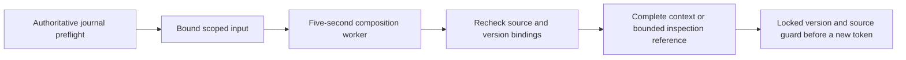

# Context efficiency reference

## Document selection

`definitions/documentation.json` owns documentation source IDs, exact selectors,
stage read routes, dependencies, historical classifications and byte budgets.
`scripts/check_documentation.py --check` checks the registry, generation drift
and byte limits; `--write` replaces only marked navigation blocks. Catalog/profile
generation through the existing `docs` helper remains separate and compatible.

Markdown selectors use an exact heading path and ignore headings inside fenced
code. JSON selectors use RFC 6901 pointers and include the transitive closure of
local or registered repository-relative `$ref` targets. Cycles are supported.
Missing, remote, unregistered or unsupported references fail explicitly. Sources
with `$id`/anchor scope changes or dynamic references are not projected as if
their reference semantics were supported. References cannot escape their owning
registered repository, even when another repository is registered.
Sources must stay within visible registered paths; private, ignored and symlinked sources
are rejected. YAML remains a whole-file input with no additional parser.

Skill entries route to one common invariant reference and exact domain sections.
Detailed procedures stay in each skill's `REFERENCE.md`; companion guides retain
command, input, output and recovery sections. Public paths and referenced anchors
remain available through short compatibility entries. Generated navigation and
the size/duplication report come from the registry, never copied normative prose.

## Content caches

Context artifacts live under the selected control root's `context-artifacts/`
directory. Their IDs bind content, selectors, dependency closure, policy and
builder version. Current source hashes are checked on every retrieval; unrelated
commits do not prevent reuse of unchanged content. Fresh provenance accompanies
reused material. Missing/corrupt artifacts rebuild, while unavailable required
sources fail explicitly.

The advisory dependency index invalidates affected retrieval entries for source,
selector or policy changes. Unknown dependencies or a stale graph invalidate
conservatively. Immutable artifacts remain inspectable after index invalidation.
The Python inspection helper accepts only validated content IDs. These caches
never refresh verification evidence, clear governing reassessment or substitute
for live authorization, approval and ownership checks.

## Complete task views

`run next`, `run retry` and `run brief` add `task_view` to their existing control
envelope. `host brief` uses the same builder after validating the binding. The
view includes task requirements and criteria, every applicable governing rule,
stage documentation and supported dependency closure. Live spec-pair and governing
checks run before cache reuse. Missing required sources or stale plans fail.

Full views default to 20,000 exact UTF-8 bytes including envelope overhead;
`--max-bytes` explicitly overrides it. Optional omissions are named; required
overflow returns references and a rescoping action. Bytes/4 is a token estimate
only. Hidden host instructions, unrelated reads and history are outside coverage.

`run brief` and `host brief` support `--representation markdown|json` and
`--output-mode full|refs`. Validate the specification pair together, then emit
one representation. Reference output preserves control blockers and required-ID
coverage and points to complete content-addressed artifacts.

## Checkpoints and recovery

Run/host brief reads return full context by default. `--since-checkpoint ID`
requests an exact-base delta; unattached CLI consumers also need `--consumer-id`.
`--full-context` explicitly rebuilds full context and conflicts with `--since-checkpoint`.
Reference output cannot request a delta. Each delta supplies changed units,
removed IDs and the complete current control envelope; applying it to its exact
base reconstructs the current document view.

Unknown/corrupt checkpoints or consumer/run/session/binding revision/stage/role/task
scope changes return full context with a reason. Session start, compaction,
handoff and new native workers require full context. Checkpoints live under
`context-checkpoints/` in the selected control root; they are advisory and never
advance gates or transfer ownership.

## Portable lifecycle hooks

The shared Python hook runner uses an allowlisted worker at existing helper
boundaries. Context preparation, retrieval-cache invalidation, validation planning and failure
digests share the same helper boundaries. Offline regression checks use this
pipeline without provider calls. No Git hooks or user
configuration are installed, and hooks never launch model/provider work.

Interactive defaults are a five-second deadline and an 8,192-byte inline result
budget. The internal runner accepts explicit recorded overrides (1,024–1,048,576
output bytes and up to 3,600 seconds). Process-tree cleanup follows timeout or
overflow. Results record effective limits, elapsed time, exact output bytes,
input/config/source identities and complete artifact references. Large prepared
views use a bounded reference response that the caller explicitly loads.

Required context failure blocks the dependent operation. Advisory formatting or
telemetry failure exposes a diagnostic and preserves the original verifier verdict,
exit code and evidence. Hooks grant no approvals and cannot advance gates.

## Discovery and inspection

`docs --discover` returns active source references from the registry;
`--include-history` includes historical entries and `--required-source-id ID`
includes their dependency closure even when historical. Broad `ingest` uses the
declared historical path patterns by default and reports excluded paths/counts.
Explicit historical scopes, `--include-history`, required governing files and
`--required-path` inputs override exclusion. Old receipts replay unchanged.

`ingest --output-mode refs` needs a control root and returns source metadata plus
a complete index artifact. `context-artifact inspect --root CONTROL --id ID`
retrieves complete content with hash verification. The inspection command accepts
content IDs, never arbitrary filesystem paths. Existing full output stays default.

## Validation feedback and failure digests

`build validation-plan --root CONTROL --config CHECKS.json --changed-path PATH`
selects focused checks from explicit project-owned mappings. Repeated paths
represent edits, deletions and both sides of renames. Overlapping mappings merge;
unknown paths, absent mappings or stale configuration select the complete
configured set. Missing/invalid check configuration remains unavailable.
The plan executes nothing, grants no authorization, and leaves every configured
required check outstanding for existing runners and proof gates.

Build verification and configured hardening responses add advisory failure
digests beside original results. JSON/JUnit/unittest reports yield measured
failure/error/skip counts, affected IDs, grouped excerpts and complete artifact
references. Raw evidence and original verdict/exit/attempt/hash stay authoritative.
Unittest digests require a terminal summary and matching test totals; partial
output leaves totals unavailable. Malformed/incomplete reports never imply zero failures. Reads are bounded to
1 MiB per log plus the hook deadline; omissions and unknown totals are explicit.
Output overflow or digest failure preserves the verifier result unchanged.

Governing Markdown projections use the same stable-ID rule boundaries as approval
resolution, including ordinary headings and fenced examples within each rule.

## Measurements

`stats context` projects best-effort metadata from run/host/native/hook operations.
It reports emitted document/envelope bytes, repeated content, helper and
selector/cache reads, durations, cache outcomes, full/delta counts and required-ID
coverage. It stores no document bodies. Repeated operation IDs count once.
Collection failure or a busy/bounded telemetry scan leaves an explicit gap without
changing the operation. See [measurement limits](usage.md#context-measurements).

## Routed worker context and reports

Routed workers receive task facts and the required output alongside the existing
complete task view. Known configuration, agent description and turn JSON/text
bytes count toward the same default 20,000-byte budget. Required skill bodies
already belong to that view, so additional caller preloads are rejected; optional
skills are not preloaded automatically. Host-internal instructions remain unknown.

Workers return a scoped JSON report with status, the supplied scope,
`completed_scope`, `evidence_refs` and `unresolved_facts`. Unstructured, mismatched,
incomplete or limited output stays partial/blocked even if it is shorter. Reports
are navigation only: existing fresh verification and independent review still
own completion. New workers receive full context; resumed/retried decisions retain
live checks and the durable task escalation allowance.

## Authoritative input preflight

Input validation reuses its authoritative journal state on unchanged paths.
When governing checks record a receipt or reassessment, they carry the transaction's
returned state forward; concurrent advancement returns `CONTEXT_PREPARATION_STALE`
rather than combining different approval versions. Existing specification drift
invalidation, exact-diff governing approval and reassessment requirements remain.
Context composition receives a private scoped input artifact after this preflight;
it does not replay the journal. The five-second worker limit starts at dispatch,
so total operation time can exceed five seconds. Temporary inputs are removed on
success or failure; orphaned inputs never become trusted cache entries.
Preparation binds root/run/items/stage/attempt, source content and journal version.
Changed sources or journal state require fresh preparation. Manifest/interview
existence and content are bound across live preflight; every applicable project
and organization receipt file remains covered by the final guard, preserving
canonical Windows checkout handling.

## Mandatory context byte diagnostics

Selected-item briefs include the selected work and its declared dependencies'
latest attempts, not unrelated items' result bodies. Task views preserve selected
requirements and shared specification facts in both Markdown and JSON, including
unclassified shared metadata. Governing rules and required dependency closure are
never dropped to make a view fit. Optional context values and provenance are reconsidered against the combined
envelope and task-unit budget before optional documents. Retained optional slices
are counted as optional bytes; required slices remain mandatory. Whole optional
units are omitted after reserving artifact references and diagnostics.

`budget.component_bytes` partitions actual serialized UTF-8 bytes into requirements,
shared specification, governing, stage documents, control envelope, artifact
references, optional content and serialization overhead. The latter includes graph,
binding and budget metadata plus punctuation; categories sum to `serialized_bytes`.
Required overflow retains `CONTEXT_BUDGET_EXCEEDED` and adds composition phase,
component sizes and a supported recovery action. A real oversized required fact
still blocks; references do not silently replace mandatory context.

## Preparation recovery

The harness explains the failed phase and guides the next action. It must resolve
required preparation before issuing a new attempt or starting model work.

- `HOOK_DEADLINE_EXCEEDED`: inspect the returned worker `limits.deadline_seconds`
  and elapsed time. The `worker` phase starts after authoritative input preflight;
  raising context bytes does not extend it. Retry from current inputs; if bounded
  composition still times out, retain the diagnostic and report the failure.
- `CONTEXT_PREPARATION_STALE` or `CONTEXT_SOURCE_CHANGED`: rebuild from current
  inputs. Diagnostics identify `preflight`, `freshness` or `commit`; a final locked
  guard checks journal version, approved sources and host identity before writing
  a new attempt. A failed live guard does not consume the operation's retry key.
- `CONTEXT_BUDGET_EXCEEDED`: inspect component sizes, then explicitly request
  sufficient context bytes or reduce task scope while preserving applicable shared
  rules and dependencies. Inspection references do not waive mandatory content.

Successful views report `preparation.preflight_ms`, `worker_ms`, their sum
`total_ms`, `journal_version` and `binding_hash`. Initial replay is included when
the caller uses the timed authoritative-read wrapper. The public lifecycle-hook
entry and reverification currently use untimed initial reads, so their reported
preflight time can omit that replay cost.
`total_ms` covers those measured phases, not the final locked replay or every
parent artifact/freshness operation. Full CLI time is measured separately. Ordinary
journal replay still grows with history; no journal compaction/archive command is
provided. Preserve the journal rather than deleting history to advance a gate.
Exact historical operation receipts retain their existing replay semantics; new
attempts always use the live guard.

Scoped preparation files use POSIX 0700 directory/0600 file modes where supported.
On native Windows, filesystem access follows the containing directory's inherited
ACLs; POSIX mode bits do not enforce NTFS ACLs. Root/run/hash/size and symlink
binding checks apply on both platforms, and temporary inputs are removed after use.
