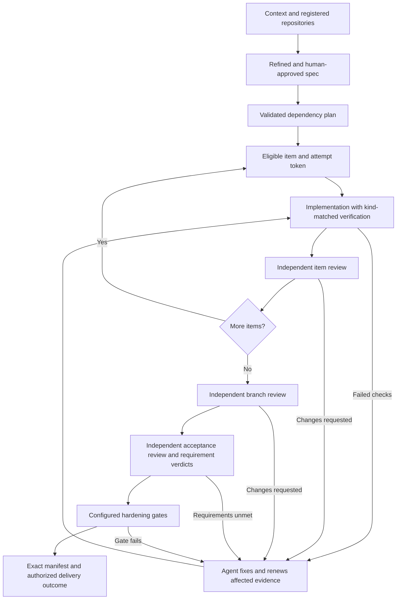

# DevFlow developer CLI walkthrough

This optional reference is for contributors, diagnostics and direct helper use.
Plugin users should start with the [user guide](setup-and-usage.md); they should
not need these shell variables, path selections or helper commands.

Update this reference whenever the documented CLI behavior changes.

## What DevFlow does today

DevFlow combines ten agent skills with a shared Python helper. The agent conducts
interviews, implements work and arranges independent reviewers. The helper records
context, approved requirements, dependent work items, attempts, verification,
reviews, acceptance, hardening, delivery, issue workflows and usage reports.

It is currently a Codex-oriented source bundle. Its helper can run directly from
a checkout; no global executable, server, daemon or dependency installation is
needed. This repository has a root `plugin.json`, but no bundled marketplace,
published installation URL or automatic installer. Merely reading/loading a skill
does not initialize a project or create state.

Claude packaging, host attachment, completion hooks, cross-host handoff and release
parity are [proposed in the design spec](superpowers/specs/2026-10-06-devflow-cross-host-design.md).
They are not implemented. Do not use the proposed `host` commands as current CLI
instructions. Upgrades are user-controlled; automatic installation updates are
not part of the proposed design either.

## Prerequisites and paths

- Python 3.11 or newer on macOS/Linux. The helper uses `fcntl`; native Windows is
  not currently supported.
- Git and an existing application checkout for proof, review and delivery checks.
- A DevFlow source checkout or an accessible installed bundle containing all
  skills, helpers, docs and examples.
- Actual test/evaluation/policy tools for the gates you configure. There is no
  requirement to install tools for unused work-item kinds.
- Separate reviewer invocations for independent reviews; unavailable review
  tooling cannot be replaced by self-review.

Set these in your shell. Replace the two application/package paths with actual
absolute locations; paths containing spaces are supported when quoted.

```sh
DEVFLOW="/absolute/path/to/devflow"
APP="/absolute/path/to/application-checkout"
CONTROL="$HOME/.local/share/devflow/greeting-project/control"
WORK="$HOME/.local/share/devflow/greeting-project/inputs"
EXAMPLES="$DEVFLOW/docs/examples"
RUN="greeting-run"
df() { python3 "$DEVFLOW/skills/workflow/scripts/run.py" "$@"; }
python3 --version
git --version
git -C "$APP" rev-parse --show-toplevel
df version
df --help
mkdir -p "$WORK"
```

`df` is a convenience shell function, not a separately installed executable. All
commands call `skills/workflow/scripts/run.py`. `df version` returns the plugin
version and state schema version. You can use the absolute Python invocation
instead of defining the function.

Keep the control root and command input/output files outside the application
checkout, as above. Test commands that create new tracked/untracked files can
invalidate repository fingerprints. If you intentionally store state inside a
checkout, exclude its runtime directories from Git and ingestion scope first.
Never put mutable project state into an installed plugin/cache directory.

## Use through an agent or directly

With DevFlow available in your Codex environment, invoke its `workflow` skill or
ask the agent to use it for your project. Provide the application path and chosen
control root. For example:

> Use DevFlow for this checkout. Keep workflow state at my selected control root.
> Resolve project context, clarify requirements and show me the rendered spec
> before asking for approval. Resume existing work rather than starting a duplicate.

If skill registration has not been configured in your environment, direct the
agent to the source [workflow instructions](../skills/workflow/SKILL.md) and use the
helper commands below. This is source usage, not an automatic plugin installation.
For a host-installed bundle, point `DEVFLOW` at that bundle's actual root and use
its supported skill registration/invocation mechanism.

Do not initialize Git, change remotes, install globally or create a marketplace
merely to use the helper. Those are separate user choices. Actual host installation
instructions will be added when supported packaging is implemented and verified.

## Initialize a project

There is currently no `init` command. Initialization consists of selecting a
control root, recording context and registering repository locations. The first
stateful helper command creates the journal at the selected root automatically.

### 1. Record context and repository

Copy the organization/project examples, edit them to reflect actual answers, then
store and resolve them. Answered records have `status` and `value`; declined
records preserve an explicit reason so the agent need not ask again.

```sh
cp "$EXAMPLES/org.json" "$WORK/org.json"
cp "$EXAMPLES/project.json" "$WORK/project.json"
# Edit these copied inputs before storing actual project context.
df context set --root "$CONTROL" --layer org --file "$WORK/org.json" --operation-id org-context-v1
df context set --root "$CONTROL" --layer project --file "$WORK/project.json" --operation-id project-context-v1
df context resolve --root "$CONTROL"
df repo register --root "$CONTROL" --repo-id app --location "$APP" --operation-id register-app-v1
```

Organization slices are platform, coding-standards, architecture, test-strategy,
release-process and design-system. Project values override organization defaults;
explicit user overrides take precedence. The resolver reports missing slices and
conflicts; the agent performs the interview. Stable repository IDs can be retained
when a checkout moves by registering its new location with a new operation ID.
Resolve changed context before starting a new run; existing runs retain their
starting context snapshot. See [project-context](../skills/project-context/GUIDE.md).

### 2. Write, refine and approve the specification

Copy the greeting example as a starting point, then replace its requirements with
the project's actual scope. Preserve requirement IDs, criteria and provenance.

```sh
cp "$EXAMPLES/spec.json" "$WORK/spec.json"
# Edit the requirements, acceptance criteria and unresolved gap records.
df spec validate --file "$WORK/spec.json"
df spec gaps --file "$WORK/spec.json"
df spec render --file "$WORK/spec.json"
df spec store --root "$CONTROL" --file "$WORK/spec.json" --repo-id app --path docs/specs/0063-ios-safari-suite.json --operation-id spec-v1
SPEC_HASH=$(df spec validate --file "$WORK/spec.json" | python3 -c 'import json,sys; print(json.load(sys.stdin)["content_hash"])')
```

`spec render` returns Markdown in the `markdown` field of a JSON response. Have
the agent review it with the human, resolve material questions and check scope
and contradictions. `spec gaps` only lists recorded unanswered questions; neither
semantic gap detection nor automatic interviewing is implemented in the helper.
The approval helper currently permits unanswered recorded gaps, so the agent must
not treat structural validation as proof of completeness.

Only after the human approves that exact rendered specification:

```sh
df spec approve --root "$CONTROL" --confirm-hash "$SPEC_HASH" --actor-id human-1 --operation-id approve-spec-v1
```

Use the actual approving actor ID. Changed content invalidates its approval; store
and approve the revision before planning again. See [specify](../skills/specify/GUIDE.md).

### 3. Validate the work plan

For the example, adapt the plan and bind it to the current spec hash:

```sh
python3 - "$EXAMPLES/plan.json" "$WORK/plan.json" "$SPEC_HASH" <<'PY'
import json, sys
from pathlib import Path
plan = json.loads(Path(sys.argv[1]).read_text())
plan['spec_hash'] = sys.argv[3]
Path(sys.argv[2]).write_text(json.dumps(plan, indent=2) + '\n')
PY
# Edit work items to cover your actual requirements and registered repositories.
df plan validate --root "$CONTROL" --file "$WORK/plan.json" --operation-id plan-v1
df plan ready --root "$CONTROL" --completed '[]'
```

Plan validation also persists the plan. All requirements must be covered, IDs must
exist and dependencies must be acyclic. Code items require code-test criteria;
IaC and agent-config items have their own typed criteria. `plan ready` accepts a
supplied completion list for planning inspection; executable dispatch uses actual
committed item completion through `run next`. See [plan-work](../skills/plan-work/GUIDE.md).

### 4. Start the run and issue work

```sh
df run start --root "$CONTROL" --run-id "$RUN" --actor-id implementer-1 --operation-id start-run-v1
df run next --root "$CONTROL" --run-id "$RUN" --operation-id next-W1-v1 > "$WORK/next.json"
ATTEMPT=$(python3 - "$WORK/next.json" <<'PY'
import json, sys
print(json.load(open(sys.argv[1]))['attempt_id'])
PY
)
df run status --root "$CONTROL" --run-id "$RUN"
df run gate-status --root "$CONTROL" --run-id "$RUN"
```

Save the returned `attempt_id`; it binds verifier evidence and result submission.
A run has one active implementation attempt. Dependency-blocked items cannot be
issued. Repeating the same request ID does not issue a second token.

## Execute, verify and review



For code, record real declared-target RED before implementation, then GREEN with
unchanged tests. Use supported JSON/JUnit reports; the greeting [example runner](examples/test_runner.py)
executes real unittest cases and emits portable JSON. Run it with Python's `-B`
option to avoid introducing bytecode files during fingerprint checks. It is an
ordinary-method example, not a complete adapter for advanced subtests/custom runners.

For IaC, verify plan/policy, record explicit apply authorization, then verify
apply/policy. For agent configuration, record baseline/post evaluations with the
same case IDs. Detailed commands are in [build-work](../skills/build-work/GUIDE.md).
A response with `passed: false` is failed verification even if the CLI exit code
is zero. Submitting a result without fresh kind-matched proof leaves work incomplete.

Arrange separate reviewer invocations for item, branch and acceptance roles.
Use distinct actual actors, real invocation references and content-bound packages.
Changed content requires renewed evidence and affected review packages. Review
correction budgets are four item waves and one branch/acceptance wave, followed by
independent adjudication. Test reruns themselves have no enforced retry counter.
See [review-work](../skills/review-work/GUIDE.md) for packages, reports and requirement
acceptance. Every planned requirement needs a verdict; MET needs valid changed-file
citations. A completed review assessment is not automatically a passing gate.

Configure any required E2E, red-team or other hardening checks with actual argv
commands using `harden configure`; execute them with `harden gate`. Missing, failed
or stale required proof blocks delivery. DevFlow enforces only declared/configured
checks. The agent coordinates fixes; an explicit opted-in bounded repair command
can launch one scoped native worker and rerun failed configured hardening gates.
An omitted gate `contract` means `{"kind":"exit-status"}` and preserves the
legacy command-only behavior. `{"kind":"json-report","version":1}` expects a
top-level JSON object with a `findings` array of objects, each with a nonempty
string `id`. Valid empty findings pass; findings, missing output, malformed
JSON, unsupported versions and reports over 1 MiB fail. The normalized contract
is part of the configuration hash and the execution proof; replay never
re-executes the command. See [structured gate example](examples/structured-gate.json).

Optional `repair configure` records explicit limits from
[bounded-repair.json](examples/bounded-repair.json). `repair status` reads the
current failure IDs and limits. `repair next --operation-id ID
--estimated-cost NUMBER` claims one native worker cycle for the attached
implementer, reruns failed configured hardening gates and journals the new
failure delta. A repeated ID never launches again. Interrupted claims block
handoff and need stopped-worker reconciliation before `repair stop
--reason-code CODE --confirm-stopped-by ACTOR`. Review findings and item
verification remain agent-led.
Terminal worker or gate-runner failures after claim journal an abort with
remaining failures. A running native invocation retains its lease until
reconciliation.

Opt-in run improvement uses `improve trace-enable` and `stats trace`. The
export is an allowlist of stage/evidence IDs, repair fingerprints and reported
usage; raw prompts and repository bodies stay out. `improve feedback` requires
the exact trace hash and stores a candidate from
[improvement-case.json](examples/improvement-case.json). A distinct actor uses
`improve case-approve` with the returned case hash. `improve run-cases`
executes approved cases in a specified checkout; `improve compare` requires
identical case hashes and scoring versions; `improve retrospective` groups
evidence-cited feedback without editing the plugin. Missing usage remains
unknown and no policy promotion occurs automatically.
Candidate artifact hashes are caller-supplied labels; neither execution nor
comparison verifies the checkout identity. Review the two artifacts and their
result provenance before using the advisory quality delta.
`improve model-evaluate --root ROOT --input INPUT.json` uses only approved
stage-tagged cases in that journal and supplied host/model/version-bound
results. [Illustrative suitability input](examples/model-suitability.json)
shows the fields; its fabricated results are not capability validation.
Schema 2 released mappings embed a reviewed report hash and require observed
matching host/model revision metadata before strict eligibility. No mapping
is installed by this command or shipped in the current policy.

`host goal-status --root ROOT --binding-id ID` returns a contract/hash derived
from the current run. After the user authorizes and activates a host Goal,
`host goal-bind --root ROOT --file goal-binding.json --operation-id ID` binds
its opaque reference to the exact host/run/release. [Goal binding example](examples/goal-binding.json).
No Goal lifecycle CLI API is invoked by DevFlow, and a host Goal cannot satisfy
the journal's verification, review or delivery gates. Handoff never copies a
source Goal reference to the destination.

`migrate verify-pilot --root ROOT --input migration-pilot.json
--operation-id ID` reserves and executes a comparison of declared legacy and
replacement argv commands in separate temporary directories containing the same
hashed fixture bytes. This is not a sandbox: commands inherit the host environment
and can access other paths. Use trusted programs or an external OS sandbox.
The example [pilot contract](examples/migration-pilot.json) and
[input fixture](examples/migration-input.txt) are disposable; replace both
commands with actual programs. `exact-bytes` compares raw output, while
`json-fields` version 1 ignores only explicitly listed top-level keys. Passing
typed proof binds the increment, criterion, current item token and repository
fingerprint; delivery rejects stale proof. Manual final-verifier parity and
waivers remain available.

Current enforcement is in helper transitions and skill instructions. Claude
completion hooks are implemented for explicitly mapped tasks; Codex completion
checks remain explicit. There are no repo-wide edit restrictions. Ordinary
shell/file operations can bypass the helper; DevFlow is not a security boundary.

## Resume, retry and change scope

A fresh agent session needs the package path, control root, application checkout
and run ID; it does not need the previous conversation transcript.

```sh
df run status --root "$CONTROL" --run-id "$RUN"
df run brief --root "$CONTROL" --run-id "$RUN"
df run gate-status --root "$CONTROL" --run-id "$RUN"
df run inspect --root "$CONTROL" --run-id "$RUN"
```

Use compact status/brief for routine handoff; inspect retrieves full records.
An active attempt retains its token. To stop that attempt deliberately and issue a
replacement, with actual current token/item ID:

```sh
df run abandon --root "$CONTROL" --run-id "$RUN" --attempt-id "$ATTEMPT" --operation-id abandon-W1-v1
df run retry --root "$CONTROL" --run-id "$RUN" --item W1 --operation-id retry-W1-v1
```

The replacement token needs its own verification. Do not abandon simply to resume
an existing session. Work-item amendments require current plan/spec hashes and a
recorded ruling. Locked-test changes require proposal, separate human approval and
exact-hash apply. Neither operation is a shortcut around proof/review requirements.

## Delivery

After acceptance and hardening pass, prepare a canonical manifest for local merge,
PR or retained branch, verify the exact hash and repository heads, and ask for the
human's delivery choice and authorization. Perform that authorized action using
appropriate tools, then record the actual result with `delivery record`.

DevFlow does not execute merges, pushes, PR creation or cleanup automatically.
A retained branch preserves exact heads; local merge records resulting commits;
PR records need the actual provider request ID. Repositories must be clean for
manifest preparation. See [workflow delivery commands](../skills/workflow/GUIDE.md#delivery-example).

## Optional workflows

| Need | Start here | Important prerequisite |
| --- | --- | --- |
| Existing code/source grounding | [ingest](../skills/ingest/GUIDE.md) | Registered repo, explicit UTF-8 source scope/profile |
| Issue-driven work | [issues](../skills/issues/GUIDE.md) | Complete snapshot and per-issue requirement scope |
| Ordered migration | [migrate](../skills/migrate/GUIDE.md) | Immutable increment graph and bound parity evidence |
| Usage and outcome reporting | [stats](../skills/stats/GUIDE.md) | Supported runtime identities, explicit prices, accepted/delivered records |

Provider adapters are injected, not bundled live connections. Outbox dispatch
requires real journaled authorization and reconciliation of uncertain receipts.
Prices in examples are illustrative. Missing usage/prices are unavailable rather
than zero; per-run coverage must meet the reporting threshold. Reporting does not
fetch raw host transcripts or prices automatically.

## State, backups and recovery

The control root contains authoritative numbered JSON events, a rebuildable
`state.json` projection, content-addressed artifacts and best-effort telemetry.
Back up the complete control root and the repositories it references. Protect the
records as project data; do not commit sensitive logs accidentally.

A missing/corrupt snapshot can be rebuilt by reading the journal. Partial temporary
files are ignored during recovery. Corrupt numbered events or unsupported future
schema versions block operation; preserve files and investigate instead of editing
history. Historical delivery replay does not depend on current repository files.

Use an operation ID for the same logical mutation only. Exact retry receipts
prevent duplication; changed input needs a new ID. Auxiliary commands require
explicit IDs and can use `--expected-version` for optimistic concurrency. Do not
create arbitrary new IDs to bypass a scope, evidence or authorization failure.

| Symptom | Action |
| --- | --- |
| STALE_STATE | Reread current state and reassess before retrying |
| OPERATION_CONFLICT | Keep the prior operation; identify whether this is a retry or genuinely new input |
| Active attempt prevents next/retry | Resume it, submit its result or explicitly abandon it |
| Missing or stale proof/package | Rerun appropriate verification or prepare a current review package |
| Required brief exceeds budget | Increase budget or inspect references; mandatory criteria are never silently truncated |
| EXECUTION_INTERRUPTED for hardening | Inspect state, then use a new ID for an intentional fresh execution |
| Usage cost is null | Inspect per-run expectations, bindings, coverage, gaps, prices and delivery timestamps |
| Telemetry warning | Workflow records remain authoritative; bytes/duration do not establish tokens saved |

## Upgrade and cross-host use

Users choose upgrades. Current helpers enforce explicit host ownership, task scope
and exact release parity at handoff. Reload instructions and refresh an active
binding, or explicitly resume a compatible detached binding with its revision.
No automatic installer/updater is included. Claude hooks are implemented; native
Codex local installation remains unverified. Native model launch/discovery is implemented; see [host contracts](hosts.md) and [requirement review](cross-host-validation.md).

## Local Claude package check

The repository root is both the Claude plugin and marketplace root. Its
`.claude-plugin/marketplace.json` entry uses `"source": "."`, so a GitHub
checkout supplies the plugin without a copied skill tree. Validate before
publishing with `claude plugin validate .`; for one-session source testing,
start `claude --plugin-dir .` from the package root. This does not install a
plugin or change a user's marketplace settings. See the
[GitHub distribution guide](github-distribution.md) for release preparation
and an isolated installation smoke.

## Reference and maintenance

- [All ten skill guides](skills.md)
- [Input examples and required edits](examples/README.md)
- [Detailed CLI notes](usage.md)
- [Durable auxiliary request contracts](journal-integration.md)
- [Current integration acceptance](journal-integration-acceptance.md)

When DevFlow changes, update this guide, the affected skill guides/diagrams and
examples together. Verify documented commands, links, fixture shapes and supported
behavior before reporting completion. Clearly label design-only features until
implemented and validated.

Host initialization developer command: invoke the bundled helper with
`host init --project-dir <working-directory> --operation-id <unique-id>`.
`--root` optionally selects external control state; omit it for project-local state.

`host attach --root <control> --file <attachment.json> --loaded-release <captured-version.json> --operation-id <id>`
records an explicit attachment. Request fields: binding_id, host (claude/codex),
session_id, actor_id, role, run_id, project_dir; reviewers also package_hash and
item reviewers item_id. Capture version when loading skill instructions.
`host status --root <control> --host <host> --session-id <session>` is read-only.
`host detach` and `host task-bind` use `--file`, `--root`, `--operation-id` and
optional `--expected-version`. Task requests name binding_id/revision/task_id and
scope item/delivery/review; items require item_id/token, reviews package_hash.
For other mutations put `--binding-id <id> --binding-revision <revision>` before
the command group. Stale bindings are rejected inside the commit lock.

`host handoff-prepare --file <request> --root <control> --operation-id <id>` accepts
binding_id/revision/handoff_id/target_host/target_actor_id and optional
target_session_id. `host handoff-accept` additionally takes `--loaded-release`;
its request names handoff_id and destination attachment fields. Source installation
is read from the recorded attachment package_root. Acceptance blocks until
shared destination model eligibility is resolved. Refresh uses `host attach`
with `refresh: true`, unchanged identity and current revision.

`host profile-resolve --root <control> --binding-id <id> --revision <n> --stage <stage>`
returns a read-only advisory/strict decision. `host model-override` journals
binding_id/revision plus mode/profile/pin/effort/allowed_models/max_cost preferences.
`host model-receipt` records an immutable invocation receipt generated by the helper,
not caller model claims; file receipt names invocation_id and stage.
`host model-interrupt` records invocation/error_kind/retry_count without modifying
run attempts. All three mutations require explicit operation IDs.

`host check --root <control> --binding-id <id> --task-id <actual-host-task-id>`
returns allow/block/inactive with compact reason codes and evidence references.
It is read-only and does not perform tests or change attempt state. `host status`
also returns a resume brief with content fingerprint. Optional task invocation_id
binds the model receipt used for strict completion (caller claims remain untrusted).

Pre-binding legacy runs require `host legacy-adopt` with `adopt_legacy: true` and
an explicit actor; known release history cannot use adoption to bypass parity.
A separate task-index cache can deny known mapped tasks when an external control
locator is corrupt/missing. It cannot grant ownership or completion permission.
For native delegated controls, `workflow_lib.host_models.delegated_configuration`
renders supported host configuration from an eligible resolution; it does not launch
an agent or manufacture observed-model receipts.

To remap after a new attempt/refresh, use `host task-bind` with `replace: true`
and `previous_mapping_hash` (canonical SHA-256 of the prior mapping, excluding
command receipt metadata), preserving run/role/item/binding scope. Exact operation
retry remains idempotent; ordinary conflicting task-ID reuse is rejected.

Model overrides may name `stage` to scope a preference (for example planning).
An override without stage applies across stages. An already recorded invocation
retains its recorded routing mode; a new preference does not switch it mid-flight.

### Scoped routing and compatible detached resume

`host attach` supports `resume: true` with the exact detached `revision`, unchanged
host/session/actor/role/run/project/package/item and freshly captured loaded
release. It checks protocol/schema compatibility, increments revision and appends
release history. Remap tasks explicitly. Transferred or active bindings cannot use
resume; new binding creation still checks exact last-owner release.

Model preference dictionaries are field updates, optionally scoped by `stage`.
`clear: ["max_cost"]` explicitly removes that field; omission keeps prior values.
For example, changing planning `mode` leaves a global `max_cost` and allowlist intact.
Receipt input names `invocation_id` and `stage`; implementation captures the active
item/token, review captures the attached package/item. The helper supplies binding,
actor, policy revision and decision; caller scope/observation claims are not evidence.
Task `invocation_id` must match that exact scope. Old unscoped receipts must be replaced
by a new invocation, not retroactively amended. `model-interrupt` derives scope
from the recorded invocation and rejects another binding's receipt.

Exact host retries compare the original kind/request/loaded release before rejecting
a now-stale precondition. They return the original committed response without
reapplying it. Changed input requires a new operation ID. `host profile-resolve`
uses cached native context without provider I/O. Native commands and JSON inputs
are documented in [native model command reference](native-models.md#developer-command-reference).

Repository-backed `spec store` requires a registered `--repo-id` and repository-relative `--path`. It writes and records a visible JSON/Markdown pair; approval rechecks both hashes. Omitting both options retains the explicit legacy journal-only flow.

### Guided setup helpers (optional developer reference)

`python3 skills/workflow/scripts/run.py setup inspect --project-dir .` is read-only.
`python3 skills/workflow/scripts/run.py setup initialize --project-dir . --choice docs/examples/setup-project-only.json --operation-id setup-1`
creates/adopts project documents. Choice JSON uses `mode` (`project-only`, `attach-org`,
`create-org`), optional explicit `documents` and `overrides`; attachment requires `url`,
creation requires `name` and absolute `target_dir` with optional `remote_url`.
Plugin users invoke the skill; the agent supplies these arguments.
