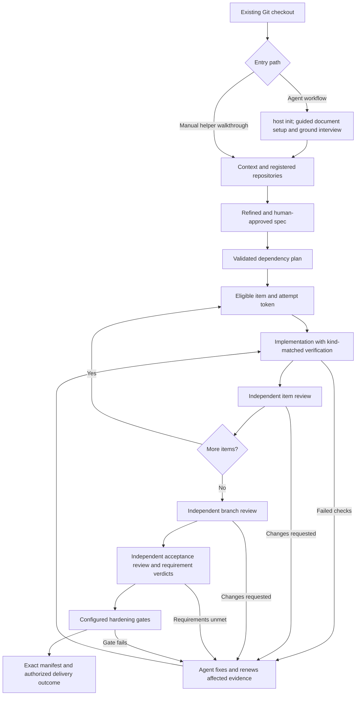

# DevFlow developer CLI walkthrough

Context selection and content-cache behavior are described in the
[context efficiency reference](context-efficiency.md). From the plugin checkout,
`python3 scripts/check_documentation.py --check` checks documentation;
`--write` regenerates marked navigation only.

`df run brief --root "$CONTROL" --run-id greeting-run --representation markdown --output-mode full --max-bytes 20000`
returns complete bounded context. For attached hosts use
`df host brief --root "$CONTROL" --binding-id BINDING --revision 1` with the
actual binding. See the context reference for output modes and overflow behavior.

For an explicit continuing CLI consumer, add `--consumer-id my-session` and later
`--since-checkpoint` with the returned checkpoint ID. Use `--full-context` after
compaction; handoffs and new workers require full context. A CLI without consumer
identity returns full context even when given an old checkpoint ID.

Preparation runs live journal/input preflight before dispatching its scoped worker.
The internal Python lifecycle runner defaults to five seconds and 8,192 output
bytes. Required preparation stops on errors; advisory diagnostics preserve verifier
outcomes. See [hook limits and behavior](context-efficiency.md#portable-lifecycle-hooks).

Use `df docs --discover` for active documentation, `--include-history` for explicit
history. Ingest supports `--include-history`, repeated `--required-path`, and
`--output-mode refs`. Inspect returned content with
`df context-artifact inspect --root "$CONTROL" --id ACTUAL_ARTIFACT_ID`.

For this plugin checkout, try
`df build validation-plan --root "$CONTROL" --config "$EXAMPLES/validation-checks.json" --changed-path skills/workflow/scripts/run.py`.
It only plans feedback; the complete required-check list remains outstanding.
Verification returns bounded advisory `failure_digest` metadata beside original
proof; inspect its raw artifact references for detail.

This optional reference is for contributors, diagnostics and direct helper use.
Plugin users should start with the [user guide](setup-and-usage.md); they should
not need these shell variables, path selections or helper commands.

Update this reference whenever the documented CLI behavior changes.

## What DevFlow does today

DevFlow combines eleven agent skills with a shared Python helper. The agent conducts
interviews, implements work and arranges independent reviewers. The helper records
context, approved requirements, dependent work items, attempts, verification,
reviews, acceptance, hardening, delivery, issue workflows and usage reports.

Codex and Claude share one skill/helper tree, host attachment, task mapping and
parity-checked sequential handoff. Claude completion hooks are implemented;
Codex completion checks are explicit. The repository packages both host manifests
and a marketplace served from `wgentil/devflow`. Isolated installs of earlier
releases succeeded on both hosts; see the [validation report](cross-host-validation.md)
for the evidence and remaining end-to-end checks. Users choose upgrades.

The helper also runs directly from a checkout with no global executable, server,
daemon or Python package installation. Reading a skill alone creates no state;
the agent explicitly calls `host init` to discover and initialize a project.

## Prerequisites and paths

- Python 3.11 or newer available as `python3` on macOS/Linux. Locking and native
  process transport have platform-aware implementations, but native Windows and
  WSL2 are not supported releases pending the remaining
  [host validation](windows-validation.md).
- Git and an existing application checkout for proof, review and delivery checks.
- A DevFlow source checkout or an accessible installed bundle containing all
  skills, helpers, docs and examples.
- Actual test/evaluation/policy tools for the gates you configure. There is no
  requirement to install tools for unused work-item kinds.
- Separate reviewer invocations for independent reviews; unavailable review
  tooling cannot be replaced by self-review.

Set these in your shell. Replace the two application/package paths with actual
absolute locations; paths containing spaces are supported when quoted.

```sh
DEVFLOW="/absolute/path/to/devflow"
APP="/absolute/path/to/application-checkout"
CONTROL="$HOME/.local/share/devflow/greeting-project/control"
WORK="$HOME/.local/share/devflow/greeting-project/inputs"
EXAMPLES="$DEVFLOW/docs/examples"
RUN="greeting-run"
df() { python3 "$DEVFLOW/skills/workflow/scripts/run.py" "$@"; }
python3 --version
git --version
git -C "$APP" rev-parse --show-toplevel
df version
df --help
mkdir -p "$WORK"
```

`df` is a convenience shell function, not a separately installed executable. All
commands call `skills/workflow/scripts/run.py`. `df version` returns the plugin
version and state schema version. You can use the absolute Python invocation
instead of defining the function.

This direct-helper walkthrough uses an external control root and input directory.
The agent workflow instead defaults to excluded `.devflow/control` state in the
application checkout. Test commands that create tracked/untracked files can
invalidate repository fingerprints; keep transient inputs and outputs outside
the checkout or in excluded runtime directories. `host init` configures the local
Git runtime exclusion, and ingestion independently excludes `.devflow`. Never
put mutable project state into an installed plugin/cache directory.

## Use through an agent or directly

With DevFlow enabled in Codex or Claude, open the application Git checkout and
invoke `workflow` or ask the agent to use DevFlow. For example:

> Start DevFlow in this checkout.
> Resolve project context, clarify requirements and show me the rendered spec
> before asking for approval. Resume existing work rather than starting a duplicate.

The agent resolves the bundled helper, discovers the project and initializes or
resumes records. Plugin users need no shell setup or package path selection.
An external control root is an optional advanced choice. Installation and upgrade
commands are in the [primary guide](setup-and-usage.md#installation).

For source development, direct the agent to the
[workflow instructions](../skills/workflow/SKILL.md), or use the helper examples
below. Direct helper usage does not require installing the plugin. Do not initialize
Git or change remotes just to use it; begin with an existing application repository.

## Initialize a project

`host init` discovers Git/worktree metadata, registers a stable repository ID,
creates missing control records and preserves existing data. It reports resumable
runs and document-setup readiness; it does not approve requirements or issue work.
Choose either this guided initialization path or the manual walkthrough below;
do not run both against the same control journal.

```sh
df host init --project-dir "$APP" --root "$CONTROL" --operation-id init-greeting-v1
df setup inspect --project-dir "$APP"
```

Omit `--root` for the project-local default. Use the returned `repo_id` for subsequent
repository-backed work. The manual sequence below uses the explicit ID `app` and
is an alternative for direct helper experiments in a fresh external control root;
do not register a second identity for a repository already registered by `host init`.
Complete guided document setup and the first-use ground interview for new projects;
see [setup helpers](#guided-setup-helpers-optional-developer-reference).

## Manual helper walkthrough

This alternative starts with a fresh external control root and explicitly
registers repository ID `app`. It demonstrates the legacy slice-context inputs;
it does not replace guided document setup for a newly initialized plugin project.

### 1. Record context and repository

Copy the organization/project examples, edit them to reflect actual answers, then
store and resolve them. Answered records have `status` and `value`; declined
records preserve an explicit reason so the agent need not ask again.

```sh
cp "$EXAMPLES/org.json" "$WORK/org.json"
cp "$EXAMPLES/project.json" "$WORK/project.json"
# Edit these copied inputs before storing actual project context.
df context set --root "$CONTROL" --layer org --file "$WORK/org.json" --operation-id org-context-v1
df context set --root "$CONTROL" --layer project --file "$WORK/project.json" --operation-id project-context-v1
df context resolve --root "$CONTROL"
df repo register --root "$CONTROL" --repo-id app --location "$APP" --operation-id register-app-v1
```

Organization slices are platform, coding-standards, architecture, test-strategy,
release-process and design-system. Project values override organization defaults;
explicit user overrides take precedence. The resolver reports missing slices and
conflicts; the agent performs the interview. Stable repository IDs can be retained
when a checkout moves by registering its new location with a new operation ID.
Resolve changed context before starting a new run; existing runs retain their
starting context snapshot. See [project-context](../skills/project-context/GUIDE.md).

### 2. Write, refine and approve the specification

Copy the greeting example as a starting point, then replace its requirements with
the project's actual scope. Preserve requirement IDs, criteria and provenance,
and replace its Mermaid diagram with one that explains the actual feature.

```sh
cp "$EXAMPLES/spec.json" "$WORK/spec.json"
# Edit the requirements, acceptance criteria and unresolved gap records.
df spec validate --file "$WORK/spec.json"
df spec gaps --file "$WORK/spec.json"
df spec render --file "$WORK/spec.json"
df spec store --root "$CONTROL" --file "$WORK/spec.json" --repo-id app --path docs/specs/greeting.json --operation-id spec-v1
SPEC_HASH=$(df spec validate --file "$WORK/spec.json" | python3 -c 'import json,sys; print(json.load(sys.stdin)["content_hash"])')
```

`spec render` returns Markdown in the `markdown` field of a JSON response. Have
the agent review it with the human, resolve material questions and check scope
and contradictions. `spec gaps` only lists recorded unanswered questions; neither
semantic gap detection nor automatic interviewing is implemented in the helper.
The approval helper currently permits unanswered recorded gaps, so the agent must
not treat structural validation as proof of completeness.

Only after the human approves that exact rendered specification:

```sh
df spec approve --root "$CONTROL" --confirm-hash "$SPEC_HASH" --actor-id human-1 --operation-id approve-spec-v1
```

Use the actual approving actor ID. Changed content invalidates its approval; store
and approve the revision before planning again. See [specify](../skills/specify/GUIDE.md).

### 3. Validate the work plan

For the example, adapt the plan and bind it to the current spec hash:

```sh
python3 - "$EXAMPLES/plan.json" "$WORK/plan.json" "$SPEC_HASH" <<'PY'
import json, sys
from pathlib import Path
plan = json.loads(Path(sys.argv[1]).read_text())
plan['spec_hash'] = sys.argv[3]
Path(sys.argv[2]).write_text(json.dumps(plan, indent=2) + '\n')
PY
# Edit work items to cover your actual requirements and registered repositories.
df plan validate --root "$CONTROL" --file "$WORK/plan.json" --operation-id plan-v1
df plan ready --root "$CONTROL" --completed '[]'
```

Plan validation also persists the plan. All requirements must be covered, IDs must
exist and dependencies must be acyclic. Code items require code-test criteria;
IaC and agent-config items have their own typed criteria. `plan ready` accepts a
supplied completion list for read-only planning inspection. It checks current
files without recording an invalidation; executable dispatch uses actual
committed completion and rechecks inputs through `run next`. See [plan-work](../skills/plan-work/GUIDE.md).

### 4. Start the run and issue work

```sh
df run start --root "$CONTROL" --run-id "$RUN" --actor-id implementer-1 --operation-id start-run-v1
df run next --root "$CONTROL" --run-id "$RUN" --operation-id next-W1-v1 > "$WORK/next.json"
ATTEMPT=$(python3 - "$WORK/next.json" <<'PY'
import json, sys
print(json.load(open(sys.argv[1]))['attempt_id'])
PY
)
df run status --root "$CONTROL" --run-id "$RUN"
df run gate-status --root "$CONTROL" --run-id "$RUN"
```

Save the returned `attempt_id`; it binds verifier evidence and result submission.
A run has one active implementation attempt. Dependency-blocked items cannot be
issued. Repeating the same request ID does not issue a second token.

## Execute, verify and review



For code, record real declared-target RED before implementation, then GREEN with
unchanged tests. Use supported JSON/JUnit reports; the greeting [example runner](examples/test_runner.py)
executes real unittest cases and emits portable JSON. Run it with Python's `-B`
option to avoid introducing bytecode files during fingerprint checks. It is an
ordinary-method example, not a complete adapter for advanced subtests/custom runners.

For IaC, verify plan/policy, record explicit apply authorization, then verify
apply/policy. For agent configuration, record baseline/post evaluations with the
same case IDs. Detailed commands are in [build-work](../skills/build-work/GUIDE.md).
A response with `passed: false` is failed verification even if the CLI exit code
is zero. Submitting a result without fresh kind-matched proof leaves work incomplete.

Arrange separate reviewer invocations for item, branch and acceptance roles.
Use distinct actual actors, real invocation references and content-bound packages.
Changed content requires renewed evidence and affected review packages. Review
correction budgets are four item waves and one branch/acceptance wave, followed by
independent adjudication. Test reruns themselves have no enforced retry counter.
See [review-work](../skills/review-work/GUIDE.md) for packages, reports and requirement
acceptance. Every planned requirement needs a verdict; MET needs valid changed-file
citations. A completed review assessment is not automatically a passing gate.

Configure any required E2E, red-team or other hardening checks with actual argv
commands using `harden configure`; execute them with `harden gate`. Missing, failed
or stale required proof blocks delivery. DevFlow enforces only declared/configured
checks. The agent coordinates fixes; an explicit opted-in bounded repair command
can launch one scoped native worker and rerun failed configured hardening gates.
An omitted gate `contract` means `{"kind":"exit-status"}` and preserves the
legacy command-only behavior. `{"kind":"json-report","version":1}` expects a
top-level JSON object with a `findings` array of objects, each with a nonempty
string `id`. Valid empty findings pass; findings, missing output, malformed
JSON, unsupported versions and reports over 1 MiB fail. The normalized contract
is part of the configuration hash and the execution proof; replay never
re-executes the command. See [structured gate example](examples/structured-gate.json).

Optional `repair configure` records explicit limits from
[bounded-repair.json](examples/bounded-repair.json). `repair status` reads the
current failure IDs and limits. `repair next --operation-id ID
--estimated-cost NUMBER` claims one native worker cycle for the attached
implementer, reruns failed configured hardening gates and journals the new
failure delta. A repeated ID never launches again. Interrupted claims block
handoff and need stopped-worker reconciliation before `repair stop
--reason-code CODE --confirm-stopped-by ACTOR`. Review findings and item
verification remain agent-led.
Terminal worker or gate-runner failures after claim journal an abort with
remaining failures. A running native invocation retains its lease until
reconciliation.

Opt-in run improvement uses `improve trace-enable` and `stats trace`. The
export is an allowlist of stage/evidence IDs, repair fingerprints and reported
usage; raw prompts and repository bodies stay out. `improve feedback` requires
the exact trace hash and stores a candidate from
[improvement-case.json](examples/improvement-case.json). A distinct actor uses
`improve case-approve` with the returned case hash. `improve run-cases`
executes approved cases in a specified checkout; `improve compare` requires
identical case hashes and scoring versions; `improve retrospective` groups
evidence-cited feedback without editing the plugin. Missing usage remains
unknown and no policy promotion occurs automatically.
Candidate artifact hashes are caller-supplied labels; neither execution nor
comparison verifies the checkout identity. Review the two artifacts and their
result provenance before using the advisory quality delta.
`improve model-evaluate --root ROOT --input INPUT.json` uses only approved
stage-tagged cases in that journal and supplied host/model/version-bound
results. [Illustrative suitability input](examples/model-suitability.json)
shows the fields; its fabricated results are not capability validation.
Schema 2 released mappings embed a reviewed report hash and require observed
matching host/model revision metadata before strict eligibility. No mapping
is installed by this command or shipped in the current policy.

`host goal-status --root ROOT --binding-id ID` returns a contract/hash derived
from the current run. After the user authorizes and activates a host Goal,
`host goal-bind --root ROOT --file goal-binding.json --operation-id ID` binds
its opaque reference to the exact host/run/release. [Goal binding example](examples/goal-binding.json).
No Goal lifecycle CLI API is invoked by DevFlow, and a host Goal cannot satisfy
the journal's verification, review or delivery gates. Handoff never copies a
source Goal reference to the destination.

`migrate verify-pilot --root ROOT --input migration-pilot.json
--operation-id ID` reserves and executes a comparison of declared legacy and
replacement argv commands in separate temporary directories containing the same
hashed fixture bytes. This is not a sandbox: commands inherit the host environment
and can access other paths. Use trusted programs or an external OS sandbox.
The example [pilot contract](examples/migration-pilot.json) and
[input fixture](examples/migration-input.txt) are disposable; replace both
commands with actual programs. `exact-bytes` compares raw output, while
`json-fields` version 1 ignores only explicitly listed top-level keys. Passing
typed proof binds the increment, criterion, current item token and repository
fingerprint; delivery rejects stale proof. Manual final-verifier parity and
waivers remain available.

Current enforcement is in helper transitions and skill instructions. Claude
completion hooks are implemented for explicitly mapped tasks; Codex completion
checks remain explicit. There are no repo-wide edit restrictions. Ordinary
shell/file operations can bypass the helper; DevFlow is not a security boundary.

## Resume, retry and change scope

A fresh agent session needs the package path, control root, application checkout
and run ID; it does not need the previous conversation transcript.

```sh
df run status --root "$CONTROL" --run-id "$RUN"
df run brief --root "$CONTROL" --run-id "$RUN"
df run gate-status --root "$CONTROL" --run-id "$RUN"
df run inspect --root "$CONTROL" --run-id "$RUN"
```

Use compact status/brief for routine handoff; inspect retrieves full records.
An active attempt retains its token. To stop that attempt deliberately and issue a
replacement, with actual current token/item ID:

```sh
df run abandon --root "$CONTROL" --run-id "$RUN" --attempt-id "$ATTEMPT" --operation-id abandon-W1-v1
df run retry --root "$CONTROL" --run-id "$RUN" --item W1 --operation-id retry-W1-v1
```

The replacement token needs its own verification. Do not abandon simply to resume
an existing session. Work-item amendments require current plan/spec hashes and a
recorded ruling. Locked-test changes require proposal, separate human approval and
exact-hash apply. Neither operation is a shortcut around proof/review requirements.

## Delivery

After acceptance and hardening pass, establish the human's delivery choice,
then prepare and verify the exact manifest and repository heads. Present that
concrete result and obtain authorization bound to its `manifest_hash` and action
before performing delivery. For retained branches and local merges, perform the
authorized action using appropriate tools and record its actual result with
`delivery record`.

For a GitHub PR, verify the dedicated ruleset setup and use `pr open` with the
verified pull-request manifest and explicit authorization. It creates or finds
the exact-head PR and posts a pending required status. The run stays active for
independent full-file review through `review pr-package` and `review record`,
then `pr publish` and `pr complete` after confirmed success. `delivery record`
does not accept new PR outcomes; historical PR records remain readable.
Rework and external updates require renewed gates and exact-head review.

The helper does not merge, push or clean up repositories. Repositories must be
clean for manifest preparation. See [delivery examples](../skills/workflow/GUIDE.md#delivery-example)
and [PR review and recovery](../skills/review-work/GUIDE.md#github-pr-full-review).

## Optional workflows

| Need | Start here | Important prerequisite |
| --- | --- | --- |
| Existing code/source grounding | [ingest](../skills/ingest/GUIDE.md) | Registered repo, explicit UTF-8 source scope/profile |
| Issue-driven work | [issues](../skills/issues/GUIDE.md) | Complete snapshot and per-issue requirement scope |
| Ordered migration | [migrate](../skills/migrate/GUIDE.md) | Immutable increment graph and bound parity evidence |
| Usage and outcome reporting | [stats](../skills/stats/GUIDE.md) | Supported runtime identities, explicit prices, accepted/delivered records |

Provider adapters are injected, not bundled live connections. Outbox dispatch
requires real journaled authorization and reconciliation of uncertain receipts.
Prices in examples are illustrative. Missing usage/prices are unavailable rather
than zero; per-run coverage must meet the reporting threshold. Reporting does not
fetch raw host transcripts or prices automatically.

## State, backups and recovery

The control root contains authoritative numbered JSON events, a rebuildable
`state.json` projection, content-addressed artifacts and best-effort telemetry.
Back up the complete control root and the repositories it references. Protect the
records as project data; do not commit sensitive logs accidentally.

A missing/corrupt snapshot can be rebuilt by reading the journal. Partial temporary
files are ignored during recovery. Corrupt numbered events or unsupported future
schema versions block operation; preserve files and investigate instead of editing
history. Historical delivery replay does not depend on current repository files.

Use an operation ID for the same logical mutation only. Exact retry receipts
prevent duplication; changed input needs a new ID. Auxiliary commands require
explicit IDs and can use `--expected-version` for optimistic concurrency. Do not
create arbitrary new IDs to bypass a scope, evidence or authorization failure.

| Symptom | Action |
| --- | --- |
| STALE_STATE | Reread current state and reassess before retrying |
| OPERATION_CONFLICT | Keep the prior operation; identify whether this is a retry or genuinely new input |
| Active attempt prevents next/retry | Resume it, submit its result or explicitly abandon it |
| Missing or stale proof/package | Rerun appropriate verification or prepare a current review package |
| Required brief exceeds budget | Inspect component sizes, explicitly allow sufficient bytes or reduce scope; references do not waive mandatory facts |
| EXECUTION_INTERRUPTED for hardening | Inspect state, then use a new ID for an intentional fresh execution |
| Usage cost is null | Inspect per-run expectations, bindings, coverage, gaps, prices and delivery timestamps |
| Telemetry warning | Workflow records remain authoritative; bytes/duration do not establish tokens saved |

## Upgrade and cross-host use

Users choose upgrades. Current helpers enforce explicit host ownership, task scope
and exact release parity at handoff. Reload instructions and refresh an active
binding, or explicitly resume a compatible detached binding with its revision.
No background installer/updater is included. Claude hooks and native model
launch/discovery are implemented. Isolated Codex/Claude package installation
has succeeded for earlier releases; current-release end-to-end host validation
has separate limits. See [host contracts](hosts.md) and [validation](cross-host-validation.md).

## Local Claude package check

The repository root is both the Claude plugin and marketplace root. Its
`.claude-plugin/marketplace.json` entry uses `"source": "."`, so a GitHub
checkout supplies the plugin without a copied skill tree. Validate before
publishing with `claude plugin validate .`; for one-session source testing,
start `claude --plugin-dir .` from the package root. This does not install a
plugin or change a user's marketplace settings. See the
[GitHub distribution guide](github-distribution.md) for release preparation
and an isolated installation smoke.

## Reference and maintenance

- [All eleven skill guides](skills.md)
- [Input examples and required edits](examples/README.md)
- [Detailed CLI notes](usage.md)
- [Durable auxiliary request contracts](journal-integration.md)
- [Historical journal integration acceptance](journal-integration-acceptance.md)

When DevFlow changes, update this guide, the affected skill guides/diagrams and
examples together. Verify documented commands, links, fixture shapes and supported
behavior before reporting completion. Clearly label design-only features until
implemented and validated.

## Host commands (optional developer reference)

Host initialization developer command: invoke the bundled helper with
`host init --project-dir <working-directory> --operation-id <unique-id>`.
`--root` optionally selects external control state; omit it for project-local state.

`host attach --root <control> --file <attachment.json> --loaded-release <captured-version.json> --operation-id <id>`
records an explicit attachment. Request fields: binding_id, host (claude/codex),
session_id, actor_id, role, run_id, project_dir; reviewers also package_hash and
item reviewers item_id. Capture version when loading skill instructions.
`host status --root <control> --host <host> --session-id <session>` is read-only.
For a new run in the same session after delivery or discard, use `host attach`
with a new binding ID and the new active run ID. It retires the terminal binding
and clears its task mappings atomically, then repairs the locator and task index.
Retry the same operation ID if cache writing was interrupted. Active native work
or a claimed repair cycle must be resolved before this transition.
`host detach` and `host task-bind` use `--file`, `--root`, `--operation-id` and
optional `--expected-version`. Task requests name binding_id/revision/task_id and
scope item/delivery/review; items require item_id/token, reviews package_hash.
For other mutations put `--binding-id <id> --binding-revision <revision>` before
the command group. Stale bindings are rejected inside the commit lock.

`host handoff-prepare --file <request> --root <control> --operation-id <id>` accepts
binding_id/revision/handoff_id/target_host/target_actor_id and optional
target_session_id. `host handoff-accept` additionally takes `--loaded-release`;
its request names handoff_id and destination attachment fields. Source installation
is read from the recorded attachment package_root. Acceptance blocks until
shared destination model eligibility is resolved. Refresh uses `host attach`
with `refresh: true`, unchanged identity and current revision.

`host profile-resolve --root <control> --binding-id <id> --revision <n> --stage <stage>`
returns a read-only advisory/strict decision. `host model-override` journals
binding_id/revision plus mode/profile/pin/effort/allowed_models/max_cost preferences.
`host model-receipt` records an immutable invocation receipt generated by the helper,
not caller model claims; file receipt names invocation_id and stage.
`host model-interrupt` records invocation/error_kind/retry_count without modifying
run attempts. All three mutations require explicit operation IDs.

`host check --root <control> --binding-id <id> --task-id <actual-host-task-id>`
returns allow/block/inactive with compact reason codes and evidence references.
It is read-only and does not perform tests or change attempt state. `host status`
also returns a resume brief with content fingerprint. Optional task invocation_id
binds the model receipt used for strict completion (caller claims remain untrusted).

Pre-binding legacy runs require `host legacy-adopt` with `adopt_legacy: true` and
an explicit actor; known release history cannot use adoption to bypass parity.
A separate task-index cache can deny known mapped tasks when an external control
locator is corrupt/missing. It cannot grant ownership or completion permission.
For native delegated controls, `workflow_lib.host_models.delegated_configuration`
renders supported host configuration from an eligible resolution; it does not launch
an agent or manufacture observed-model receipts.

To remap after a new attempt/refresh, use `host task-bind` with `replace: true`
and `previous_mapping_hash` (canonical SHA-256 of the prior mapping, excluding
command receipt metadata), preserving run/role/item/binding scope. Exact operation
retry remains idempotent; ordinary conflicting task-ID reuse is rejected.

Model overrides may name `stage` to scope a preference (for example planning).
An override without stage applies across stages. An already recorded invocation
retains its recorded routing mode; a new preference does not switch it mid-flight.

### Scoped routing and compatible detached resume

`host attach` supports `resume: true` with the exact detached `revision`, unchanged
host/session/actor/role/run/project/package/item and freshly captured loaded
release. It checks protocol/schema compatibility, increments revision and appends
release history. Remap tasks explicitly. Transferred or active bindings cannot use
resume; new binding creation still checks exact last-owner release.

Model preference dictionaries are field updates, optionally scoped by `stage`.
`clear: ["max_cost"]` explicitly removes that field; omission keeps prior values.
For example, changing planning `mode` leaves a global `max_cost` and allowlist intact.
Receipt input names `invocation_id` and `stage`; implementation captures the active
item/token, review captures the attached package/item. The helper supplies binding,
actor, policy revision and decision; caller scope/observation claims are not evidence.
Task `invocation_id` must match that exact scope. Old unscoped receipts must be replaced
by a new invocation, not retroactively amended. `model-interrupt` derives scope
from the recorded invocation and rejects another binding's receipt.

Exact host retries compare the original kind/request/loaded release before rejecting
a now-stale precondition. They return the original committed response without
reapplying it. Changed input requires a new operation ID. `host profile-resolve`
uses cached native context without provider I/O. Native commands and JSON inputs
are documented in [native model command reference](native-models.md#developer-command-reference).

Repository-backed `spec store` requires a registered `--repo-id` and repository-relative `--path`. It writes and records a visible JSON/Markdown pair; approval rechecks both hashes. Omitting both options retains the explicit legacy journal-only flow.

### Guided setup helpers (optional developer reference)

`python3 skills/workflow/scripts/run.py setup inspect --project-dir .` is read-only.
`python3 skills/workflow/scripts/run.py setup ground-check --project-dir .` is also
read-only and reports missing topics and material deferrals.
`python3 skills/workflow/scripts/run.py setup initialize --project-dir . --choice docs/examples/setup-project-only.json --operation-id setup-1`
creates/adopts project documents. Choice JSON uses `mode` (`project-only`, `attach-org`,
`create-org`), optional explicit `documents` and `overrides`; attachment requires `url`,
creation requires `name` and absolute `target_dir` with optional `remote_url`.
Plugin users invoke the skill; the agent supplies these arguments.

For an existing organization source, copy
[setup-attach-org.json](examples/setup-attach-org.json), replace its URL, and run
`setup initialize` with that choice. The response contains `manifest.org.id`, `org_checkout`, `repo_id` and the selected
`control_root`. Setup registers project/organization identities when unambiguous
and prepares exact governing proposals. Inspect `approval_status` and any pending
reason; use the returned identities instead of registering duplicate owners.
Show the proposal diff and before/after hashes to the human, then use
`document approve` with its exact `proposal_hash` and actual approving actor.
Approve changed organization inputs through their owning repository's additional
proposal. Resolve pending prerequisites and retry setup before specification or
planning; setup never grants approval itself. An unchanged applicable approval
is retained. Separately store/review the visible specification pair and record
its human approval with `spec approve`. Later applicable policy edits require
new exact governing approval and reassessment. Recover unreachable or stale
organization sources first; a local path or `file://` URL remains local-only.

## Governing reassessment after policy changes

`plan validate --root <control> --file <plan.json> --governing-reassessment
"<plan and verification impact>" --operation-id <new-operation-id>` records the
current effective governing digest and the explicit assessment. Approve exact
changed document diffs first. A normal validation without the assessment cannot
clear `GOVERNING_REASSESSMENT_REQUIRED`. `plan ready` cannot clear it either.
A run whose recorded digest differs fails with `RUN_GOVERNING_INPUTS_STALE`;
start a new run ID after revalidation, retaining the old run for audit. Do not
automatically discard old runs or copy their verification evidence.

An exact `document approve` retry returns its committed approval before reading
files, even after baseline advancement or file removal. Changing its actor
returns `OPERATION_CONFLICT`; this historical receipt does not authorize current
drift. New approvals still require a current exact proposal.

Interactive delegation can be inspected with `host delegation-prepare --root CONTROL --file REQUEST.json`; see [native worker limitations](native-models.md#interactive-delegation-preparation). The command prepares only and accepts no bridge or trusted observations from JSON.

Item review packages may use `--item ID --input-paths-json '{"app":["src/greeting.py","tests/test_greeting.py"]}'`.
Inspect per-repository `liveness_mode` and coverage reasons; see [scoped input contracts](../skills/review-work/REFERENCE.md#scoped-item-review-liveness).

`setup initialize --project-dir APP --root CONTROL --choice CHOICE.json --operation-id ID`
uses the selected control root for exact governing approval proposals. Omit `--root`
for the project's default control root. Inspect `approval_status`, `approval_proposal`,
`additional_approval_proposals`, `review_diff` and omission count; resolve pending
prerequisites and obtain human approval before specification/planning. See
[approval-ready setup](../skills/project-context/GUIDE.md#approval-ready-setup).


## Fresh verification and correction recovery

Use `run reverify --root CONTROL --run-id RUN --item ITEM` for stale completed code.
Keep files in place and capture the fresh attempt token. Run `build verify --phase
green --red-proof-id ID` with the original declared test/target/argv/report contract;
add `--red-run-id RUN` only for an explicit same-control-root source run. Capture
returned `proof_id` and submit `run result --result
'{"outcome":"passed","verifier_proof_id":"PROOF"}'` for the current token. See
[qualification and full command context](../skills/build-work/REFERENCE.md#reusing-recorded-red).
Item-bound request-changes instead returns `run retry`; pending items route to
implementation even while historical GREEN remains recorded.


## Context preparation diagnostics

Context preparation returns `preparation` diagnostics with `preflight_ms`,
`worker_ms`, `total_ms`, `journal_version` and `binding_hash`. The hook's worker
limit excludes parent journal/input checks; these fields do not promise total
five-second CLI latency. Scoped worker inputs are internal and never approve work.
`CONTEXT_PREPARATION_STALE` requires fresh preparation from current inputs. Existing
helper calls remain live-validating; no trusted-snapshot CLI flag is provided.


A selected-item `run brief` scopes latest attempts to the selected work and its
dependencies. `budget.component_bytes` reports actual UTF-8 wire costs. On
`CONTEXT_BUDGET_EXCEEDED`, inspect `required_bytes`, `max_bytes`, `phase`,
`component_bytes` and `action`. Explicit `run next/brief --max-bytes` can raise
that request's context allowance; otherwise reduce task scope without omitting
required rules. No journal archive/compaction command is provided by this change.

See the [synthetic required-overflow response](examples/context-preparation-diagnostics.json)
for the diagnostic field shape; it is not evidence for a real project.


For worker deadlines, freshness failures and byte recovery, use
[preparation recovery](context-efficiency.md#preparation-recovery). The actual
worker limit remains in `limits.deadline_seconds`. `preparation.total_ms` sums
preflight and worker measurements; it excludes final locked transaction time.

Contributors can run a disposable synthetic scale benchmark from the package root:

```sh
python3 scripts/benchmark_context_preparation.py --events 4370 --delivered-runs 40 --history-bytes 79691776 --output REPORT.json
```

The benchmark accepts no existing control root. It creates and removes its own
Git/control directories, exercises real `run next` and exact retry, and reports
actual event/state sizes, parent/worker replay counts, phase costs, full CLI time,
locked commit time and selected-context equality against a small project. Historical
delivered metadata and review strings are synthetic; no live provider or verifier
deliveries are claimed. Ordinary journal replay remains required. Timings depend
on the available platform; routine tests assert structural counts, not speed.


Timing limitation: public lifecycle-hook preparation and `run reverify` can omit
their initial journal read from `preflight_ms`. Measure full CLI elapsed time when
diagnosing those paths; the separate worker limit still starts at dispatch.

## Text file contract

Helper JSON requests, document sources, reports and patch files use strict UTF-8,
independent of the system locale. Invalid UTF-8 is rejected; binary artifacts and
Git content hashes retain their original bytes. See [Windows validation](windows-validation.md).

CLI JSON and hook stdout/stderr are emitted as UTF-8 bytes even under a legacy
Windows console code page. Consumers should decode that protocol as UTF-8.
In-process text streams retain Unicode without global stream reconfiguration.
If a downstream write fails after a durable operation, retry the same operation
ID to recover its receipt; the write failure does not roll back the journal.
Successful output byte accounting is recorded after the response is written.
Optional telemetry diagnostics use UTF-8 and never mask the operation when their
diagnostic stream also fails.

Verification captures stdout/stderr bytes as immutable evidence. JSON/XML reports
require UTF-8 on their structured pipe; exit-status-only output and diagnostic
stderr may contain arbitrary bytes. Raw hardening artifacts and hashes preserve
CRLF and legacy log bytes. Invalid report bytes return a failed encoding result and cannot
establish RED or GREEN proof. Git text identities decode as UTF-8; raw Git blobs,
patch bytes and canonical tracked-CRLF identity retain their existing contracts.

Git attributes keep fingerprinted package text and routed `docs/reference/`
sources at LF on Windows and Unix,
while auto-detected binary assets retain their exact bytes. This preserves raw
release identity across checkouts without relaxing handoff fingerprint checks.
These attributes apply to the DevFlow package, not application documents or their
existing tracked-CRLF approval identities. Refresh a checkout/install that predates
the policy before comparing package parity; do not rewrite journal receipts.

The optional installed-host verifier retains a bounded underlying failure cause
when a native transport wraps a cleanup/startup error. A failed cleanup is not
accepted as passing startup evidence.

## Hook refresh replay scope

An attached Claude SessionStart/UserPromptSubmit refresh reuses its authoritative
read during context preparation, including the original read-time attribution.
Legacy format 1 replays the journal once, so that read still scales with history.
Format 2 uses indexed selected state and exact current-context shards, without
loading unrelated archived runs or historical package bodies. Undiscoverable
optional refreshes skip authoritative reads. Live source preflight, context
budgets and task-completion authority remain enforced.

The Claude adapter treats only the UserPromptSubmit helper's eight-second timeout
as advisory: exit 0, bounded best-effort UTF-8 diagnostic, no partial/successful
context stdout. TaskCompleted timeout exits 2. Explicit block decisions and
non-timeout errors retain blocking behavior; descriptor launcher-failure policy
and the ten-second host limit are unchanged. See
[event and recovery details](hosts.md#prompt-refresh-and-timeouts).

## Inspect locked-test change proposals

Use `df build test-change list --root "$CONTROL" --run-id greeting-run` to inspect
all proposals for that run. It needs no `--proposal-id` and returns
`{"proposals": {}}` when none are recorded. Populated results preserve proposal
fields and statuses; listing performs no approval, application or authoritative
state change. Listing skips approval-consuming live-input preflight, so historical
proposals remain inspectable with stale/missing spec files and no governing
receipt refresh. It does not establish readiness for work. Ordinary best-effort
command metrics can still be recorded.
An unknown run returns the structured `RUN_NOT_FOUND` error. Approve/apply retain
required proposal IDs and exact-hash approval gates. See the
[runnable developer example](examples/test-change-list.md).

## Control maintenance

Use the [maintenance command contracts](reference/control-maintenance.md) for
`state compact/gc/verify/backup/policy/pins`. Compact/GC default to dry-run; effects
require the exact plan hash where applicable and explicit actor/operation IDs.
The [example policy](examples/maintenance-policy.json) disables post-terminal
compaction by default. Inspect with `--details` for complete bound candidate
paths/reasons. Maintenance inspection does not mutate live application approval
state. No automatic root conversion or GC is enabled by installing an upgrade.

New roots use storage format 2; legacy event layouts remain format 1 until explicit
conversion. `version` advertises storage formats separately from logical schema.
For interrupted first-root initialization, `state compact --resume` takes a fresh
recovery operation ID and actor; then retry the original first-work ID. Compaction
resume keeps its original maintenance ID/actor and verifies the pre-guard source
backup. Retry `state backup` using the same output, operation ID and actor to
resume its owned incomplete output; a fresh operation requires a new destination.
See [recovery](reference/control-maintenance.md) and the
[backup retry example](examples/control-backup-recovery.md).


## Disposable storage benchmark

`python3 scripts/benchmark_control_storage.py --output storage-benchmark.json`
creates owned synthetic Git/control roots, measures real cold/warm commands with
10 and 1,000 terminal runs, and verifies a complete 100 MiB closed-review corpus.
It reports queries, SQLite work, actual object bytes, complete-command/stage
timings, hot logical payload and separate physical storage categories. It cleans
only its own temporary roots. This maintainer check does not migrate Bandpick or
any existing project and does not submit model work. Timings describe the measured
machine and generated corpus; they are not universal latency promises. SQL trace/VM
counters cover transaction bodies, excluding connection BEGIN/schema/head
validation and COMMIT; they are not complete-command SQL totals.

Owned benchmark Git fixtures disable automatic/detached maintenance so Git lock
creation/removal does not race strict read-only repository snapshots. Existing
project or global Git configuration is not changed.
