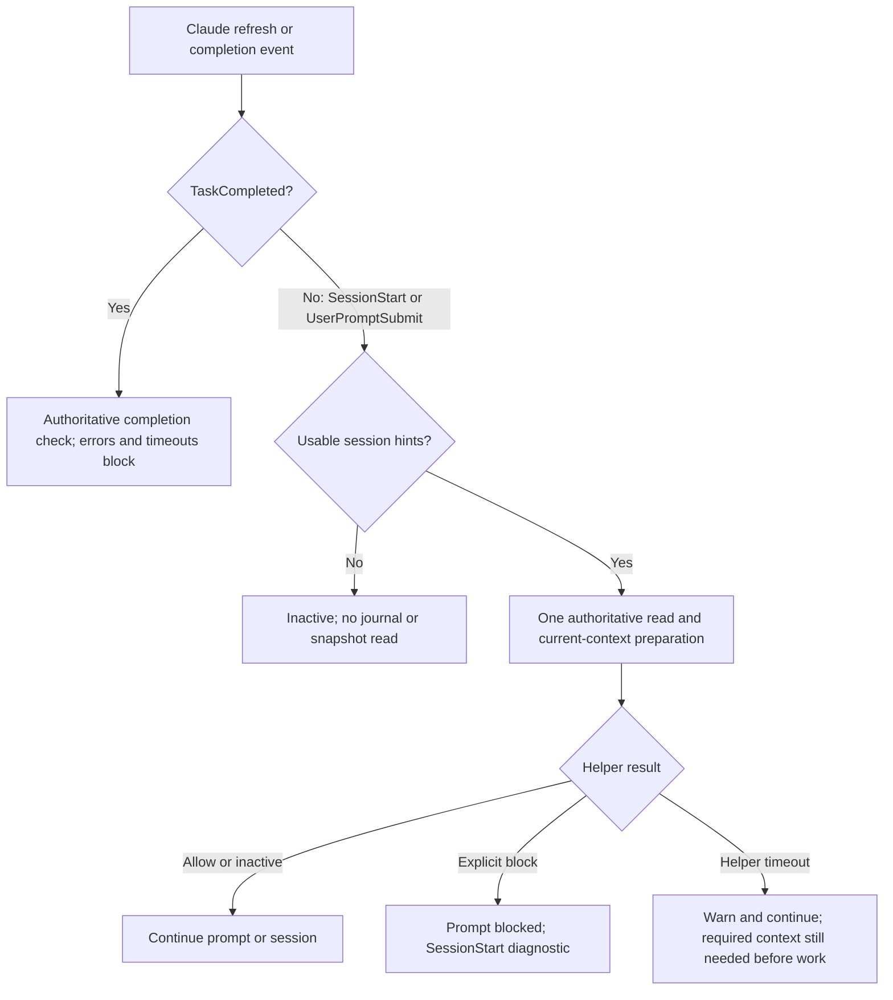

# DevFlow hosts

`host brief` validates the current binding and uses the same
[complete task-view builder](context-efficiency.md#complete-task-views) as run
briefs, including live input checks and required-context byte limits.
Authoritative journal/input preflight runs in the parent, followed by the shared
bounded composition worker. Required failure blocks read/dispatch. The worker
deadline excludes preflight; see [preparation recovery](context-efficiency.md#preparation-recovery). Large complete views travel through content-addressed artifacts
instead of overflowing the hook's inline response.
Attached Claude SessionStart rebuilds full context, including after compaction.
Ordinary repeated prompts still deduplicate only after live checks. An oversized
inline view exposes its control envelope and complete artifact reference with
`context_complete: false`; load that artifact before model work. Native workers
always receive the complete view directly and never reuse a previous worker's
checkpoint.

One package contains `.codex-plugin/plugin.json`, `.claude-plugin/plugin.json`,
`.claude-plugin/marketplace.json`, the shared `skills/`, helpers and all
guides/examples. The marketplace entry selects the repository root as the
Claude plugin source; the private `wgentil/devflow` repository now serves it
from `main`. Users manage
each host installation separately. Upgrades never happen automatically. Release identity hashes
skills, helpers, adapters, policy and manifests; relocated copies have the same identity.

The package requires an existing Python 3.11+ interpreter on macOS/Linux. It does
not provision Python. Claude hooks now use shell-free exec form with `python3`
and a plugin-root argument; native Windows script checks and actual host event dispatch are separate
[validation gates](windows-validation.md). Live installed event acceptance remains unverified. Missing runtime is an installation diagnostic; no environment
variables or manual helper paths are part of user onboarding.

Invoke workflow from the project after enabling the plugin. Capture the loaded
release when reading workflow instructions; after an upgrade, reload/restart and
explicitly refresh attachment. Unknown loaded release blocks attachment/handoff.

Codex uses explicit completion checks. Claude's completion adapter is implemented
and has passed a real local-load smoke. Isolated Codex and Claude marketplace
installs succeeded for earlier releases. Scoped native model workers also passed
live CLI smoke tests; these are separate from current-release end-to-end workflow
validation. See the [validation report](cross-host-validation.md).

Packaging contracts: [Codex packaging](https://developers.openai.com/plugins/build/plugins)
and [Claude manifest](https://code.claude.com/docs/en/plugins-reference).

## Explicit attachment

The agent records a host/session/actor and role against a selected run. One
implementer owns a run; separate item, branch, acceptance and PR reviewers attach to prepared review packages.
All actors that implemented the run remain excluded from independent review.
Task mapping explicitly names the item/latest token or exact review package.
Unmapped tasks are ordinary host work. Detach preserves attempts and release history.

Locators under `.devflow/hosts/<host>/<hashed-session>.json` contain only control
root and binding ID. Journal state grants ownership. Retrying committed attachment
repairs a missing/corrupt locator; locator edits cannot grant ownership. Mutating
commands from attached sessions include binding ID/revision, checked again under
the journal lock. Unattached trusted developer CLI access remains supported.

## Handoff and upgrades

Prepare names the source revision and destination host/actor (session may be
chosen later). Source ownership remains active until destination acceptance.
Acceptance uses the destination's installed helper, rereads both package contents
and atomically transfers ownership under CAS without changing the attempt token.
Every mismatch leaves the original owner active. Detach/resume checks the last
owner's release; detaching cannot bypass parity. Matching older releases work.
An active bounded-repair claim also blocks handoff and mapped task completion.
Reconcile a stopped native invocation and stop its repair cycle before changing
ownership; the old owner remains active throughout.

For a new handoff preparation or acceptance, the helper rereads the approved
repository specification pair and applicable project and organization governing
documents. The organization checkout must be registered under its manifest ID,
reachable at its Git URL and at the source's current HEAD. An edited applicable
policy returns `DOCUMENT_APPROVAL_REQUIRED` for the owning repository and path;
the source host keeps ownership. Ask DevFlow to present the exact before/after
diff and hashes, obtain a separate human document approval, then reassess the
handoff with a new operation ID. Specification approval and a Git commit do not
authorize a policy edit. If the source HEAD has moved, preserve local checkout
work and select or explicitly update a current checkout before retrying; fetch
alone does not move its checked-out HEAD. Unreachable or local-only organization
URLs must be made reachable to the destination. See the
[governing approval sequence](examples/governing-approval.md) and
[setup recovery](setup-and-usage.md#recovering-a-stale-organization-checkout).

Preparation records the effective governing digest. Acceptance checks it again
before ownership transfers, so a policy change after preparation requires
reassessment. A retry of an already committed handoff validates the original
request hash and returns its recorded receipt before the live input check. It
does not transfer ownership again; changing that request with the same operation
ID returns `OPERATION_CONFLICT`.

## Optional Goals

`host goal-status` returns the current journal-derived completion contract and
hash. With explicit user authorization, an agent activates `/goal` in its own
host session and records an opaque reference using `host goal-bind`. Codex Goals
are thread-scoped; Claude Goals are session-scoped. Both host command surfaces
exist, but DevFlow does not claim a portable API to create, pause or inspect
them programmatically. See the [Codex adapter](../adapters/codex/GOALS.md) and
[Claude adapter](../adapters/claude/GOALS.md), grounded in their respective
official guides. `goal-status` reports `manual-host-goal-lifecycle` to make
that limitation explicit.

The binding records the exact run, release, host, contract hash and user
authorization. Goal status never grants a DevFlow gate. On handoff, the source
Goal reference stays with its host; the destination sees a fresh contract and
must obtain a new authorization and Goal. Repair exhaustion and user pause
remain blockers regardless of host Goal state.

After intentionally aligning installations, reload instructions and explicitly
refresh the existing attachment with its revision. For a detached binding, use explicit resume with the exact detached revision and
unchanged identity. Resume checks protocol/schema compatibility and preserves the
previous release in history; it cannot transfer ownership or bypass an active owner.
Compatible refresh/resume preserves
attempts and immutable release history. Unsupported journal contracts require a
separate migration; DevFlow never installs or chooses an upgrade.

A session bound to a delivered or discarded run can attach to a different active
run using a new binding ID. One journal event detaches the terminal binding and
clears its old task mappings, then activates the new binding. The CLI rewrites
the locator and task index; retry the same attach operation ID to repair those
caches after an interruption. A running native worker or claimed repair cycle
blocks this transition. Refresh remains limited to the same run, and an active
prior run still requires detach or handoff.

## Model profiles and lifecycle

Specification/planning/debugging/review/acceptance/security request deep-reasoning
(high supported effort); bounded implementation requests efficient-coding (moderate
supported effort); narrow scans request fast-analysis. Deterministic tests/indexing/
journal/calculations and delivery-record checks never dispatch a model. Designing tests and diagnosing failures
are model work, distinct from executing tests.

This release ships profiles but no capability-validated provider defaults. Runtime
availability does not prove suitability. Portable adapters disclose advisory
recommendations and do not configure an existing parent conversation. The library resolution
engine supports validated ordered mappings, pins, allowed fallback lists, effort and
sourced numerical cost caps. Production discovery uses Codex app-server model/list
or a Claude selected-model native probe. Native workers apply model/effort controls
and journal actual host model observations; Claude effective effort is unknown.
See [native usage and recovery](native-models.md).
Strict mode blocks when mapping, configuration or effective identity is unavailable.
CLI input cannot manufacture trusted observation receipts.

New models remain candidates until representative specification/coding/debug/review
evaluations establish suitability and a user-installed release promotes them.
Policy schema 2 requires approved cases across all four stages, versioned
thresholds and a report hash bound to the released mapping. Native access is
only availability evidence. Discovery now reports a host CLI version and a
model revision only if the native catalog exposes it; absent revision metadata
cannot qualify a released strict mapping. This release still contains no
provider defaults. The [suitability guide](native-models.md) separates
illustrative cases, actual evaluated results and installed-host observations.
Unavailable pins pause; fallback requires a validated permitted equivalent mapping.
Auth/network/quota/rate-limit/context failures are distinct from retirement. A model
interruption preserves attempts/evidence and requires a new recorded invocation.
Transient retry allowance is bounded at two; no automatic spend escalation.
The production discovery cache is advisory, keyed by host/account/policy/release
with a fifteen-minute TTL (library maximum one hour), invalidated explicitly, on policy revision and on availability failure.
Hooks never enumerate models or contact providers.

## Completion and resume

Shared read-only completion policy checks only explicitly mapped task IDs. Item
completion needs the current token, no active item attempt, live fresh final proof
and verified result. Review completion means the mapped independent actor recorded
an assessment of the current package; request-changes/block completes assessment
but never passes the workflow gate. Acceptance assessment is separate from accepted
requirements. Delivery completion needs the recorded actual terminal manifest result.

Resume briefs name mapping, role, attempt, stage, blockers and budget; unrelated
journal events do not change their fingerprint. Every completion check rereads
eligibility and live repository freshness; a brief cache never grants permission.
Failures return to the current implementer; checks do not run tests or launch agents.

Native delegated configuration can be rendered with supported Claude agent
model/effort fields or Codex custom-agent TOML model/model_reasoning_effort. These
controls apply to new native invocations, not the current parent conversation.
Rendering configuration is not evidence that a host accepted it or exposed effective
identity; organization policy and substitutions must still be reported.

Real local Claude 2.1.284 smoke: relocated read-only package loaded, a mapped task
was blocked, genuine RED/GREEN/result allowed completion, and Stop permitted pause.
This establishes that protocol path, not capability validation for a provider default.

After rework issues a new attempt, explicitly remap the same host task to its
latest token. Remapping names the exact previous mapping hash and preserves
run/role/item ownership; it cannot quietly turn an item task into delivery.
Compatible binding refresh likewise requires remapping tasks to the new revision.

`host status` includes current task mapping hashes for explicit rework remapping.
Journal mutation events reference binding ID/revision rather than duplicating the
release descriptor on every operation; release history belongs to the binding.

Moving a project with its default control directory requires explicit repository/
binding relocation repair; initialization does not invent a second repository ID.
A locator copied from another project cannot make mapped work complete there.

## Review fixes and remaining model scope

Stage preferences are field updates in journal order. Omitting a field keeps its
prior restriction; explicit `clear` removes named fields for the chosen stage.
A stage-only mode change never silently removes a spending cap or allowlist.
Advisory observation does not override an explicit ineligible pin/budget decision.

Invocation receipts capture binding/revision, host/session, role/actor, run, stage,
policy revision and active item/token or attached review package/item. Map only
the receipt for that work. A matching invocation keeps its original mode; unrelated
or legacy unscoped receipts cannot relax completion. Interruption records derive
from that binding's immutable receipt and preserve its scope. Receipt creation for
implementation occurs while the attempt is active, before model work starts.

Exact committed host retries return the original response even after detach,
refresh or transfer. They do not mutate ownership again; conflicting reuse of an
operation ID fails. Retry cache repair only uses a still-current active binding.
Known mapped completion blocks on locator/root/binding inconsistencies, including
a wrong existing journal. Repair attachment against the task index's intended
control root; never edit authoritative history to make a task complete.

Native discovery, selected-model probes and scoped launch are integrated. Hooks
and portable read-only resolution never launch workers or contact providers.
No representative capability-validated automatic mappings ship in this release.
Earlier isolated native Codex installation checks succeeded; current-release
install-to-workflow and repair validation remain separate evidence requirements.

Governing policy approval alone does not resume a paused repository-backed run.
Record plan and verification impact through explicit plan revalidation; a run
whose original governing digest differs still blocks handoff preparation and
acceptance. Retain it for audit and attach a fresh run from the revalidated plan.
The source host stays active when a handoff is rejected.

For delegated workers, use [task facts and host controls](reference/task-routing.md). Prepared interactive input is not execution; no production interactive bridge ships.

## Claude launcher failure policy

Mandatory `UserPromptSubmit` and `TaskCompleted` exec hooks declare
`onFailure: block`, requiring Claude Code 2.1.295+ for this policy. A host-side
launcher failure therefore cannot silently bypass those mandatory hooks on that
supported host profile. SessionStart/Stop retain their diagnostic policy. Python
3.11+ must be available through the descriptor's `python3` executable; DevFlow does
not create an alias or install a runtime. Script tests, host schema validation and
actual installed event dispatch are separate [acceptance gates](windows-validation.md).

## Optional attachment discovery

SessionStart and UserPromptSubmit skip journal/snapshot reads when that session
has neither a valid attachment locator nor a usable task index. The result is
inactive (`ATTACHMENT_NOT_DISCOVERED`, or `LOCATOR_INVALID` for a corrupt locator),
with guidance to retry explicit attachment. This discovers hints, not ownership:
a missing cache does not prove that the journal has no binding. No cache or
journal repair is performed. An empty but valid task index still selects its
authoritative root. TaskCompleted retains journal validation and its existing
default-control-root fallback, including when discovery caches are missing or
invalid; cache absence cannot waive completion checks in that journal.

## Prompt refresh and timeouts

An attached refresh reuses its authoritative read for context preparation. Legacy
format 1 replays the journal once and that read grows with history; format 2 uses
indexed selected state and exact current-context shards. The helper keeps its
eight-second deadline.
A UserPromptSubmit helper timeout emits a best-effort UTF-8 warning and lets the
prompt continue, without successful-context output. SessionStart timeouts remain
advisory. An explicit returned policy/context block still blocks the prompt;
non-timeout helper/launcher failures and malformed mandatory input still block.
TaskCompleted timeouts and errors remain blocking. Descriptor `onFailure: block`
and the ten-second host limit are unchanged: this is not a host-launch failure
bypass or a new configurable timeout.

Prompt acceptance is not evidence that required context is ready. Ask the harness
to check attachment and refresh the required context before workflow work. Stop
continues to allow pauses. Direct script tests do not establish live host dispatch.

