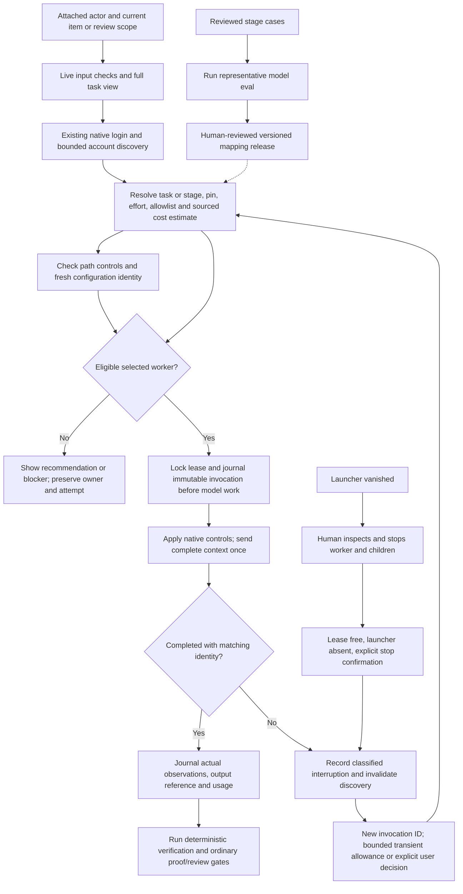

# Native model work

Every new worker receives a full checked task view. Codex sends it once in the
turn input; configuration contains stable actor/stage instructions. Claude uses
the same full view once. Required preparation failure prevents worker creation.
Known configuration/turn text is measured together against `context_max_bytes`
(default 20,000); protocol envelopes and hidden host content remain outside that
measurement. Explicit overrides do not change workflow approval or spending gates.

Invoke DevFlow from an initialized project with the plugin enabled. The agent uses
bundled helpers and the host's existing CLI login. Users do not configure shell
variables, Python commands, installation paths or API keys. Python 3.11+ and the
selected host CLI must already be available; Claude provider identity is supported
only for first-party authentication in this adapter; missing executables/authentication
produce diagnostics. Native workers are new scoped conversations; they do not
change the current parent conversation. A threaded pipe transport is present for
Windows, with processes attached to a Job Object before their initial thread resumes; installed-host behavior and native Windows
acceptance have not been verified; Windows support is not yet released.

Say “Use my permitted model for implementation, advisory with unvalidated
suitability explicitly allowed; preserve the spending cap and show actual settings.”
Or “Discover models available to this Codex account before choosing.” Claude has
no enumerated account model catalog here: an explicit selection is tested by a
native invocation. Probes and workers can incur provider usage. An access probe
establishes access, never suitability for specification, coding or review.

No capability-validated automatic mappings ship. Default advisory routing therefore
returns a stage/effort recommendation without launching. Explicit unvalidated
choices require an advisory pin and `allow_unvalidated: true`. Strict routing
requires a released validated mapping, supported configuration and trusted observed
model/effort. Claude returns model identity but no effective effort, and strict
Claude work blocks. Codex reads the native thread's effective configuration.
Policy schema 2 now defines versioned representative-eval thresholds for
specification, coding, debugging and review. An approved case set and observed
results can produce a candidate report with `improve model-evaluate`; this is
review material, not an installed mapping. A released mapping must embed its
matching report hash, policy version, host/model revision and tested host
version. Runtime resolution accepts it only when current discovery exposes the
same host version and model revision. Missing revision metadata, an alias with
unknown backing revision, or a changed host release leaves the mapping
ineligible. No provider mapping has been released in this package.



Discovery is an advisory fifteen-minute cache keyed by host, opaque account hash,
policy version and release fingerprint. An explicit refresh or availability failure
invalidates it. Completion uses cached context and immutable receipts; hooks do not
enumerate models, launch workers or contact providers. Re-authentication is checked
before new native work. Raw account metadata is not journaled.

Workers capture binding/revision, actor/role, stage, policy revision and item/token
or attached review package. Start rejects scope or preference changes during
preflight. Running workers block attempt changes, detach, refresh and handoff.
Exact terminal worker and reconciliation retries return the original receipt without
spending again; changed input under the same operation ID is rejected.
Provider output is a referenced artifact and is not verification evidence.

Model/auth/quota/context/retirement failures preserve attempts and evidence. Network
and rate-limit failures permit at most two explicitly requested replacements using
new invocation IDs; no automatic launch loop is included. Other failures require an
explicit user decision. Pins never silently fall back. Unknown numerical cost
estimates block; estimated caps are preflight eligibility checks, not a provider
billing ceiling. Prices must be a versioned sourced record in the shared journal.

A crashed launcher leaves work blocked. Inspect native processes and stop the
worker and its children before asking DevFlow to reconcile, naming the human actor
confirming they stopped. Reconciliation checks the invocation lease and recorded
launcher PID; a live or reused PID fails closed. It never kills an arbitrary PID,
restarts work or treats a crash as a failed test. Stop confirmation is a human
attestation because this adapter has no native cross-process worker-status query.

Destination handoff checks its own account and selected-model eligibility before
changing ownership. Explicit selections require a small native probe; default
advisory recommendations do not. A policy change during that check rejects transfer.
Source remains owner on any mismatch or blocked destination decision.

## Developer command reference

These are optional agent/developer calls, not onboarding steps. Resolve the helper
relative to the loaded skill. All stateful native calls use the existing control
root and an explicit operation ID.

```sh
python3 <workflow-skill>/scripts/run.py host model-discover --root <control> --binding-id <binding> --revision 1
python3 <workflow-skill>/scripts/run.py host model-probe --root <control> --binding-id <binding> --revision 1 --stage implementation
python3 <workflow-skill>/scripts/run.py host model-run --root <control> --file <request.json> --operation-id <unique-operation>
python3 <workflow-skill>/scripts/run.py host model-reconcile --root <control> --file <reconcile.json> --operation-id <unique-operation>
```

See [worker request](examples/native-worker.json) and
[stopped-worker reconciliation](examples/native-reconcile.json). Replace fixture
identities with the active binding. `model-run` fields: binding_id, revision,
invocation_id, stage, prompt; optional access (`read-only`, default, or
`workspace-write` for implementation owner), timeout_seconds (1–3600), refresh,
task_id, replace/previous_mapping_hash, replacement_of and replacement_authorization
(`approved: true`, actor_id). Output includes status/reason, scoped decision,
observed settings, native invocation reference, output artifact and optional usage.
Missing usage remains unavailable. `model-reconcile` requires invocation identity
and worker_stop_confirmation (`approved: true`, actor_id).

The illustrative [model suitability input](examples/model-suitability.json)
shows four stage cases and result fields. The agent first records genuinely
approved cases in the selected DevFlow journal, then calls `improve
model-evaluate --root ROOT --input INPUT.json` with their IDs and actual
observed results. A reported `eligible` decision does not install a mapping;
source-controlled policy release and host observation remain separate. The
example's invented model and results are not validation evidence.

Codex uses app-server initialize/account/read/model/list/thread/start/turn/start;
configured external MCP and app tools are disabled, approval requests denied.
Claude uses a native `--agents` definition, explicit model/effort, bounded tool
allowlist, strict empty MCP configuration and no session persistence. Read-only
Claude workers allow Read/Glob/Grep; writing workers additionally permit project
Edit/Write, with Bash requests not automatically approved. Native host settings
and organization policies may deny these controls; DevFlow reports interruption.
The adapter targets the documented native CLI protocol, and incompatible future
host versions produce diagnostics rather than fabricated observations.

Live smoke tests used Codex and Claude 2.1.284 existing logins, exact requested
model identity, tiny no-tool outputs, immutable receipts and exact retry replay.
Worker smoke is separate from the successful earlier isolated plugin-install
checks and does not establish current-release install-to-workflow behavior or
representative model capability. See [validation](cross-host-validation.md).

## Task routing intent

The canonical [task routing reference](reference/task-routing.md) defines facts,
stage defaults, user constraints and receipt limits. Existing stage-only requests
remain valid. Routed isolated requests use the same model policy and live gates.

## Escalation boundaries

See [authorization and recovery](reference/task-routing.md#escalation-and-recovery).

## Routed isolated requests

`host model-run` accepts optional task facts and `execution_path: isolated-native`.
Use the [task schema](reference/task-routing.md#task-decisions); the item identity
is required for item-bound work. Native capabilities are refreshed before launch.

## Interactive delegation preparation

`host delegation-prepare --root CONTROL --file REQUEST.json` returns a complete
prepared input with `status: not-dispatched`, `dispatch: false`. It starts nothing.
Use the [example](examples/delegation-request.json) with live identities.
No production interactive bridge ships; see [host control limits](reference/task-routing.md#host-controls).

## Routing outcomes and offline comparison

See [outcomes and evaluation](reference/task-routing.md#outcomes-and-evaluation)
for scoped worker reports, `stats routing` and reviewed offline comparisons.
