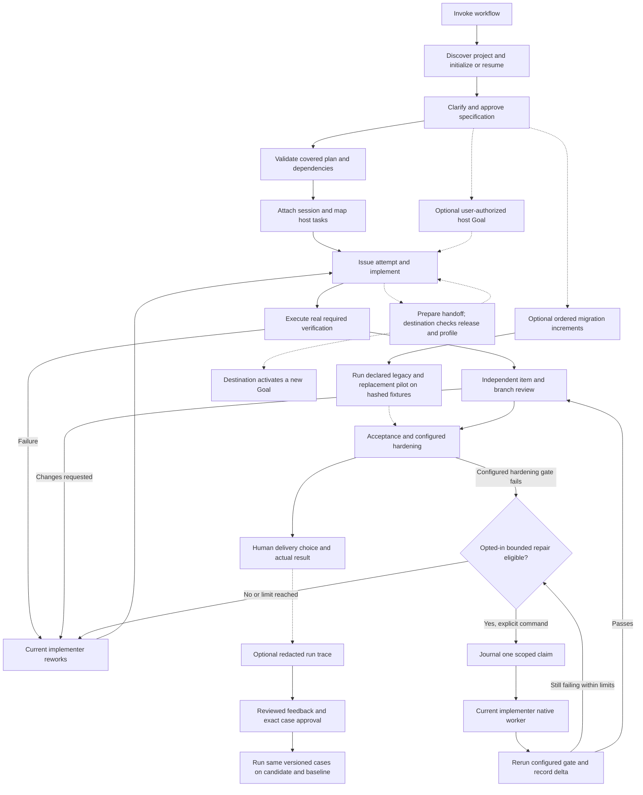

# DevFlow setup and usage

Install/enable DevFlow, open your Git project and invoke workflow. The agent calls
bundled helpers, discovers the project and initializes or resumes its records.
No shell variables, CLI function, installation paths or Python commands are user
setup steps. Existing Python 3.11+ on macOS/Linux is required; this package does
not provision an interpreter. Native Windows is outside current support.

## Installation

Codex and Claude have separate installations of the same shared package. Users
choose when to upgrade. Both manifests and one skills/helper tree are included;
no marketplace has been published by this change. Enable a distribution through
your host's plugin manager. Host-specific verification and remaining limitations
are recorded in [hosts](hosts.md) and [validation](cross-host-validation.md).
Local source-package testing is described in the optional [developer guide](developer-cli.md).

## Initialize a project

Ask “Start DevFlow in this repository.” Workflow resolves the helper relative to
its loaded skill, checks the interpreter and discovers Git/worktree metadata.
It initializes missing `.devflow/control` records, registers a stable repository
identity and preserves existing data. `.devflow/hosts` holds rebuildable session
locators. Git excludes runtime data locally, and ingestion excludes it independently.
Mutable inputs/artifacts belong in the project/control root, never plugin caches.

No Git project requires a focused project choice; DevFlow does not initialize Git
or choose a sibling project. Several resumable runs require a run selection.
An advanced external control root is optional. Initialization does not approve a
spec/plan, create an attempt or grant permission for provider writes or delivery.
Ordinary host work stays inert until explicit attachment and task mapping.

## Requirements, planning and work

Describe the intended outcome. The agent gathers relevant context, interviews
unresolved requirements and shows a written specification for exact-content
approval. Changes require renewed approval. Semantic gap discovery remains
agent-led; the helper validates structure and lists recorded gaps, rather than
proving semantic completeness. Approval currently permits recorded unanswered gaps,
so the agent must resolve material questions before proceeding.

Code needs declared-target RED/GREEN proof. IaC requires plan/policy proof and
explicit authorization before apply. Agent configurations need baseline/post
results. E2E/red-team checks must be configured as supported targets/hardening
gates; DevFlow does not infer all suites. A proof must match the latest attempt
and current repository fingerprint. Missing live evidence never counts as success.
For a bounded migration pilot, DevFlow can run declared legacy and replacement
commands over separate copies of the same hashed fixtures and compare declared
outputs. The passing proof binds the increment, criterion, current item attempt
and repository fingerprint; delivery rejects stale proof. Existing manual
final-proof parity and scoped waivers remain available. See the
[migration guide](../skills/migrate/GUIDE.md#executable-pilot-parity).
Configured hardening gates use command exit status by default. A version 1
`json-report` gate also requires valid JSON with a `findings` array; missing or
malformed output and reported findings fail the gate even on exit zero. The
[workflow guide](../skills/workflow/GUIDE.md#configured-hardening-example)
shows both contracts.

Reviewers use separate invocations and distinct actors, excluding every actor who
implemented the run. Item reviews allow four correction waves; branch/acceptance
allow one, then independent adjudication is needed. Recording request-changes or
block completes the assessment, but leaves advancement blocked. Feedback goes to
the current implementer. Optional bounded repair is manual by default and starts
only with `repair next` after explicit policy configuration. It claims one cycle,
launches the attached implementer, reruns failed configured hardening gates and
records remaining failures. Attempt, elapsed-time, cost and no-progress limits
stop further dispatch. Missing cost estimates or model eligibility block dispatch.
Interrupted claims require reconciliation and never replay a second worker.
Review findings and item proofs still require agent-led rework. Hooks never launch
repair, and independent review must be renewed after source changes.

For improvement work, select a run and explicitly enable its redacted trace.
The agent can show its stage, evidence IDs, repair fingerprints, model observations
and reported usage while omitting prompts and repository contents. A reviewer
records feedback against the exact trace hash; a different human actor approves
the resulting case hash. Approved cases can run against baseline and candidate
checkouts with identical scoring versions. The report exposes quality,
coverage and elapsed time; missing usage stays unknown. No skill or policy
revision is promoted automatically. See the [workflow guide](../skills/workflow/GUIDE.md#run-derived-improvement-cases).

For long-running work, ask DevFlow to show the optional Goal contract for the
attached host. Review its outcome, verification, limits and blocked condition
before authorizing activation in the current Codex or Claude session. DevFlow
records that host-specific Goal reference only after authorization. A host Goal
cannot mark tests, review or delivery complete in DevFlow. Handoff carries the
contract, not the Goal ID; the destination requires a new host Goal. Host
activation and lifecycle are currently agent/user actions, not an automatic
plugin API. See [host Goal adapters](hosts.md#optional-goals).

## Host task completion

Claude hooks check explicitly mapped task IDs. An item task requires current fresh
final proof and a verified result. Reviewer completion requires its actual independent
assessment on the current package, separate from acceptance of requirements.
Delivery completion requires the recorded terminal result and manifest. Unmapped
tasks remain ordinary host work even during an attached run. Codex uses the same
shared check explicitly; automatic Codex hook enforcement is not claimed.

Hooks never run tests or change ownership. Stop permits pauses and human-input
waits. A completion blocker directs rework; it does not force endless continuation.
Host bindings coordinate trusted local clients, rather than secure arbitrary shell
or filesystem access.

## Model choices

Design/planning/debugging/review/acceptance/security request deep-reasoning with
high supported effort; bounded coding requests efficient-coding with moderate
effort; narrow scans request fast-analysis. Executing deterministic tests, indexing
and journal/delivery-record operations uses no additional model.

Ask for preferences conversationally, for example “use strict policy for planning”
or “pin this permitted model for new implementation calls.” Requested, resolved
and observed settings are separate. New models remain candidates until capability
validation; unavailable pins pause; fallback needs a validated permitted equivalent.
Representative suitability evaluation requires approved cases for
specification, coding, debugging and review with versioned thresholds. The
agent can generate a report with `improve model-evaluate`, but installing a
mapping remains a reviewed plugin release. Host/model revision observations
must match that release; unknown revisions remain ineligible. No validated
provider default ships yet. See [native model work](native-models.md).
Unknown pricing under a numerical spending cap blocks rather than counting as zero.
Stage preferences preserve prior constraints unless explicitly removed. Receipts
are scoped to the actual binding/actor/stage and item attempt or review package;
an unrelated earlier advisory receipt cannot relax strict completion.

This release supports scoped workers using the installed Codex or Claude CLI and
its existing authentication. Ask “Run this stage with my permitted model and show
the observed settings.” The agent invokes bundled helpers; no environment variables,
API keys, helper paths or direct Python commands are required from the user.
Native discovery and selection use bounded account-scoped caches. Explicit model
probes and workers may incur provider usage. No capability-validated automatic
provider defaults are shipped. Claude reports model identity but no trusted effective
effort, so strict Claude workers pause. See [native worker usage](native-models.md).
Adapters disclose advisory recommendations. Strict dispatch/completion pauses when
mapping, configuration or actual model/effort cannot be verified. Existing parent
conversations are not silently switched. See [model limitations](hosts.md).

## Pause, resume and cross-host handoff

Ask “Resume DevFlow and show the item and blockers.” Records preserve attempt
identity, proof, reviews and findings; no transcript replay is required. Resume
briefs are scoped and deduplicated. A pause does not abandon an attempt.

All-Claude, all-Codex and sequential collaboration use the same local journal.
One implementation owner is active at a time; reviewers may attach independently.
Source prepares a handoff and stays owner until destination acceptance. Destination
checks its own installed helper, the source package, exact DevFlow release identity,
supported schema and model eligibility before CAS transfer. The token is preserved.

Parity means identical DevFlow release/version/fingerprint/protocol, not identical
host application or provider models. A mismatch leaves ownership unchanged; users
align installations themselves. Matching older pairs can hand off. After upgrading,
reload instructions and explicitly refresh an active attachment or resume the exact
detached binding revision with unchanged identity. Compatible explicit resume keeps
release history and attempts; known release history cannot
be bypassed by detaching or pretending the run is legacy. Lost locators are repaired
through explicit attachment retry; they never grant authority. Known mapped tasks
block if their locator points at the wrong root or binding. An exact committed
retry returns its original receipt even after detach/refresh/transfer.

## Delivery and optional workflows

After acceptance and required gates pass, choose merge, PR or retained branch.
DevFlow verifies the exact manifest and records the actual authorized outcome.
It does not infer permission for external writes, merges, pushes or publication.
Missing remote makes PR unavailable, without preventing local implementation.

Optional source ingestion, issues, migrations and usage reporting are documented
in [all ten guides](skills.md). Missing usage is unavailable, not zero; example
prices and provider records are fixtures unless explicitly described as live.

## Recovery and maintenance

Back up the authoritative control journal. `state.json`, locators and brief caches
are rebuildable. Corrupt/future-schema events require diagnosis, not history edits.
Stale active bindings require refresh; detached ones require explicit revision-bound
resume. Stale proof requires verification; changed review
inputs require a renewed package. Uncertain provider outcomes require reconciliation.

Review this guide and affected skills, guides, diagrams and examples whenever
DevFlow changes. The [developer CLI](developer-cli.md), [command contracts](usage.md)
and [cross-host design](superpowers/specs/2026-10-06-devflow-cross-host-design.md)
provide deeper reference. Documentation describes actual behavior and distinguishes
fixture verification from installed-host readiness.

If a project moves, ask DevFlow to repair repository/binding references explicitly.
Existing local records with a different location produce a relocation diagnostic
rather than a duplicate repository identity. Preserve the original journal.
