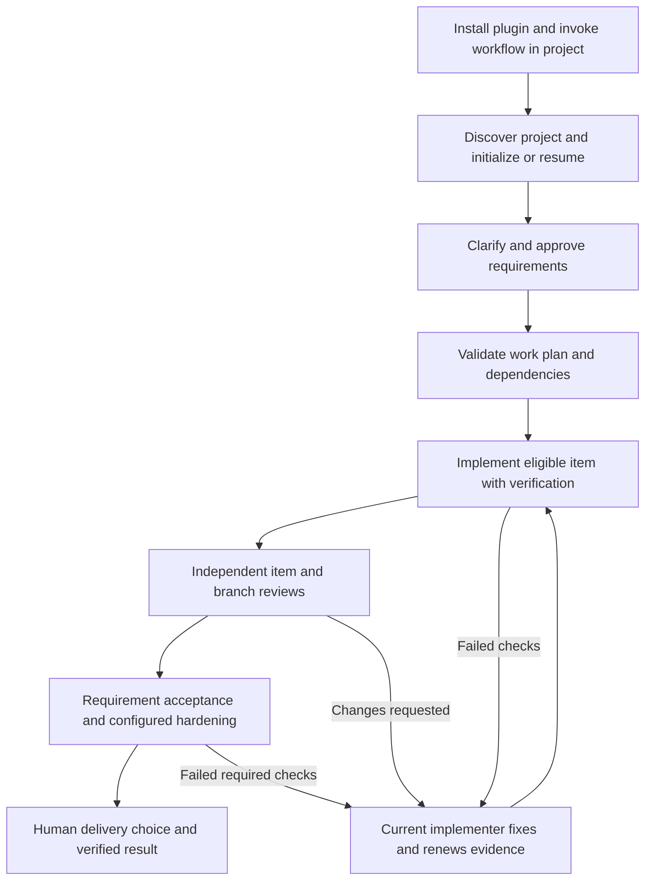

# DevFlow setup and usage

This is the primary user guide. Keep it current with every DevFlow change.

## The intended plugin experience

**Install the plugin, open your coding project, and invoke DevFlow's workflow
skill.** DevFlow should locate its packaged helpers, discover your repository,
initialize or resume its records, and guide the work. You should not configure
shell variables, provide installation paths, define a CLI function or run Python
commands yourself.

This experience is an explicit requirement of the
[proposed host design](superpowers/specs/2026-10-06-devflow-cross-host-design.md).
The current source has bundled skills/helpers and tested workflow commands, but
installation-to-initialization discovery has not yet been implemented or verified.
Claude packaging, hooks and handoff are also proposed. This guide labels those
steps accordingly; it is not a claim that a published plugin installer exists.

Developers who need direct helper access can use the optional
[CLI walkthrough](developer-cli.md). Those instructions are not user setup steps.

## Install DevFlow

Proposed user flow:

1. Install or enable DevFlow using your host's plugin manager.
2. Open the project repository in Codex or Claude Code.
3. Invoke DevFlow's `workflow` skill or ask the agent to start DevFlow for the project.

Codex and Claude installations are separate entries backed by the same package
source. Each contains the shared skills, Python helpers, guides and examples.
Users decide when to upgrade. No automatic installation updates are proposed.

The current repository has a Codex-oriented root manifest but no published
marketplace/installation URL or automatic installer. The Claude manifest is still
proposed. Exact install commands and UI instructions must be documented here only
when the packaging has been implemented and tested in the respective host.

The current helper requires Python 3.11+ on macOS/Linux. Python code is packaged;
a Python interpreter is not currently bundled. The proposed adapter automatically
checks and locates a compatible runtime. A missing runtime produces a clear
installation/runtime diagnostic instead of asking for PATH edits or shell setup.
Native Windows and runtime provisioning are not implemented.

## Start work in a project

After installation and initialization support is implemented, a request can be:

> Start DevFlow in this repository. I want to add a greeting command. Help me
> clarify the requirements, show me the specification, and guide the work.

DevFlow will:

- Resolve its helper path from the loaded plugin/skill, independently of where
  you launched the host.
- Identify the project from the host's working directory and Git repository.
- Use repository-local `.devflow/control/` for journal/artifact state and
  `.devflow/hosts/` for session locators, without asking you to select paths.
- Exclude `.devflow/` runtime data from Git and source ingestion, preserving
  existing exclusions. Keep mutable files out of the installed plugin directory.
- Register the repository under a stable ID and initialize only missing records.
- Detect existing runs and offer a concise resume/new-work choice when necessary.
- Attach the session to the selected run and explicitly map DevFlow tasks.

If the working directory is outside a Git project, or several projects/runs are
plausible, DevFlow asks a focused clarification. It does not guess another project's
state, initialize Git or change remotes. Advanced external-control-root overrides
remain optional; the standard user flow does not depend on them.

Initialization occurs when you explicitly start DevFlow. Installing the plugin,
loading an unrelated skill or doing ordinary host work does not create project
state or attach a run.

These initialization/attachment steps are **proposed**, not current automatic
behavior. Existing helper commands already support explicit root/repository setup;
the adapter must implement discovery and defaults around them.

## Requirements and approval

Describe what you want to achieve. DevFlow uses project context, organization
answers and relevant source evidence, asks unresolved questions and renders a
specification for your review. You approve the written content before planning.
Changes require renewed approval of the revised specification.

Current limits: the specification helper validates structure and lists recorded
gaps. Semantic completeness/contradiction review and interviewing depend on the
agent. The helper currently permits approval with recorded unanswered gaps;
DevFlow's agent must resolve material questions rather than treat validation as
proof that the design is complete.

## Build, test and review

The agent runs the packaged helper on your behalf. You do not need to learn its
CLI to use DevFlow. It creates work items, respects dependencies and records actual
kind-matched verification before considering work complete.

Code verification uses declared-target RED/GREEN evidence. IaC requires plan/policy
proof and explicit authorization before apply. Agent configurations use baseline
and post evaluations. Required E2E/red-team checks must be configured as supported
targets or hardening gates; DevFlow does not infer every test suite automatically.

Independent reviewers use separate invocations and distinct actors. Item reviews
permit four correction waves; branch/acceptance reviews permit one, then unresolved
requests require independent adjudication. An assessment requesting changes is a
completed review task, not a passing gate. Failed required proof blocks advancement.
The agent coordinates fixes; the helper does not automatically dispatch a rework agent.

Current helper gates enforce journal transitions. Proposed Claude hooks would
also block mapped host task completion; proposed Codex guidance would invoke the
same check explicitly. Neither prevents arbitrary filesystem edits outside the
workflow. No current host-completion hook should be assumed implemented.

## Proposed model selection

The host design also proposes stage-based capability profiles. Specifications,
planning and independent review favor deep reasoning; clearly scoped implementation
can use an efficient coding model, with escalation for difficult work. Running
actual tests and deterministic helpers does not require a separate model.

DevFlow would map profiles to validated models/effort available in each host, using
sensible defaults without shell configuration. New models remain candidates until
validated; users choose when to install a release with changed defaults. Retired
or inaccessible models can use only permitted validated fallbacks. An unavailable
user-pinned model requires a user decision. No fallback silently exceeds spending
policy or turns unknown pricing into zero cost.

Requested, resolved and actual model settings are recorded separately where the
host exposes them. Advisory mode discloses settings it cannot control/verify;
strict mode blocks when required configuration or actual identity is unknown.
Claude and Codex may use different models while sharing the same DevFlow release.
These routing/lifecycle controls are proposed, not currently implemented.

## Pause and resume

You should be able to say:

> Resume DevFlow for this project and show me the current item and blockers.

The proposed adapter finds the project's records, checks its runtime/release and
loads a scoped brief. The current journal already preserves run IDs, active attempt
tokens, proof, reviews and blockers; direct helper users can resume from those
records today. A fresh session need not replay the old conversation transcript.

Normal pauses and human-input waits are allowed. Stopping a response does not
require delivering the entire run. Abandoning an attempt is an explicit workflow
choice; it is not necessary merely because you restarted the host.

## Collaborate between Claude and Codex

Proposed behavior supports all-Claude, all-Codex or collaboration through sequential
handoff. One implementer owns a run at a time; independent reviewers can assess
separately. Both hosts access the same local project journal.

Ask for a handoff to the other host. DevFlow prepares it and the destination accepts
using its own installed helper. Matching installed/loaded DevFlow release versions
and fingerprints are required. A mismatch blocks the transfer and explains which
installation/session needs attention; you decide when to upgrade or reload.
Ownership and the attempt stay unchanged until successful transfer.

Host attachment, ownership and enforced version-parity handoff remain design-only.
Direct journal-based resume is not yet equivalent to that managed handoff.

## Delivery and optional workflows

When requirements and required gates pass, choose local merge, PR or retained
branch. DevFlow prepares/verifies an exact manifest and records the actual outcome.
It does not infer authorization or perform external effects automatically.

Optional workflows include source ingestion, complete issue snapshots/grouping,
ordered migrations, scoped issue reconciliation and usage reports. Provider
connectors and runtime inputs are supplied integrations; prices in examples are
illustrative. Missing usage is unavailable, not zero. The
[skill guide index](skills.md) explains each capability and its limits.

## Records, troubleshooting and upgrades

Proposed default records are in ignored `.devflow/` runtime directories. Back up
workflow state along with the project data it references; moving or deleting a
project should not silently discard its journal. The current control-root journal
is authoritative, while `state.json` is rebuildable. Corrupt/future-schema events
block operations; do not edit history to bypass gates.

If work is blocked, ask DevFlow to explain the current gate and next required
operation. Missing/stale proof needs new verification; changed review content
needs a renewed package; uncertain issue-provider results need reconciliation.
Missing tools or runtime produce actionable diagnostics, not invented success.

Upgrade using your host's installation mechanism when you choose. The adapter
must recheck loaded skills against the installed helper and require a session
refresh when necessary. Preserve project state and respect supported journal
schemas. Automatic upgrading and silent journal migration are not part of the design.

## Further reading and maintenance

- [All ten skill guides](skills.md)
- [Example inputs](examples/README.md)
- [Optional developer CLI walkthrough](developer-cli.md)
- [Detailed current helper contracts](usage.md)
- [Proposed installation, initialization and host design](superpowers/specs/2026-10-06-devflow-cross-host-design.md)

Every DevFlow change must review and update this guide, affected skill guides,
diagrams and examples. Keep user instructions free of implementation setup;
describe actual verified behavior and label remaining design-only steps explicitly.

## Shared host package and release identity

See [host setup and compatibility](hosts.md). The shared package includes both
host manifests. Python source is bundled; an existing Python 3.11+ interpreter
is required. User-controlled upgrades require reloading the workflow instructions
and refreshing the attachment. Host integration readiness is reported separately
from package/protocol fixture verification.
