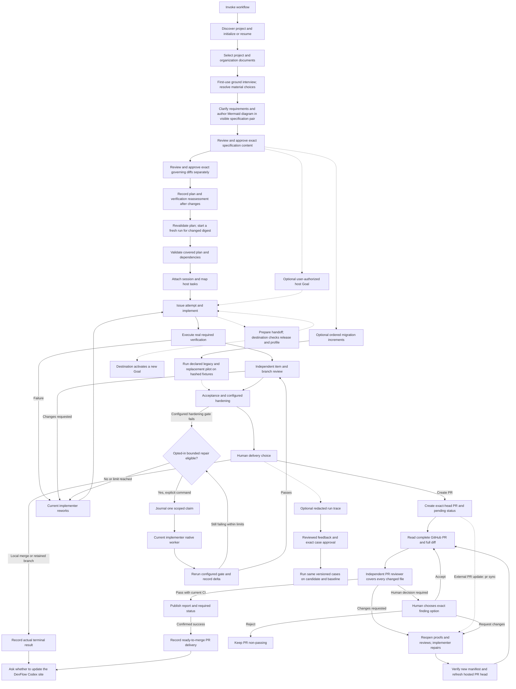
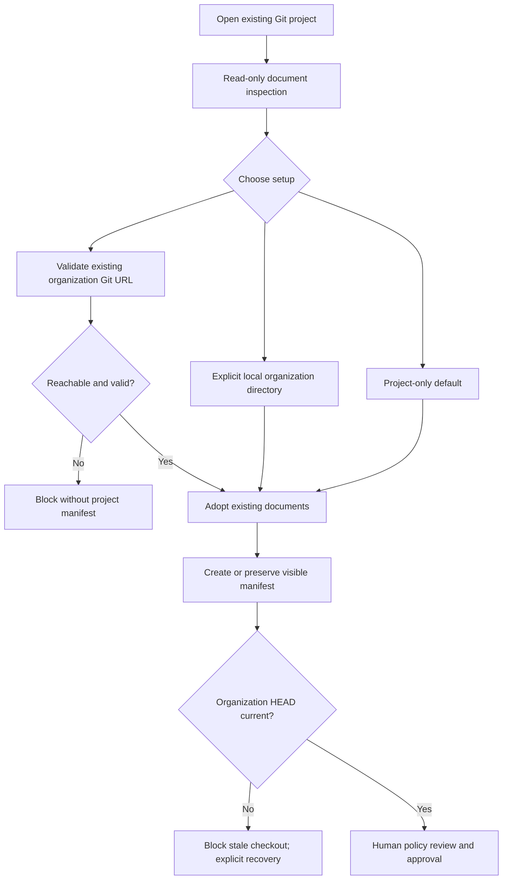

# DevFlow setup and usage

For the minimum install-and-start path, use the [quick start](quick-start.md).
This remains the detailed primary reference. The harness guides setup and next
steps; users should not need to understand skill names or helper commands.

Install/enable DevFlow, open your Git project and invoke workflow. The agent calls
bundled helpers, discovers the project and initializes or resumes its records.
No shell variables, CLI function, installation paths or Python commands are user
setup steps. Existing Python 3.11+ available as `python3` on macOS/Linux is
required; this package does not provision an interpreter. Native Windows core
runtime, installed-package/startup checks and signed-in workflows are separate
validation gates. See the [platform matrix](windows-validation.md) for exact
candidate evidence. Unreleased candidate checks do not change the package served
from the marketplace until integration and publication. Signed-in Windows event/worker/handoff acceptance remains
unverified, and WSL2 is a separate target. The native Windows Claude profile
requires Python 3.11+ available as `python3` and Claude Code 2.1.295+ for mandatory
launcher-failure blocking. DevFlow does not install Python or create aliases.
Npm host installations also need native Node; native host `.exe` installations
use their executable directly. Detailed maintainer checks stay in the
[acceptance procedure](examples/windows-host-acceptance.md).


## Installation

Codex and Claude have separate installations of the same shared package. Users
choose when to upgrade. Both manifests and one skills/helper tree are included;
the package version is `0.3.12`;
the Claude marketplace descriptor is packaged at `.claude-plugin/marketplace.json`.
The private GitHub repository `wgentil/devflow` serves the marketplace from
`main`. Codex users with access to that repository can install it:

```sh
codex plugin marketplace add wgentil/devflow
codex plugin add devflow@devflow-marketplace
codex plugin list
```

Claude Code CLI users can install it separately:

```sh
claude plugin marketplace add wgentil/devflow
claude plugin install devflow@devflow-marketplace
claude plugin list
```

The third-party Claude marketplace does not auto-update by default. To upgrade at a
time you choose, run `claude plugin update devflow@devflow-marketplace`, then
start a new session or reload plugins. For Codex, run `codex plugin marketplace
upgrade devflow-marketplace` and select the new version in the plugin browser
or run `codex plugin add devflow@devflow-marketplace`. Align the installations
before a cross-host handoff; DevFlow checks exact installed release parity.
For source development, `claude --plugin-dir` loads a local checkout for one
session as described in the optional
[developer guide](developer-cli.md#local-claude-package-check).
Isolated Claude and Codex GitHub marketplace installs of 0.3.1 succeeded. These
checks validate those earlier packages; they do not establish current-release
end-to-end workflow, repair, or cross-OS behavior. The current package contains
eleven skills, including the standalone UX reviewer.
An isolated local Claude v0.3.9 installation and its hook-script behavior checks
also passed; these checks do not establish live installed-session event dispatch.
Host-specific verification and remaining limitations
are recorded in [hosts](hosts.md) and [validation](cross-host-validation.md).
The [evidence-loop acceptance review](evidence-loops-acceptance.md) separates
implemented policy from live host behavior and remaining proof limits.
Local source-package testing is described in the optional [developer guide](developer-cli.md).

## Context and recovery

Run/host briefs include complete bounded task context. Required missing/oversized
inputs stop the operation; optional omissions are named. Session start, compaction
and handoff rebuild full context. Load complete referenced artifacts before model
work. Focused feedback and failure digests preserve full verification gates. See
[context behavior and measurement limits](context-efficiency.md).

## Initialize a project

Ask “Start DevFlow in this repository.” Workflow resolves the helper relative to
its loaded skill, checks the interpreter and discovers Git/worktree metadata.
It initializes missing `.devflow/control` records, registers a stable repository
identity and preserves existing data. `.devflow/hosts` holds rebuildable session
locators. Git excludes runtime data locally, and ingestion excludes it independently.
Mutable inputs/artifacts belong in the project/control root, never plugin caches.

No Git project requires a focused project choice; DevFlow does not initialize Git
or choose a sibling project. Several resumable runs require a run selection.
An advanced external control root is optional. Initialization does not approve a
spec/plan, create an attempt or grant permission for provider writes or delivery.
Ordinary host work stays inert until explicit attachment and task mapping.

Guided document setup returns an exact manifest/policy approval proposal. The
harness shows the changes and requests required human approval during setup,
before specification and planning. Generated content is not auto-approved.
Pending proposal preparation is reported with recovery guidance; completed file
creation alone does not mean governing approval is complete.

## Requirements, planning and work

Ask for a UX review of a live interface, design, screenshot, or requirements to
use [ux-reviewer](../skills/ux-reviewer/GUIDE.md). Supply the target and main
user task when known. Its report classifies observed defects, requirement gaps,
risks, and questions; prioritizes evidence-backed findings by user impact; and
states what could not be checked. It can inform a formal DevFlow review,
which still follows the independent [review-work](../skills/review-work/GUIDE.md)
gates; the UX skill adds no helper command or automatic approval.

Describe the intended outcome. The agent gathers relevant context, interviews
unresolved requirements and shows a written specification for exact-content
approval. For a newly initialized project, DevFlow first conducts a ground
interview in Git-trackable `docs/devflow-ground-interview.json`. It covers product
and users, constraints, architecture, languages, coding and lint standards, data
and database, API and UI frameworks, design system, accessibility and
localization, security and privacy, integrations, testing, performance and
reliability, release, operations, and team conventions. The agent inspects code
and inherited organization rules, then asks only for missing choices. Each topic
is answered, established with source references, deferred with a reason, or
not applicable with a reason. Material deferrals block repository-backed planning
and work. The helper checks the inventory; the agent judges answer quality and
materiality. Older manifests without an interview declaration retain legacy
behavior. See the [workflow guide](../skills/workflow/GUIDE.md#first-use-ground-interview).
Feature-specific gaps still belong in the spec. If the baseline changes, reassess
affected specifications, plans, verification and governing documents. Changes
require renewed approval. Semantic gap discovery remains
agent-led; the helper validates structure and lists recorded gaps, rather than
proving semantic completeness. Approval currently permits recorded unanswered gaps,
so the agent must resolve material questions before proceeding.
DevFlow authors at least one relevant Mermaid diagram in every new or revised
specification. The diagram lives in the authoritative JSON and appears in the
rendered Markdown for review. New or changed repository-backed specs cannot be
approved without it; older approved content remains valid until edited. The
agent checks the diagram's meaning and rendering, because the helper only
validates its structure.



Code needs declared-target RED/GREEN proof. IaC requires plan/policy proof and
explicit authorization before apply. Agent configurations need baseline/post
results. E2E/red-team checks must be configured as supported targets/hardening
gates; DevFlow does not infer all suites. A proof must match the latest attempt
and current repository fingerprint. Missing live evidence never counts as success.
For a bounded migration pilot, DevFlow can run declared legacy and replacement
commands over separate copies of the same hashed fixtures and compare declared
outputs. The passing proof binds the increment, criterion, current item attempt
and repository fingerprint; delivery rejects stale proof. Existing manual
final-proof parity and scoped waivers remain available. See the
[migration guide](../skills/migrate/GUIDE.md#executable-pilot-parity).
The temporary working directories are not a sandbox; use trusted commands or
an external OS sandbox when process isolation is required.
Configured hardening gates use command exit status by default. A version 1
`json-report` gate also requires valid JSON with a `findings` array; missing or
malformed output and reported findings fail the gate even on exit zero. The
[workflow guide](../skills/workflow/GUIDE.md#configured-hardening-example)
shows both contracts.

Reviewers use separate invocations and distinct actors, excluding every actor who
implemented the run. Item reviews allow four correction waves; branch/acceptance
allow one, then independent adjudication is needed. Recording request-changes or
block completes the assessment, but leaves advancement blocked. Feedback goes to
the current implementer. Optional bounded repair is manual by default and starts
only with `repair next` after explicit policy configuration. It claims one cycle,
launches the attached implementer, reruns failed configured hardening gates and
records remaining failures. Attempt, elapsed-time, cost and no-progress limits
stop further dispatch. Missing cost estimates or model eligibility block dispatch.
Interrupted claims require reconciliation and never replay a second worker.
Terminal worker failures or gate-runner errors journal an abort and remaining
failures; an active native worker still needs reconciliation.
Review findings and item proofs still require agent-led rework. Hooks never launch
repair, and independent review must be renewed after source changes.

For improvement work, select a run and explicitly enable its redacted trace.
The agent can show its stage, evidence IDs, repair fingerprints, model observations
and reported usage while omitting prompts and repository contents. A reviewer
records feedback against the exact trace hash; a different human actor approves
the resulting case hash. Approved cases can run against baseline and candidate
checkouts with identical scoring versions. The report exposes quality,
coverage and elapsed time; missing usage stays unknown. No skill or policy
revision is promoted automatically. See the [workflow guide](../skills/workflow/GUIDE.md#run-derived-improvement-cases).
The caller prepares each checkout and supplies its artifact hash; DevFlow does
not verify that hash or bind comparison JSON to a checkout, so comparison
results are advisory until a reviewer verifies the artifact and execution.

For long-running work, ask DevFlow to show the optional Goal contract for the
attached host. Review its outcome, verification, limits and blocked condition
before authorizing activation in the current Codex or Claude session. DevFlow
records that host-specific Goal reference only after authorization. A host Goal
cannot mark tests, review or delivery complete in DevFlow. Handoff carries the
contract, not the Goal ID; the destination requires a new host Goal. Host
activation and lifecycle are currently agent/user actions, not an automatic
plugin API. See [host Goal adapters](hosts.md#optional-goals).

## Host task completion

Claude hooks check explicitly mapped task IDs. An item task requires current fresh
final proof and a verified result. Reviewer completion requires its actual independent
assessment on the current package, separate from acceptance of requirements.
Delivery completion requires the recorded terminal result and manifest. Unmapped
tasks remain ordinary host work even during an attached run. Codex uses the same
shared check explicitly; automatic Codex hook enforcement is not claimed.

Hooks never run tests or change ownership. Stop permits pauses and human-input
waits. A completion blocker directs rework; it does not force endless continuation.
Host bindings coordinate trusted local clients, rather than secure arbitrary shell
or filesystem access.

## Model choices

Design/planning/debugging/review/acceptance/security request deep-reasoning with
high supported effort; bounded coding requests efficient-coding with moderate
effort; narrow scans request fast-analysis. Executing deterministic tests, indexing
and journal/delivery-record operations uses no additional model.

Ask for preferences conversationally, for example “use strict policy for planning”
or “pin this permitted model for new implementation calls.” Requested, resolved
and observed settings are separate. New models remain candidates until capability
validation; unavailable pins pause; fallback needs a validated permitted equivalent.
Representative suitability evaluation requires approved cases for
specification, coding, debugging and review with versioned thresholds. The
agent can generate a report with `improve model-evaluate`, but installing a
mapping remains a reviewed plugin release. Host/model revision observations
must match that release; unknown revisions remain ineligible. No validated
provider default ships yet. See [native model work](native-models.md).
Unknown pricing under a numerical spending cap blocks rather than counting as zero.
Stage preferences preserve prior constraints unless explicitly removed. Receipts
are scoped to the actual binding/actor/stage and item attempt or review package;
an unrelated earlier advisory receipt cannot relax strict completion.

This release supports scoped workers using the installed Codex or Claude CLI and
its existing authentication. Ask “Run this stage with my permitted model and show
the observed settings.” The agent invokes bundled helpers; no environment variables,
API keys, helper paths or direct Python commands are required from the user.
Native discovery and selection use bounded account-scoped caches. Explicit model
probes and workers may incur provider usage. No capability-validated automatic
provider defaults are shipped. Claude reports model identity but no trusted effective
effort, so strict Claude workers pause. See [native worker usage](native-models.md).
Adapters disclose advisory recommendations. Strict dispatch/completion pauses when
mapping, configuration or actual model/effort cannot be verified. Existing parent
conversations are not silently switched. See [model limitations](hosts.md).

## Pause, resume and cross-host handoff

Ask “Resume DevFlow and show the item and blockers.” Records preserve attempt
identity, proof, reviews and findings; no transcript replay is required. Resume
briefs are scoped and deduplicated. A pause does not abandon an attempt.

All-Claude, all-Codex and sequential collaboration use the same local journal.
One implementation owner is active at a time; reviewers may attach independently.
Source prepares a handoff and stays owner until destination acceptance. Destination
checks its own installed helper, the source package, exact DevFlow release identity,
supported schema and model eligibility before CAS transfer. The token is preserved.

Parity means identical DevFlow release/version/fingerprint/protocol, not identical
host application or provider models. A mismatch leaves ownership unchanged; users
align installations themselves. Matching older pairs can hand off. After upgrading,
reload instructions and explicitly refresh an active attachment or resume the exact
detached binding revision with unchanged identity. Compatible explicit resume keeps
release history and attempts; known release history cannot
be bypassed by detaching or pretending the run is legacy. Lost locators are repaired
through explicit attachment retry; they never grant authority. Known mapped tasks
block if their locator points at the wrong root or binding. An exact committed
retry returns its original receipt even after detach/refresh/transfer.

When a session starts a new active run after its previous run was delivered or
discarded, attach with a new binding ID and the new run ID. The journal detaches
the terminal binding and removes its session task mappings atomically. The host
locator and task index are then rebuilt for the new binding, including on an
exact attach retry. Active native work or a claimed repair cycle blocks the
switch until resolved. A nonterminal run still needs the normal detach or
handoff path.

## Delivery and optional workflows

After acceptance and required gates pass, choose merge, PR or retained branch.
DevFlow verifies the exact manifest and records the actual authorized outcome.
It does not infer permission for external writes, merges, pushes or publication.
Missing remote makes PR unavailable, without preventing local implementation.
The optional GitHub PR ruleset setup helper can currently inspect and configure
the dedicated `devflow/pr-review` required status with named direct-push bypass
actors. It requires authenticated GitHub CLI access and repository ruleset
permission. PR opening, publication, refresh and completion recheck the live
ruleset; a stale setup receipt cannot silently remove the required gate.
The `pr open` command can create or find one exact-head GitHub PR and
post an initial pending status after explicit authorization. It leaves the run
active. `review pr-package` gathers complete hosted and local diff evidence;
a distinct PR reviewer records every-file coverage. `pr publish` writes a
concise summary, actionable inline findings and a required status, then
`pr complete` records delivery only after a fresh successful status readback.
The helper does not merge the PR. While delivery is pending, use `pr sync`
after an external PR change, renew the gates and `pr refresh`, then rerun the
review. After PR delivery is recorded, start a fresh run for a later update;
there is no webhook watcher. A fork's exact commits must be locally available.
An explicit human rejection also closes this run's PR path; a later attempt
needs a fresh run.
After each completed delivery record, including a ready-to-merge PR, the agent
asks whether to update the [DevFlow Codex site](https://devflow-field-guide.waygent.chatgpt.site/)
with that build. The question is asked once per completed build and does not
hold up delivery if declined or unanswered. Site updates are a separate user-
approved action; DevFlow does not synchronize or publish the site automatically.
If CI is missing, GitHub pages are truncated, or the PR changes, the gate
stays closed. The setup receipt alone does not create or review a PR. See the
[full review guide](../skills/review-work/GUIDE.md#github-pr-full-review) for
the explicit `pr rework`, `pr sync` and `pr refresh` recovery steps. See the
[developer command reference](usage.md) for its input and recovery behavior.

Optional source ingestion, issues, migrations and usage reporting are documented
in the [skill guides](skills.md). Missing usage is unavailable, not zero; example
prices and provider records are fixtures unless explicitly described as live.

## Recovery and maintenance

Back up the authoritative control journal. `state.json`, locators and brief caches
are rebuildable. Corrupt/future-schema events require diagnosis, not history edits.
Stale active bindings require refresh; detached ones require explicit revision-bound
resume. Stale proof requires verification; changed review
inputs require a renewed package. Uncertain provider outcomes require reconciliation.

Review this guide and affected skills, guides, diagrams and examples whenever
DevFlow changes. The [developer CLI](developer-cli.md), [command contracts](usage.md)
and [cross-host design](superpowers/specs/2026-10-06-devflow-cross-host-design.md)
provide deeper reference. Documentation describes actual behavior and distinguishes
fixture verification from installed-host readiness.

If a project moves, ask DevFlow to repair repository/binding references explicitly.
Existing local records with a different location produce a relocation diagnostic
rather than a duplicate repository identity. Preserve the original journal.

### Repository-backed specifications

New requirements use short ID/title headings followed by ordinary description
paragraphs. Exact legacy Markdown stays readable; rewriting it needs renewed
approval of the new pair. See the [specify guide](../skills/specify/GUIDE.md).

Ask DevFlow to store the specification in the selected registered repository as a
visible JSON/Markdown pair, for example `docs/specs/greeting.json`
and `.md`, and review the rendered file before confirming its exact content hash.
Include a titled `diagrams` entry with Mermaid source in the JSON; DevFlow renders
it into the Markdown and requires it before approving new or edited content.
The helper records the repository ID, relative paths and both hashes. Approval
rereads both files immediately before journaling; changed or missing files require
repair and renewed review. Ignored paths, `.devflow`, and paths escaping the
repository cannot hold the pair. Repository files are authoritative for this flow.
An interrupted pair write must be repaired by storing the pair again.

Existing journal-only specifications remain available as legacy behavior. Optional
CLI details are in the [specify guide](../skills/specify/GUIDE.md); plugin users
need no shell variables or manual installation paths.

## Specification drift and legacy upgrades

For repository-backed work, DevFlow checks the visible specification pair before
planning, run start, host handoff and delivery. Observed drift persists as a
blocker even after restoration; ask the agent to repair/store the pair and obtain
a fresh human approval. Journal inspection and replay remain available without
repository files. A temporary change restored between checks is unobservable.

Existing journal-backed specifications remain compatible. Ask “Migrate the legacy
specification from this control root to `docs/specs/greeting.json` in
the registered repository.” The agent requires explicit source and target, uses
a stable operation ID, preserves the recorded JSON content hash, and refuses to
overwrite either companion. Migration creates a candidate requiring new human
approval. See the [workflow guide](../skills/workflow/GUIDE.md#repository-specification-preflight)
and [developer migration example](examples/spec-migration.md).

A retry of a committed host handoff first validates the original request hash and
returns its recorded receipt before checking live specification files. Changed or
missing files cannot alter that read-only retry. A changed request with the same
operation ID reports an operation conflict. New handoff operations still require
the live pair gate.

## Repository governing context

Invoke `project-context` to resolve Git-backed organization/project documents.
Use `docs/devflow-context.json` in the project and `docs/devflow-org.json` in the
organization checkout. The agent runs explicit resolution with existing checkout
paths; no shell setup is required for plugin users. Organization ID and URL must
match the supplied source. Unreachable sources block even with a local cached clone.
Fetch verifies availability and updates remote refs; the user maintains the selected
checkout branch. Stale organization HEAD blocks resolution; guided setup can create
a runtime clone, while explicit resolution requires a selected checkout. Legacy journal
slice context remains supported independently. See the
[project-context schema, diagram and limitations](../skills/project-context/GUIDE.md#git-backed-governing-documents)
and [manifest examples](examples/devflow-context.json).


### Governing-document approval during feature work

Ask DevFlow to review changed governing documents and present their exact diff
for human approval before feature implementation. This approval is separate from
specification approval and is scoped to the registered repository that owns the
files. A commit does not authorize an edit. The first feature preflight accepts
unchanged files already in Git history; later preflights compare the recorded
applicable content as well as the working tree, so committing observed drift
cannot bypass approval. Register the organization checkout when inherited rules
are configured. A removed governing manifest blocks further work once recorded.
Windows checkout CRLF is ignored when the tracked Git blob uses LF; tracked
CRLF document content keeps its established hash.

The project manifest may record `irrelevance_decisions`, an array of objects
containing `rule_id` and a nonempty `reason`. All other effective rules are
applicable. Changing the manifest itself requires approval. Handoff preserves
the effective digest and refuses a mismatch before ownership transfer. Journal
replay reads historical receipts without consulting repository files.

Developer command syntax and a sample manifest are in
[the governing approval example](examples/governing-approval.md). Plugin users
can ask DevFlow to perform these actions; no shell setup is required.

In a clean project attached to an organization URL, the first plan validation
stops until the visible specification pair is approved. It then names the new
project manifest as `DOCUMENT_APPROVAL_REQUIRED`. After a human reviews and
approves that exact manifest diff separately, plan validation can proceed with
the inherited organization rules. A later edit to an applicable organization
policy blocks a new handoff at the owning organization repository; the current
host remains the owner. Review the new policy diff, approve it separately and
retry the handoff with a new operation ID. An organization source whose HEAD has
moved also needs explicit checkout recovery before policy can be trusted.


Accepted governing receipts retain file bytes for reconstructing exact changes.
Committing an unapproved edit cannot turn its proposal into an empty diff:
the proposal still compares against the accepted feature input. Approval applies
only to that exact before/after change; restoring an older approved version from
a newer baseline requires a new proposal. Committing an already accepted edit
remains allowed. If an older receipt lacks the original bytes and Git HEAD no
longer matches its digest, DevFlow reports `GOVERNING_BASELINE_UNAVAILABLE`
instead of approving an empty diff; restore the recorded baseline from trusted
history before proposing the change.

## Guided organization and project setup

Open an existing Git project and invoke workflow or project-context. The agent
inspects the repository without writing documents, including from nested directories.
Choose project-only (the default), attach an accessible organization Git URL, or
create a local organization with a name and an explicit absolute directory outside
the project. DevFlow creates necessary folders and a visible `docs/devflow-context.json`.
Existing documents are adopted through explicit category, path and rule IDs; their
contents are preserved. Repeating setup preserves an existing manifest and validates
its organization source. Change an existing manifest through the document proposal
and approval workflow rather than rerunning setup with another choice.

Attachment validates reachability, remote identity, the organization manifest and
rule documents before writing a project manifest. It creates an excluded runtime
checkout under `.devflow/org/`; use the returned `org_checkout` when resolving context.
Local organization creation writes and locally commits an empty organization manifest;
it creates no remote repository and publishes nothing. Optional remote URLs must
already contain an accessible organization with the same stable identity. Prefer
attachment for an existing remote. No policy text is generated or automatically approved.

Local paths and file URLs are labeled local-only. Another host must resolve the same
source; missing or inaccessible organization sources block setup recovery and handoff.
Do not silently substitute cached organization policy. Newly created empty manifests
supply no policy until humans author and approve governing documents.



### Recovering a stale organization checkout

Setup and governing-document resolution verify that the selected organization
checkout HEAD matches the Git source's advertised HEAD. A mismatch returns
`GOVERNING_SOURCE_STALE` before reading effective organization policy. Fetching
updates remote references but does not move the checkout. DevFlow never silently
resets or checks out a user repository. Ask the agent to select an up-to-date clone,
or explicitly authorize updating the chosen checkout after preserving local work.
For a stale generated `.devflow/org/` checkout, ask the agent to preserve or remove
that runtime clone and rerun guided setup to clone the source anew. Retry context
resolution and policy review afterward. Source HEAD must be advertised and reachable;
custom pinned older revisions are not currently supported.

## Governing input reassessment

Plan validation records the effective governing digest. An applicable policy
change after validation leaves a persistent `GOVERNING_REASSESSMENT_REQUIRED`
blocker, even after exact-diff approval or a repeated preflight. Reassess the
plan and verification impact, then explicitly validate the plan with a recorded
assessment. The helper checks that the assessment is nonempty; the agent and
human remain responsible for its substance and any required plan edits.

Runs retain their original governing digest. A run with an older digest remains
blocked with `RUN_GOVERNING_INPUTS_STALE` after plan revalidation. Preserve that
run and its evidence for audit and start a fresh run from the revalidated plan;
previous verification and review evidence are not carried forward. Discarding an
old run is a separate, explicit user-directed action, never automatic recovery.

Use the repository-document category `application-contracts` for application API,
data and event contracts. Existing OpenAPI YAML/JSON and JSON Schema files retain
their formats and paths, with one declared rule ID per machine-readable file.
Inheritance, explicit overrides, sealing and exact-diff approvals apply normally.
JSON syntax is checked; contract semantic/schema validation uses the project's
own tools. These documents are distinct from DevFlow host/verification contracts.

The harness supplies task facts and guides model/effort decisions within your constraints. You do not need to learn skill names or control syntax. Unsupported controls or missing observations are reported as unresolved; see [routing limits](reference/task-routing.md#host-controls).

## Recovering verification and review

The harness guides recovery within the current run when later commits stale completed code evidence or an item reviewer requests a correction. It can issue a fresh attempt, explicitly reuse a qualifying recorded RED, run fresh GREEN and bind the result to its proof. Keep implementation files in place. Exact repository freshness still applies; finish planned commits before renewing stale proofs. See [build recovery](../skills/build-work/REFERENCE.md#reverify-completed-work) and [item review corrections](../skills/review-work/GUIDE.md#item-correction-recovery).


## Context preparation on long-lived projects

The harness checks journal and approved inputs before starting its bounded context
worker. Total preparation can take longer than the worker's five-second limit.
A stale-preparation result means inputs changed; ask the harness to rebuild current
context before trying again. Required context errors do not issue a new attempt.

For a context byte-budget error, the harness can explain which components are
large. Explicitly allow a larger context budget or split the task while retaining
all applicable rules. Unrelated delivered history is not task prompt content.
There is no automatic journal compaction or archival step. See the
[context limits and diagnostics](context-efficiency.md#mandatory-context-byte-diagnostics)
and [preparation recovery](context-efficiency.md#preparation-recovery).
