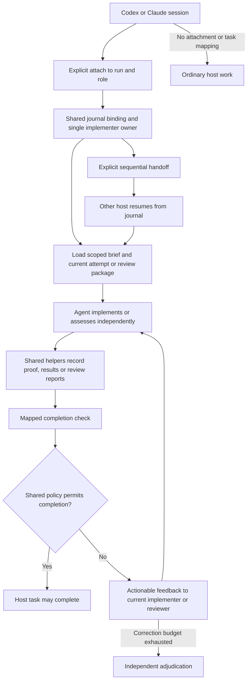

# DevFlow shared Codex and Claude Code design

Status: draft for user review. This document proposes a new increment; none of
its new adapters or hook behaviors should be treated as implemented.

## Intent and agreed decisions

Support Codex and Claude Code from one DevFlow repository, using one skill set,
Python engine, evidence model, journal and documentation. Preserve current
verification, independent review, human authorization and delivery semantics.
Avoid duplicated instructions, repeated context loading and unnecessary tool calls.

The user selected:

1. Enforce only during an explicitly attached DevFlow run. Ordinary host work is
   unaffected.
2. Sequential implementation handoff between hosts. Retain one active
   implementation attempt per run; independent reviewers use separate roles.
3. Return verification failures to the current implementer for rework. Do not
   automatically launch a rework agent.

Assumptions proposed for approval: retain the existing Python 3.11+ macOS/Linux
support; share a local filesystem control root; do not add remote coordination,
a daemon, marketplace publishing or global installation in this increment.

## Current behavior and scope boundary

Existing `skills/` includes ten SKILL.md files, Mermaid process diagrams in the
orchestrator skills and companion GUIDE.md files. The Python helpers under
`skills/workflow/scripts/` already implement dependency-based selection,
single-active attempts, code/IaC/evaluation proof, reviews, acceptance, hardening,
delivery and auxiliary journal records. Root `plugin.json` lists Codex skills.
The journal is protected by a filesystem lock and optimistic state versions.

Skills currently contain Codex-specific reviewer wording. There is no Claude
manifest, host/session attachment, host task mapping or completion hook. Runtime
usage imports accept explicit normalized v1 records; automatic raw transcript
collection is not implemented. Repository instructions currently live in AGENTS.md.

This increment adds host packaging, explicit session bindings, resume/handoff,
Claude hooks, shared completion policy and documentation. It does not close the
separate semantic spec-gap discovery/interview workflow, introduce concurrent
implementation attempts, or add a dedicated red-team findings dispatcher.

## Alternatives and selected approach

| Approach | Benefits | Costs |
| --- | --- | --- |
| Shared source and thin host adapters, recommended | One behavioral implementation; preserves existing paths; small host-specific surface | Adapter contracts and compatibility checks needed |
| Generate complete host packages | Can tailor every skill to each host | Build pipeline and generated documentation drift risk |
| Maintain separate host skill trees | Maximum independent host customization | Duplicated procedures, examples and fixes |

Use shared source and thin adapters. Hook behavior belongs to the Claude adapter;
common skills explain the workflow using host-neutral language. The shared Python
engine defines completion and evidence eligibility, so hooks do not become a
second implementation of workflow rules.

## Package layout

```text
devflow/
  plugin.json                       # existing Codex entry
  .claude-plugin/plugin.json        # Claude metadata; discovers shared skills/
  AGENTS.md                         # shared maintenance rules, Codex entry
  CLAUDE.md                         # imports/references those maintenance rules
  skills/                           # one copy of all skills and GUIDE.md files
    workflow/scripts/
      run.py                        # existing CLI, extended host commands
      commands/host.py
      workflow_lib/hosts.py         # binding transitions and shared policy
  adapters/
    claude-code/
      hooks.json                    # Claude plugin hook configuration
      hook.py                       # stdin/output translation, no domain rules
    codex/
      GUIDE.md                      # attach, resume and explicit completion checks
  docs/
    hosts.md                        # capability matrix and host-specific setup
    examples/                       # host attachment and hook payload examples
  tests/                            # shared contracts plus host adapter fixtures
```

Keep the root Codex manifest and current skill/helper paths compatible. The Claude
manifest references its hook configuration and the default shared skills directory.
Do not duplicate shared SKILL.md files or insert Claude-only hooks/frontmatter
into them. Claude plugin paths resolve from its installed plugin root. Codex
instructions resolve from the loaded skill directory as they do today.

CLAUDE.md is for maintaining this source repository; it is not assumed to load
when this repository is installed as a plugin in someone else's project.

## Attachment, ownership and handoff

Attachment is explicit and uses a selected control root, run ID, host, session ID,
actor ID and role. Roles are implementer, item reviewer, branch reviewer and
acceptance reviewer. Item-level attachment also identifies its work item; reviewer
attachment identifies the review package being assessed. Session/actor IDs are
provenance records, not authentication or proof of a real independent invocation.

New host CLI operations: `host attach`, `host status`, `host detach`,
`host handoff`, `host task-bind` and `host check`. All mutations require explicit
operation IDs and support expected-version checks. Exact retry returns the same
committed result; conflicting reuse cannot change binding or ownership.

Bindings are journaled, with a revision ID and active/detached/transferred state.
A per-project locator under `.devflow/hosts/<host>/<hash-of-session-id>.json`
contains only the absolute control-root location and binding ID. It is a
rebuildable discovery cache, not authoritative state. Use atomic replacement,
reject mismatching sessions and validate the referenced journal binding on reads.
Runtime locator files are ignored by Git and never placed in installed plugin
cache directories. Installation or ordinary skill loading does not attach a run.

The attach command receives the project directory explicitly and verifies that
it matches a registered run repository. Claude hooks use their actual session ID
and project directory to find a locator; the Codex agent supplies its session ID
through the explicit host CLI. Hook payload IDs are never taken from model text.

One active implementer binding owns a run. Reviewers may attach concurrently to
independent packages; they cannot take implementation ownership. Two sessions
cannot acquire implementer ownership through concurrent attach requests.

Handoff atomically transfers the implementer binding from source session to a
specified target host/session/actor, invalidates the source binding and preserves
the existing run/attempt token. The destination recreates its locator from the
committed transfer using `host attach`; locator updates cannot grant ownership.
If no target session ID exists yet, the user can explicitly detach the old session
and then attach the new one. A crashed owner is replaced only by an explicit
handoff/detach naming the prior binding revision; no clock-based auto takeover.

Track every implementing actor across handoffs. Independent reviewers cannot be
any actor that implemented the reviewed work, regardless of host or later ownership
changes. Existing runs seed this set from their recorded implementer. No state
schema replacement or destructive journal migration is required.

After transfer, old sessions must refresh before any new workflow mutation. Shared
mutation preflight must reject an explicitly supplied stale host binding. Existing
unattached trusted CLI clients retain current behavior; host ownership is local
coordination, not a security boundary around arbitrary shell or filesystem access.

## Task mapping and completion policy

Claude task IDs are not DevFlow work-item IDs. `host task-bind` explicitly maps a
host task to a binding revision, run, work item/role or delivery scope, and expected
attempt token/package hash where applicable. Never infer mapping from a task title.
Unmapped tasks in an attached session remain outside completion enforcement;
attachment/resume feedback explicitly identifies mapped and unmapped tasks.

`host check` evaluates authoritative state and returns a structured decision:
allow, block or inactive, reason code, compact blockers, references, current stage
and binding revision. Checks are read-only. There is no test execution, state
transition, approval recording or worker dispatch as a side effect.

| Mapped completion scope | Required state |
| --- | --- |
| Implementation item | Committed item completion, no active attempt for that item, latest appropriate final proof fresh against its registered repository |
| Item reviewer | A report by the mapped independent actor/invocation, bound to the mapped fresh item package |
| Branch reviewer | Corresponding fresh independent branch report |
| Acceptance reviewer | Corresponding fresh independent acceptance review report |
| Delivery | Actual terminal delivery record bound to accepted requirements, required gates and exact authorized manifest |

A review task can finish after recording pass, request-changes or block. Finishing
its assessment does not imply that the review gate passed. Acceptance reporting
and requirement acceptance remain separate operations; a completed reviewer task
must not imply all requirements are MET. Required hardening gates belong to
delivery eligibility, not every individual implementation task.

Missing or stale evidence blocks mapped completion. Current-repository freshness
checks may consult Git at the check boundary; historical event materialization
remains deterministic and never consults live repositories or runs tools.

## Claude hooks and context loading

Use plugin-level command hooks, inert unless a valid binding is explicitly active.
The adapter reads a JSON hook payload from stdin, validates fields and size,
resolves the binding, calls shared policy and emits only the documented response
for that event. Construct subprocess argv without shell interpolation of payloads.

- SessionStart: on a previously attached session resume, return compact run state
  and binding information. A new unattached session creates no journal/root files.
- UserPromptSubmit: after attachment or a changed relevant brief fingerprint,
  supply scoped context for the mapped item or role. Emit no duplicate full brief
  when relevant state/content is unchanged.
- TaskCompleted: check only an explicitly mapped task. Allow satisfied assessments
  and item completions; block failed/missing prerequisites with actionable feedback.
  Do not issue attempts, run tests, or mark DevFlow work complete from this hook.
- Stop: never require the entire run to be delivered before a response can end.
  Permit pauses, questions and human-input waits. Emit no blocking continuation loop.

Use the latest hook invocation's session/task identity and reread authoritative
state for every completion check. Compact context may be cached by binding,
brief/content fingerprint and byte budget; eligibility decisions are not cached.
Unrelated journal events should not force full brief reinjection.

Feedback names failing/missing evidence, item, relevant stage and next supported
operation. The current implementer performs diagnosis, fixes and reruns. Existing
review correction budgets/adjudication apply; do not introduce endless hook-driven
retries or auto-start a new rework worker. E2E/red-team tests participate when
configured as supported targets or hardening gates, with existing semantics.

## Codex behavior and parity

Codex uses shared attach/status/handoff/check commands and host-neutral skills.
Before reporting a mapped item or review task complete, its agent explicitly runs
`host check`. Do not claim automatic event enforcement in Codex unless a supported
runtime hook surface is independently verified and implemented later.

Thus evidence and completion decisions are equivalent across hosts, while
invocation mechanics differ. Both preserve explicit approval for specification,
IaC apply, test changes, issue writes and delivery. Host attachment grants none of
those approvals. Skill loading does not mutate project state or enable gates.

## Error handling and overhead

No locator: inactive, no effects and no injected context. A stale locator resolving
a journaled detached binding: inactive, report once when useful. An existing locator
whose control root is missing/corrupt or binding identity mismatches: return a clear
configuration error; for a mapped task, fail closed rather than fabricate success.
Malformed hook payload: bounded diagnostic, no execution based on malformed fields.

An attached but unmapped task remains unaffected and is visibly reported as
unmapped. Corruption must never be silently converted into detached/inactive
success. Recovery is an explicit locator repair or authoritative detach/handoff.

Set a bounded hook timeout, cap feedback/brief bytes and preserve mandatory brief
criteria. On required-content overflow, provide references and an explicit overflow
message instead of truncating criteria. Fast checks have no external provider calls
and no test reruns. Do not add a daemon or persistent polling process.

Raw Claude runtime usage parsing is deferred. Record host/session provenance so
explicit normalized usage imports can be attributed now and a versioned raw
adapter can be added later. Missing actual usage stays unavailable. Measure helper
bytes/duration and context reinjection counts without claiming token savings from
those measurements alone.

## Process diagram



## Requirements and acceptance criteria

- R1: Shared packaging — Codex manifest remains valid; Claude validates its manifest
  and discovers all ten shared skills from a relocated plugin directory.
- R2: Shared instructions — no duplicated skill tree; core skills/guides use
  agent-neutral roles and link explicit host setup and capability differences.
- R3: Opt-in attachment — loading/installing the plugin or using an unrelated task
  causes no journal mutation, control-root creation or completion block.
- R4: Durable ownership — concurrent implementer attachment admits one owner;
  exact retries are idempotent and changed requests conflict without mutation.
- R5: Sequential handoff — source binding invalidates, target resumes same attempt
  from a fresh process, and stale source binding cannot mutate through host preflight.
- R6: Independent actors — any actor in the implementation history is rejected as
  an independent reviewer even after a cross-host handoff.
- R7: Explicit task mapping — no title-derived association; mapped/unmapped tasks
  receive their documented behavior, including two projects/roots and multiple runs.
- R8: Shared completion policy — failed, missing or stale final evidence blocks
  implementation completion in both hosts; a completed assessment can request
  changes without falsely passing review, acceptance or delivery.
- R9: Claude protocol — plugin hook fixtures cover active/inactive bindings,
  SessionStart, UserPromptSubmit and TaskCompleted, correct event responses and
  malformed input. A real local Claude smoke verifies discovery and hook execution.
- R10: Safe stopping — a waiting/paused/incomplete run can end a response without
  an automatic continuation or false terminal delivery record.
- R11: Scoped context — unchanged relevant content is not reinjected; changed
  attempt, package, context or ownership refreshes the brief. Required content
  overflow is explicit. Completion decisions always reread current state.
- R12: Recovery — interrupted journal/cache updates recover from committed binding
  state; relocation, detached locators and corrupt roots produce the specified
  inactive/error decisions, never fabricated completion.
- R13: No hidden execution — completion/context hooks do not run test suites,
  invoke providers, launch rework agents or grant external-action authorization.
- R14: Compatibility — existing journal fixtures/CLI workflows pass without
  destructive migration; historical delivery replay remains free of live Git reads.
- R15: Documentation — every affected SKILL.md, GUIDE.md, diagram, shared reference
  and example is updated with actual host behavior and limitations. AGENTS.md and
  CLAUDE.md share the documentation maintenance policy.
- R16: Usage honesty — host provenance supports normalized imports; unsupported
  raw collection and unavailable costs remain explicitly unavailable.

## Validation and delivery

Use reducer/command tests for binding conflicts, CAS races, task scopes, actor
history, proof freshness and crash recovery. Protocol fixtures check Claude JSON
input/output separately from policy. Exercise installed/relocated paths, project
paths containing spaces and read-only plugin caches. Existing full tests and all
skill metadata/link/example checks must pass.

Test a real local Claude session with a disposable repository: attach, map task,
fail verification, observe completion block, record real GREEN/result, observe
completion allow, and pause without forced continuation. Reproduce the same policy
through Codex commands. Do not fabricate independent review records in live tests.
If required host tooling is unavailable, report the live criterion CANNOT VERIFY
and do not claim full host readiness from protocol fixtures alone.

Implementation requires approval of this written spec, then a separate ordered
implementation plan and selected execution method. No implementation, installation,
merge, push or publishing is authorized merely by this brainstorming artifact.

## Sources and related documentation

Claude host contracts were checked against official documentation during design:
[plugin layout and manifests](https://code.claude.com/docs/en/plugins-reference),
[skills and dynamic context](https://code.claude.com/docs/en/skills), and
[hook protocol and TaskCompleted](https://code.claude.com/docs/en/hooks).
Plugin-level adapters avoid coupling shared frontmatter to host extensions.

Existing source: [original design](2026-10-06-devflow-design.md),
[skill guides](../../skills.md), [journal integration](../../journal-integration.md),
[run attempts](../../../skills/workflow/scripts/workflow_lib/runs.py),
[review records](../../../skills/workflow/scripts/workflow_lib/reviews.py).
