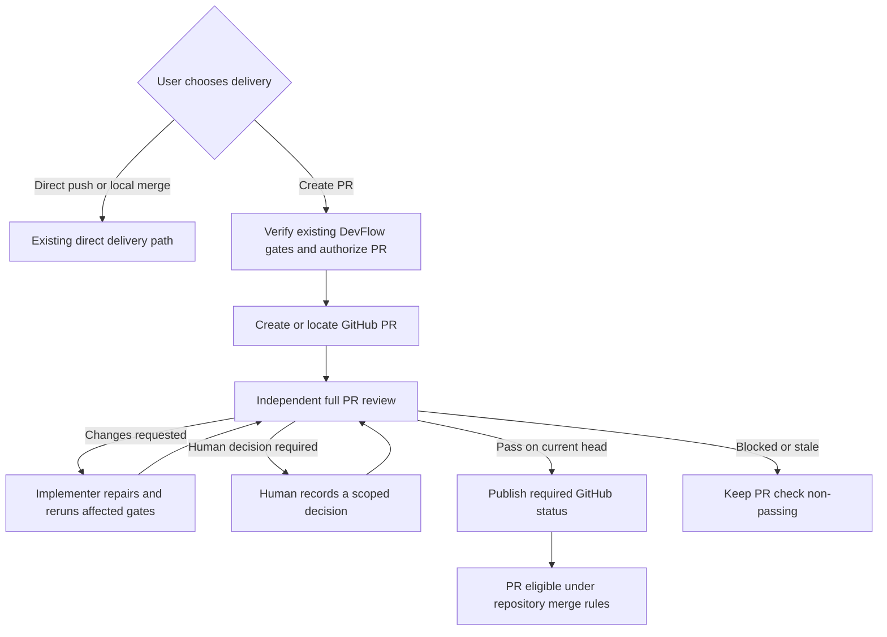

# DevFlow PR review agent design

> Historical design or implementation record. Status, checkboxes, paths and
> validation results describe the original work and may have been superseded.
> Use the [current setup guide](../../setup-and-usage.md) and
> [documentation index](../../README.md) for supported behavior.

Status: approved for implementation by the request to start the build with Autowork.

## Acceptance requirements

- **R1:** Only an explicit create-PR choice invokes the PR agent; direct delivery paths remain available.
- **R2:** Setup configures and verifies a GitHub required `devflow/pr-review` status and named trusted direct-push bypass actors without altering unrelated rules.
- **R3:** PR creation leaves delivery pending until a current, independent full-diff review and required status publication succeed.
- **R4:** The review package covers every changed file and current specs, rules, tests, CI, discussion, and mergeability; missing or stale evidence cannot pass.
- **R5:** Changes requested receive bounded implementer repair and fresh verification; human-required decisions block until a recorded human choice; unrecoverable conditions fail closed.
- **R6:** GitHub receives a concise report, actionable inline findings, and a head-bound required status without duplicate writes on retry.
- **R7:** Skills, diagrams, guides, examples, and automated and live verification describe and exercise the implemented behavior and limits.

## Purpose and scope

A DevFlow build can produce too much code for a practical line-by-line human PR review. When a user chooses the pull-request delivery path, DevFlow should assign a fresh, independent agent to review the complete hosted PR, give the team a concise decision, and send only unresolved judgment calls to a person. A passing agent review should make the PR eligible to merge once its other required checks pass.

The PR agent is invoked only after the user explicitly asks DevFlow to create a PR. Direct push, local merge, and retained-branch delivery remain available choices and do not invoke it. This design targets GitHub for its first release. It extends the existing item, branch, and acceptance reviews; it does not replace their evidence or gates.

## Chosen approach and alternatives

The first release uses the installed Codex or Claude host to run a separate local PR-reviewer invocation. DevFlow stores the review against the hosted PR and publishes a GitHub commit status that the repository ruleset requires. This reuses the current CLI workflow and avoids a hosted service. A later release could use a GitHub App to give the status a stronger source identity and automate review when PRs change outside DevFlow.

A GitHub Actions reviewer would run automatically on PR events, but would require model credentials in CI and a reliable transfer of DevFlow's local evidence. A hosted GitHub App could own check runs and webhooks, but adds hosting, installation, and operations. Neither is part of this increment.

GitHub's required-check rule applies to a target branch, not only to DevFlow-created PRs. Setup will therefore configure named trusted actors with ruleset bypass permission to preserve the user's direct-push option. This is a broad GitHub bypass: those actors can also bypass the PR check in GitHub. DevFlow itself must still refuse to advance its PR path without a passing PR review. The UI and setup documentation must state that limitation plainly.

## Components and state

1. **Repository setup** discovers the GitHub repository and target branch, checks administrative permission, creates or reconciles a DevFlow-owned ruleset entry requiring the `devflow/pr-review` status, and configures only the user-selected bypass actors. It verifies the resulting rule and bypass list. It must preserve unrelated repository rules. If permissions are missing or verification fails, PR mode remains unavailable; setup reports the specific required human action. No ruleset change occurs silently during ordinary delivery.
2. **PR coordinator** starts only after the existing DevFlow verification, branch review, acceptance, and delivery preflight pass and the user authorizes PR creation. It creates or identifies the hosted GitHub PR, verifies the expected repository, target branch, and exact head SHA, and records its provider ID and URL. PR creation is a provider write and uses the existing authorization boundary. The PR outcome remains pending until review and status publication succeed; the current terminal-at-PR-creation delivery behavior must change for this path. The passing PR gate completes PR delivery, while actual merging remains a separate user or repository action.
3. **PR review package** contains the complete PR diff and commit list, PR title/body, changed paths, relevant approved specification and governing rule revisions, work-item criteria, test and prior review evidence, GitHub CI/check conclusions other than DevFlow's own PR-review status, discussion, mergeability information, and earlier PR findings. It binds repository ID, PR ID, base branch and observed base SHA, head SHA, DevFlow run ID, and a content hash. The package identifies unavailable or incomplete evidence rather than treating it as a pass.
4. **Independent reviewer** uses a new PR role and a distinct invocation and actor ID. It cannot be an implementer or any earlier reviewer for that run. It inspects the full PR against correctness, security, business rules, compatibility, design and test requirements, and the existing evidence. The earlier reviews inform it but do not substitute for its own full-diff assessment. For a large PR, the reviewer may divide the diff into bounded file or subsystem batches, but its final report must enumerate every changed file and mark it reviewed; incomplete coverage blocks a pass. It avoids comments already resolved by formatting and lint checks.
5. **GitHub reporter** publishes one concise review summary and actionable inline findings, then updates the `devflow/pr-review` commit status for the exact head SHA. The report records its GitHub URLs and provider response. A status is successful only when the current package has a passing verdict and all human decisions are resolved. Until then it is pending or failing. Provider write failures leave DevFlow's PR gate closed and require reconciliation before retrying.

The PR record and review evidence live in DevFlow's authoritative journal. A GitHub summary makes the decision visible to repository collaborators without requiring them to read that journal. Published comments and statuses are outputs, not the source of truth for DevFlow's content-bound gate.

## Review outcomes and repair

The reviewer returns one of four outcomes:

- **Pass:** no blocking findings or unresolved human decisions. DevFlow may publish success for the reviewed head after confirming that the PR and required CI evidence are still current.
- **Changes requested:** specific actionable findings with severity, path and line or PR-level location, reason, and an acceptance condition. DevFlow sends them to the implementer, reruns affected verification and existing review gates after changes, and performs a fresh full PR review on the new head.
- **Human decision required:** a bounded question that code and tests cannot settle, with options, consequence of each, evidence, and a named decision owner. The status remains non-passing until an authorized human records a choice and rationale in DevFlow. Acceptance of a risk does not waive failing tests or stale evidence; DevFlow rechecks before publishing success.
- **Blocked:** missing review prerequisites, an unreviewable or unsafe change, failed required CI, unavailable reviewer, or a provider state that cannot be reconciled. The report identifies the blocker and next action. No success status is published.

Every PR-head change invalidates the prior PR verdict. DevFlow also rechecks the target branch, relevant governing document revisions, CI conclusions, and PR metadata before it records a verdict or publishes success; material changes require a new package. A check on an older commit never satisfies the new head. Setup requires the PR branch to be up to date with its target before merge so a moving base cannot silently reuse an old successful check; a base update calls for a fresh review after the branch is updated. The first release does not run an always-on webhook service: an external PR update leaves the new head without a DevFlow success status until the user resumes DevFlow's PR review. Setup and troubleshooting documentation must explain that rerun.

Automated repair is bounded and journaled. The PR agent never edits code; the current implementer owns repairs. After a configurable small number of unsuccessful PR-review correction rounds, DevFlow stops automatic dispatch and asks for human direction or independent adjudication. It never turns repeated failures into a pass. The plan must choose and test a concrete default limit before implementation.

## Human review boundary

The human is asked to decide only issues the reviewer cannot responsibly settle, such as a business-rule interpretation, intended product behavior, a material security or privacy tradeoff, or an explicit risk waiver. Each request names the decision, alternatives, affected requirement or file, impact if wrong, and the reviewer recommendation. The human can accept with rationale, request changes, or reject delivery. A generic approval of the whole generated diff is not required for a clean PR; GitHub's existing repository policies may impose additional human review independently.

Human decisions bind to the PR package hash and exact head. A changed head or relevant requirement can invalidate them and require renewed review. DevFlow records the actor and rationale and checks that the decision actor is distinct from the PR reviewer. A human choice cannot forge a PR-agent pass verdict.

## Failure and recovery

Setup fails closed when the GitHub remote cannot be identified, the user lacks ruleset authority, bypass identities are unresolved, the required status cannot be configured, or verification disagrees with requested policy. It leaves existing unrelated rules intact and reports whether a partial write needs reconciliation.

PR review fails closed when GitHub is unreachable, the PR head or base changes during review, CI evidence is incomplete, the reviewer is unavailable, or publishing the status or comments has an uncertain result. Retrying must read the current GitHub state and use idempotent provider references to avoid duplicate PRs or repeated comment floods. A recorded passing verdict without confirmed GitHub success is not a completed PR gate. Direct delivery remains a separate explicit choice and is never silently substituted for failed PR delivery.

## Verification and documentation

Unit tests should cover role independence, package hashes and stale inputs, verdict validation, human-decision binding, correction limits, and gate behavior. Provider-adapter tests should cover idempotent PR/status/comment writes and uncertainty reconciliation. A temporary GitHub repository should exercise setup and ruleset verification, a passing PR, failed CI, head updates, human escalation, and the trusted direct-push bypass. Live tests must distinguish observed GitHub behavior from mocks and fixtures.

Implementation must update the PR/review skills, their guides and workflow Mermaid diagram, host role and command references, `docs/setup-and-usage.md`, `docs/skills.md` if the skill inventory changes, and relevant examples. The setup guide must explain first-use GitHub permissions, bypass scope, manual rerun after external PR updates, and recovery. Until this design is implemented, current documentation continues to describe the existing pre-PR branch and acceptance reviews and provider-reported PR delivery.
