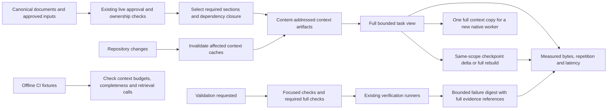

# Context efficiency and guided onboarding

Status: approved by the user on 2026-10-19 after commit `0ded5ff`. The user requested
Autowork implementation of all discussed context/documentation optimizations and
the approved quick start.
Baseline: `3e924c5` (v0.3.9). Preserve the existing main-checkout `AGENTS.md` edit.

## Outcome and scope

New users start guided setup from one short page. Agents receive complete,
bounded context for their task, with less duplicate material and measurable
retrieval behavior. Authoritative documents and historical evidence remain on
disk. Existing verification, approval, ownership and delivery gates remain intact.

This specification covers the context and documentation optimizations. The earlier
business-rule/category, contract-validator and selective-invalidation redesign is
a separate scope choice; it is not silently bundled into this implementation.
Existing governing rules and application contracts are supported as context inputs.

## Approach

Extend the existing local, deterministic helpers and existing native-host paths.
Documentation-only restructuring would leave runtime duplication and checkpoint
gaps. A new search service or model-generated summaries would introduce extra
dependencies and uncertainty without being necessary for this scope.



## Requirements

## R1: Quick start

Add `docs/quick-start.md`, at most 350 words and 4,096 UTF-8
bytes. Include marketplace registration plus plugin installation for Codex/Claude,
opening an existing Git repository or asking the harness to create a local one,
and a copyable “Start DevFlow in this repository…” prompt. Include the existing
OS, interpreter, Git and marketplace-access prerequisites concisely. State that
the harness guides setup, asks needed questions and explains next steps; users
need not understand skill names, control roots, manifests or helper commands.
GitHub hosting is optional. Lead README and documentation navigation with this
page; `docs/setup-and-usage.md` remains the authoritative detailed guide.

## R2: Small entry points and canonical ownership

Each shipped `SKILL.md` must
be at most 4,096 bytes, and their aggregate at most 32,768 bytes. Keep triggers,
stage responsibilities, mandatory stop conditions and explicit read routing.
Keep common mandatory invariants in one canonical reference of at most 4,096
bytes; organize detailed procedures by domain using existing canonical guides
where suitable. Each independently loaded domain section is at most 12,288
bytes. Preserve public document paths and referenced anchors through short
compatibility entries when content moves. Update affected guides and diagrams.

## R3: Generated navigation and budgets

Add a versioned
`definitions/documentation.json` describing canonical source IDs, section selectors,
stage read requirements, dependencies, history classification and byte budgets.
Generate repeated skill/load navigation and a size/duplication report from this
source; never generate several authoritative copies of normative prose. A
dependency-free maintainer checker verifies generation drift, references and
budgets. Initial skill/common/stage documentation loads must fit 20,000 bytes.
Developer shell setup has one canonical home in `docs/developer-cli.md`.

## R4: Complete task views

Extend run/host briefs through a shared context-view
builder. Include current task requirements and acceptance criteria, applicable
governing constraints, required documentation sections and declared dependencies,
plus fresh authorization, blockers and evidence references. Resolve IDs and
dependencies deterministically, recording selection reasons and source hashes.
Missing required inputs fail explicitly. Absent an approved narrower applicability
model, all applicable governing rules remain required; retrieval selections never
change the governing digest or grant rule irrelevance. Existing full briefs remain
the default; added fields/options are backward compatible.

## R5: Contract and document projections

Support exact Markdown heading
sections and JSON Pointer selections. JSON contract selections include transitive
local and registered repository-relative `$ref` dependencies, with cycle handling
and existing path-containment/visibility restrictions. Unknown, unregistered,
remote or unsupported dependencies cannot produce a falsely complete view.
YAML contracts remain whole-file inputs in this increment; section extraction
from YAML does not ship, and no YAML parser dependency is added. Validate spec JSON and
generated Markdown together in the helper, then emit only the requested model
representation. Referenced sources remain authoritative and independently approved.

## R6: Real load budgets

Measure exact UTF-8 bytes for the documentation and
context actually emitted, including required skill/common sections and envelope
overhead. Default full task-view budget is 20,000 bytes, explicitly overridable.
Optional omissions name what was omitted. Required overflow reports size, source
references and a rescoping action; it never truncates constraints or claims success.
Measure the combined known native configuration/turn payload as well. Bytes/4
may be reported only as an estimate. Hidden host instructions, unrelated tool
reads and conversation history remain outside measured coverage and are disclosed.

## R7: Content reuse

Cache immutable document/view artifacts under the selected
control root by content identities, selectors, dependency closure and builder/policy
versions. Any dependency change invalidates its derived content. Reuse unaffected
content across unrelated changes while producing fresh source/provenance metadata.
Corrupt or missing caches rebuild safely. Cached content never substitutes for
live source/approval/ownership checks or fresh attempt/gate state.

## R8: Checkpoints and recovery

Add explicit full/since-checkpoint options to
read briefs. A delta identifies its exact base and current checkpoint, changed
units, removed IDs and a complete current control-state envelope. Applying a
valid delta to its base must reconstruct the full current document view. Deltas
require the same run, host/session binding revision, stage, role and task scope.
Unattached CLI consumers use full mode unless an explicit consumer identity is
supplied. Unknown/corrupt checkpoints, identity mismatches, compaction, session start and
handoff rebuild a full view with a reason. New native workers always receive full
context. Checkpoints are advisory caches and cannot advance workflow gates.

## R9: Eliminate duplicate native context

Codex currently receives the same
brief in developer instructions and its turn prompt. Supply the shared full view
exactly once while preserving task instructions, actor identity and native model
observation checks. Claude receives the equivalent full view once. Preserve
existing launch deduplication, leases, interruption handling and output artifacts.

## R10: Active discovery

Routine documentation discovery and broad source
indexing omit declared historical designs, plans, release notes and old audits by
default, reporting excluded scope. Explicit history requests remain supported.
Required governing inputs and declared task dependencies are always included,
even when their paths are classified historical. Record the selection policy in
index/cache fingerprints; legacy receipts remain replayable without reinterpretation.

## R11: Compact output modes

Add explicit reference/projection modes to large
read operations, including source indexes and context views. Return compact
metadata, decision/failure information, counts and content-addressed artifact
references; provide explicit inspection to retrieve complete material. Preserve
existing default output compatibility where callers depend on full content.
Never hide mandatory blockers, approvals or verification failures behind a summary.

## R12: Honest workflow metrics

Extend best-effort telemetry and add a context
statistics projection for document bytes emitted, repeated content bytes, helper
calls, latency, cache outcomes and full/delta counts, with run/task/invocation
attribution when available. Include relevant host/native operations. Repeated
operation IDs do not double count. Keep document bodies out of telemetry.
Use existing explicit runtime usage/pricing evidence for actual usage or cost;
otherwise report unavailable. Byte reduction is not measured token or cost savings.
Report supplied-required-ID coverage and fixture omissions separately from unknown
semantic omissions; do not infer correctness from smaller output.

## R13: Requirement headings and descriptions

For newly generated specifications, render a short requirement heading followed
by its description as ordinary paragraph text, with no renderer-added bold or
heading styling on the description. Use an optional single-line requirement
`title` for the short heading and keep the existing `text` field as the complete
description. Include the stable requirement ID in the heading. If a legacy
requirement has no title, use its ID as the heading rather than promoting the
whole description into it. New authored requirements should have concise titles.

```markdown
## R1: Greeting output

Return a greeting for a supplied name.
```

Preserve acceptance criteria, provenance, assumptions, citations and diagrams.
Adding a title changes specification content and follows ordinary reapproval.
Existing approved JSON/Markdown pairs in the prior deterministic layout must
remain readable and valid against their exact recorded hashes until explicitly
rewritten. Storing a reformatted pair must record its new Markdown hash and
require normal approval; compatibility must never accept arbitrary Markdown.
Update specify instructions, its companion guide/diagram and the greeting
example. Tests cover titled requirements, the ID-only fallback, plain description
formatting, title validation, old approved-pair compatibility, and reapproval
after rewriting the rendered pair.

## R14: Shared Python lifecycle hooks

Implement portable Python hook functions at existing helper boundaries, shared
by the Codex and Claude adapters. Cover pre-invocation context preparation,
repository-change invalidation, validation planning, verifier-result digests and
offline CI regression checks. Reuse R4–R12 for context preparation and recovery;
avoid a second implementation of their policies. No additional native host event
API is required, and installation does not modify user Git hooks or configuration.

Each interactive hook has an explicit deadline and output budget, defaulting to
five seconds and 8,192 UTF-8 bytes, with overrides recorded in its result.
Report status, reason, elapsed time, output size, source/configuration hashes and
artifact references. Missing inputs, deadline expiry or overflow produce an
explicit diagnostic. A required context/preflight failure stops that operation;
advisory formatting or telemetry failure preserves the original verification
outcome and exposes the gap. Hooks never grant approval, replace proof, launch
model/provider work, install dependencies or advance workflow gates. A diagnostic
cannot turn an unknown or failed check into a passing result.

## R15: Verification failure digests

After an existing verification runner produces a result, build a deterministic,
bounded digest with the original status, failed/error/skipped counts, affected
test or finding IDs, relevant error excerpts and references to complete reports
and logs. Group identical failures only while retaining their individual IDs and
counts in the referenced evidence. Preserve original exit codes, raw evidence,
attempt identity and content hashes; the digest is a navigation aid, not proof.

Process large logs within bounded read/time limits. If details exceed the output
budget, retain the failure status and totals, identify omitted detail explicitly,
and reference the complete artifact. Malformed or incomplete reports retain their
unavailable/error result rather than implying no failures. Tests cover real
structured test results, repeated failures, Unicode, oversized logs and digest
failure without any change to the underlying verifier verdict.

## R16: Dependency-based cache invalidation

After observing repository changes, compare declared source and configuration
identities and invalidate affected derived context artifacts through the reverse
dependency graph. Handle edits, deletions, renames and dependency/selector changes;
report affected IDs and reasons. Unchanged unrelated content remains reusable.
Unknown dependencies or an incomplete graph trigger conservative invalidation of
the affected scope instead of speculative reuse. Live preflights remain required.

This hook invalidates retrieval caches only. It cannot clear governing-input
reassessment, refresh old proof or selectively reuse verification evidence across
changed inputs. Test direct/transitive changes, unknown scope, stale graph data,
unchanged bytes, and source drift after warming the cache.

## R17: Focused validation planning

Before running validation, produce a plan from explicit project-owned mappings
between changed paths/components and configured checks. Identify focused checks
for fast feedback and the complete checks still required before workflow
advancement. Include selection reasons and configuration/source hashes. Missing
or uncertain mappings fall back to the configured full required set; missing
check configuration remains unavailable rather than generating guessed commands.

The hook plans existing authorized runners and does not execute additional
commands or grant external-action authorization. A focused pass never satisfies
an outstanding full-suite or configured gate requirement. Existing attempt,
repository, report and freshness checks still determine valid proof. Test known,
overlapping and unmapped changes, stale configuration and preservation of the
complete required-check set.

## R18: CI context-regression checks

Run deterministic, offline fixtures in the existing Python CI suite. Compare
declared context-byte and retrieval-call budgets, duplicate-content counts,
required rule/requirement IDs, dependency completeness and full/delta
reconstruction. Include cold-cache, warm-cache, dependency-change and
compaction/handoff scenarios. Missing required facts fail even if payloads shrink.
Unexpected budget or call-count growth requires an explicit reviewed baseline or
policy change rather than automatic regeneration that conceals the regression.

Record latency for comparison without brittle fixed-time assertions on shared CI
runners. Reuse R3's documentation checker and R12's measurements. Fixtures must
not call providers, create paid model sessions or claim that byte/call reductions
establish actual token savings, costs or semantic correctness.

## Compatibility and verification

No new daemon, service or required Python packages. Preserve existing journal
hashes, replay, legacy specs, helper commands and registered source formats.
Additive context metadata must not rewrite historical approvals. The new read
paths use the same preflights as their existing equivalents. Implementation does
not authorize provider work, publishing, merging, pushing or a new release.

Tests cover complete constraints, dependency closure, changed dependency bytes,
safe path handling, same-content reuse, corrupt caches, reconstruction/removals,
full compaction/handoff recovery, exact budgets/Unicode, mandatory overflow,
source drift with warm caches, one-copy native payloads, history exceptions,
reference inspection and honest telemetry/unknown costs. Run required documentation
checks, hook deadline/output/failure tests and the complete existing suite. Verify
that failure digests preserve verifier results, invalidation never clears gates,
validation plans retain all required checks, and CI catches missing required facts
as well as size/call regressions. Compare a fixed representative fixture
before/after using identical required facts; require at least a 50% reduction in
aggregate skill entry bytes and a strictly smaller valid same-scope delta. Record
call/byte/latency results without presenting them as provider-token savings.
