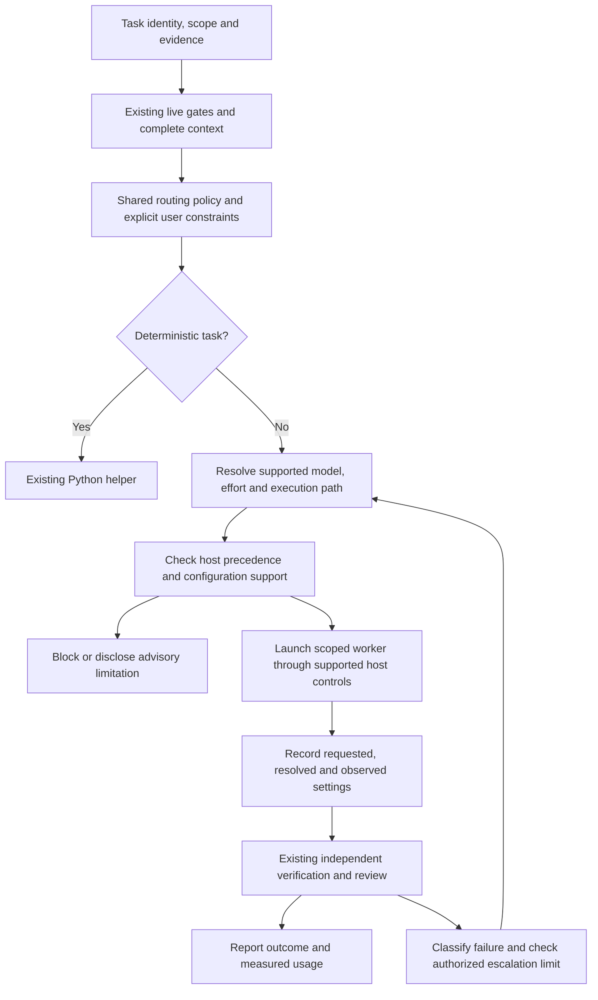

# Task-based model and effort routing for Claude and Codex

Status: approved by the user after commit `ff09e6c`; implementation planning is
authorized. Implementation awaits review of the written plan.
Baseline: `d673deb` on `main`. Preserve the existing user edit to `AGENTS.md`.

## Outcome and scope

DevFlow chooses suitable permitted model and reasoning effort for each delegated
task, explains its choice, and escalates only for a recorded reason within an
authorized limit. Users describe their goals without learning agent names, model
configuration syntax or effort settings. Success means verified task outcomes
with less unnecessary reasoning, context loading and repeated work; savings must
be measured rather than assumed.

This extends existing stage profiles, model preferences, native launchers,
invocation receipts and evaluation machinery. It includes Claude and Codex
interactive delegation where supported, alongside their existing isolated native
worker paths. It does not change the parent conversation's model or effort.

## Approach and alternatives

Use one deterministic policy resolver and host-specific adapters. Skills supply
task facts and required evidence; policy owns routing rules. This keeps the
host-independent intent consistent while respecting different host controls.

Prompt-only advice is simpler but cannot reliably explain precedence or bind
decisions to invocation evidence. Separate host policies permit quick local
changes but duplicate rules and can produce different treatment of the same
task. Neither is the selected approach.

## R1: Canonical routing policy

Extend `definitions/model-policy.json` and its existing resolver rather than
introducing another routing system. Version new policy/receipt shapes explicitly.
Routing is deterministic for identical task facts, preferences, policy and
capability evidence. Return selection reasons and content identities. Preserve
legacy stage-only requests and historical receipt replay without rewriting them.

## R2: Task facts and conservative classification

Accept a versioned task description containing run/item/stage/actor identity,
task kind, scope, complexity, uncertainty, consequence of error, required output,
and references to supporting evidence. Use explicit categorical values with
validation and a policy-defined mapping; descriptions alone are not proof.
Missing classification facts retain the existing stage profile. Uncertain or
contradictory facts cannot justify reducing effort below that profile.
Record whether facts were supplied by the user, plan or harness. A harness
classification cannot override explicit user or governing constraints.

## R3: Initial effort profiles

Retain the current low/medium/high stage defaults as the starting policy. Add
task-specific selection rules using these proposed categories:

| Work | Starting profile | Adjustment constraint |
|---|---|---|
| Targeted discovery, inventories, bounded extraction | Fast analysis | Only when scope and required facts are explicit |
| Bounded implementation from an approved plan | Efficient coding | Raise for material uncertainty or cross-component consequences |
| Requirements, architecture, difficult debugging, security and independent review | Deep reasoning | Do not lower merely because the output is short |
| Deterministic indexing, formatting, calculation and test execution | Existing helper | No model invocation for the deterministic operation |

Profiles express intent; model-specific supported levels determine valid effort
values. The same effort name is not assumed to imply equivalent quality or cost
across models or hosts. Do not ship new validated provider mappings without
representative evaluation. Empty mappings remain recommendations, not automatic
dispatch. Preserve separately authorized advisory selection of unvalidated models.

## R4: Explicit preferences and effective precedence

Existing human pins, stage/host preferences, allowlists, strict/advisory mode and
spending constraints remain binding. Distinguish preferences from hard limits;
task routing and escalation cannot clear either implicitly. Resolve DevFlow
preferences first, then assess the host's actual precedence and report conflicts.
Never silently modify user/global settings or remove an environment override.
Unknown precedence/configuration evidence is an explicit limitation. Strict
dispatch blocks when required settings cannot be established under existing rules.

## R5: Claude controls

Support explicit model and effort on non-fork interactive subagent invocations
where the host exposes the documented controls. Capability-check the host version
and invocation surface; the documented per-invocation effort minimum is v2.1.292.
Agent-default effort is distinct from invocation effort. Detect and report the
higher-priority `CLAUDE_CODE_EFFORT_LEVEL` override and forced subagent model
settings without exposing unrelated environment values. Respect managed/account
model restrictions and model-specific effort support.

Keep the existing isolated Claude launcher. Its CLI controls do not prove that
interactive Agent-tool controls were applied. Treat fork behavior separately;
do not assume non-fork overrides apply to forks. Unsupported interactive routing
returns a clear alternative through the existing authorized isolated path, or
remains unavailable; switching paths is recorded and never increases permissions.

## R6: Codex controls

Support explicit model and reasoning effort for interactive delegated agents
where available, plus the existing app-server worker path. Resolve custom agent
configuration, explicit spawn settings, agent defaults and parent inheritance
according to the installed client's supported precedence. In particular, custom
agent model/effort settings can override spawn selections; detect conflicting
values instead of claiming the requested settings took effect.

Use discovered per-model supported efforts. Selecting a different model requires
an explicit resolved effort valid for that model; do not accidentally carry an
incompatible inherited value. Preserve existing app-server effective-configuration
observation, account-scoped discovery and substitution checks.

## R7: Execution-path capability contract

Represent interactive and isolated-worker capability evidence separately for each
host. Record host version, supported controls, provenance and unknown fields;
invalidate stale capability evidence after relevant host/configuration changes.
An interactive route must use an actually available supported host surface; do
not invent a native event or tool API. Where the enclosing harness does not expose
such a surface, provide a prepared delegation request with an explicit
not-dispatched status. Rendering configuration alone is not execution evidence.
Reuse current leases, binding revision checks and invocation deduplication.

## R8: Requested, resolved and observed receipts

Extend immutable invocation evidence with task/policy identities, execution path,
classification reasons, requested settings, resolved host settings, relevant
override provenance and observed settings with their source. Keep unavailable
observations explicitly unknown. Never accept worker self-report as trusted host
observation. Interactive receipts require the same attribution and freshness
standards as existing native receipts.

Claude effort remaining unobservable must continue to block strict routing; this
increment does not weaken that gate. When a host exposes trustworthy new metadata,
support it through tested parsing and provenance checks. Detect substitutions and
reject them as strict-compliance evidence. Model access, configuration support,
observability and evaluated task suitability remain separate properties.

## R9: Complete bounded worker context

Reuse the existing complete task-view builder, live preflights and context budget.
Supply required requirements, criteria, governing constraints, dependency closure,
task identity and evidence references exactly once in DevFlow-controlled payloads.
Preload only required skill entries; keep shared routing rules in one canonical
reference. Account for additional known agent descriptions, preloaded skills and
configuration text when measuring emitted context. Disclose hidden host context.
Do not omit governing inputs or project instructions simply to lower byte counts.

## R10: Worker boundaries and completion

Preserve actor separation and independent review. Discovery/review workers use
the supported restricted tool surface; implementation workers retain only their
authorized scope. No route grants additional permissions or external-action
authorization. Keep human decisions in the parent harness.
Worker output must identify completed scope, evidence, unresolved facts and
partial/blocked status. Turn/time limits cannot turn partial work into completion.
Do not introduce recursive delegation or unconditional parallel fan-out.

## R11: Bounded escalation

Escalation requires recorded evidence of unresolved reasoning difficulty,
material ambiguity or repeated unsuccessful diagnosis after verification. Missing
inputs, approval, authentication, quota or configuration problems are not reasons
to buy more reasoning. First correct or surface those blockers.

Default automatic allowance is at most one escalation per task lineage, and only
within an explicitly authorized routing policy, permitted models, effort ceiling
and existing budget. Otherwise return a recommendation for human decision.
Select the next eligible policy entry, not an assumed universal effort ladder.
Higher effort and a different model are distinct recorded choices. Stop if no
eligible next entry exists. No retry loop or automatic new credit purchase.

Every escalation creates a new invocation linked to its predecessor and preserves
attempt/proof freshness rules. Resume retains a recorded same-scope choice only
after live checks and host-precedence reconciliation; changed routing inputs or
scope require a new decision. Counters survive resume, handoff and retries.

## R12: Honest evaluation and reporting

Extend existing evaluations and telemetry to compare routing outcomes using
representative discovery, implementation, debugging and review cases. Measure
correctness, missing facts, independent findings, retries, escalation count,
elapsed time, context bytes and attributable runtime usage. Use explicit sourced
pricing for monetary estimates; unknown usage/cost remains unavailable. Do not
infer savings from low effort or fewer bytes. Promotion remains content-bound to
tested host/model/policy evidence under existing validation rules.

Normal regression tests remain offline. Paid/provider evaluations and live
configuration probes require their ordinary explicit authorization; spec approval
alone does not authorize paid runs. Record untested paths honestly.

## R13: Documentation and guided experience

Update affected skills, companion guides, references, Mermaid diagrams, examples,
host/native documentation and `docs/skills.md` in the implementation change.
Review the primary `docs/setup-and-usage.md`; preserve the quick start's minimal
onboarding. Explain routine routing briefly and disclose blockers/escalations when
they require a decision. Users need not know skill or agent names.
Keep developer configuration details in the optional developer reference.
All existing documentation generation, link and byte-budget checks still apply.

## Acceptance and verification

Tests must cover deterministic decisions and stage-only compatibility; missing or
contradictory task facts; explicit pins and hard limits; invalid/model-specific
effort; stale capabilities; Claude version boundaries and environment overrides;
Codex conflicting custom-agent settings and inheritance; unsupported interactive
surfaces; truthful not-dispatched responses; requested/observed mismatch; strict
unknown-effort blocks; complete context and no duplicate injected skill content;
partial output; escalation limits across replay/resume/handoff; and preserved
approval, ownership, independent-review and verification gates.

Use mocked host-boundary integrations for both interactive and isolated paths,
plus the existing full Python suite, documentation checker, runnable examples and
package/install smoke checks. Required missing facts must fail even when context
or reasoning usage shrinks. No environment installation or live model run is
needed to approve this design or run offline regressions.

## Exclusions and approval boundary

No parent-session model changes, provider/account provisioning, global settings
edits, new validated model claims without evaluation, automatic publishing,
business-rule/category redesign or selective reuse of old verification proof.
Existing read-only analysis and deterministic helpers remain available without
introducing new model-selection approval prompts.

This design chooses conservative automation and preserves strict observability.
User approval of the written spec permits implementation planning; it does not
approve implementation, live paid evaluation, merging, pushing or release.

## Sources and current implementation

Documentation checked 2026-10-19; host-specific behavior must be revalidated for
the installed versions during implementation:

- [Claude effort controls](https://code.claude.com/docs/en/sub-agents#choose-an-effort-level)
- [Claude subagent configuration and skill preloading](https://code.claude.com/docs/en/sub-agents)
- [Codex subagents and configuration precedence](https://learn.chatgpt.com/docs/agent-configuration/subagents)
- [Codex configuration reference](https://learn.chatgpt.com/docs/config-file/config-reference)
- Existing [policy](../../../definitions/model-policy.json),
  [resolver](../../../skills/workflow/scripts/workflow_lib/model_policy.py),
  [native adapters](../../../skills/workflow/scripts/workflow_lib/native_models.py),
  [invocation lifecycle](../../../skills/workflow/scripts/workflow_lib/native_runtime.py),
  and [native worker guide](../../native-models.md).
