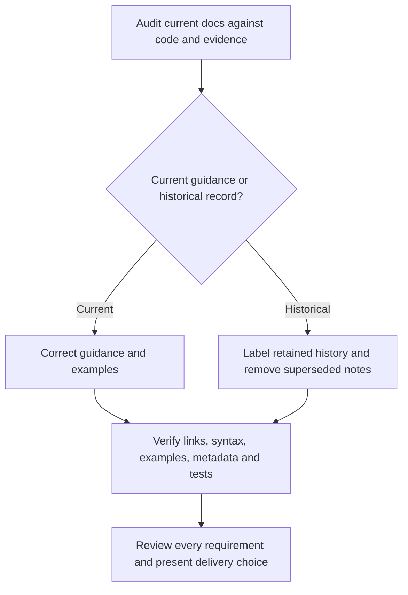

# Documentation refresh design

Approved scope: the user requested a repository-wide documentation audit, reviewed
the reported stale guidance, then instructed: “update all docs and remove any that
are no longer valid.” Implementation baseline: `7020c6a` (DevFlow v0.3.8).

## Requirements

- R1: Current guides describe the implemented eleven-skill, shared Codex/Claude
  package, marketplace, host initialization and guided document setup.
- R2: Installation evidence distinguishes successful isolated installs of earlier
  releases from unverified current-release end-to-end host behavior. Portable
  source and CI results do not imply released native Windows or WSL2 support.
- R3: Delivery guidance uses `pr open`, independent PR review, `pr publish` and
  `pr complete`; direct delivery recording covers retained branches/local merges.
  External actions still require user authorization.
- R4: Examples use consistent feature names and valid current CLI syntax. Local
  links, skill metadata and JSON inputs resolve and runnable examples pass.
- R5: Remove superseded execution notes after retaining relevant evidence in the
  validation report. Clearly label retained historical designs, plans and audits;
  preserve their original findings, release-specific counts and limitations.
- R6: Review `docs/setup-and-usage.md`, all current references, skill instructions,
  companion guides, diagrams, adapters and release notes. Preserve the user's
  existing `AGENTS.md` edit and change no runtime behavior or release version.

## Approach

Correct current references against bundled command parsers, implementation and
recorded evidence. Keep `docs/setup-and-usage.md` as the primary user guide;
shell functions, path variables and Python calls remain optional developer
instructions. Keep historical evidence separate from current support claims.
Implement and validate in an isolated documentation branch.

## Verification

Check all tracked Markdown local links and heading anchors, JSON example syntax,
all eleven skill metadata/guide pairs, documented helper commands against the
actual parser, greeting RED/GREEN behavior and the full unittest suite. Review
the diff for unsupported claims and references to removed files. No live account,
installation, provider, merge or publication actions are part of this change.
