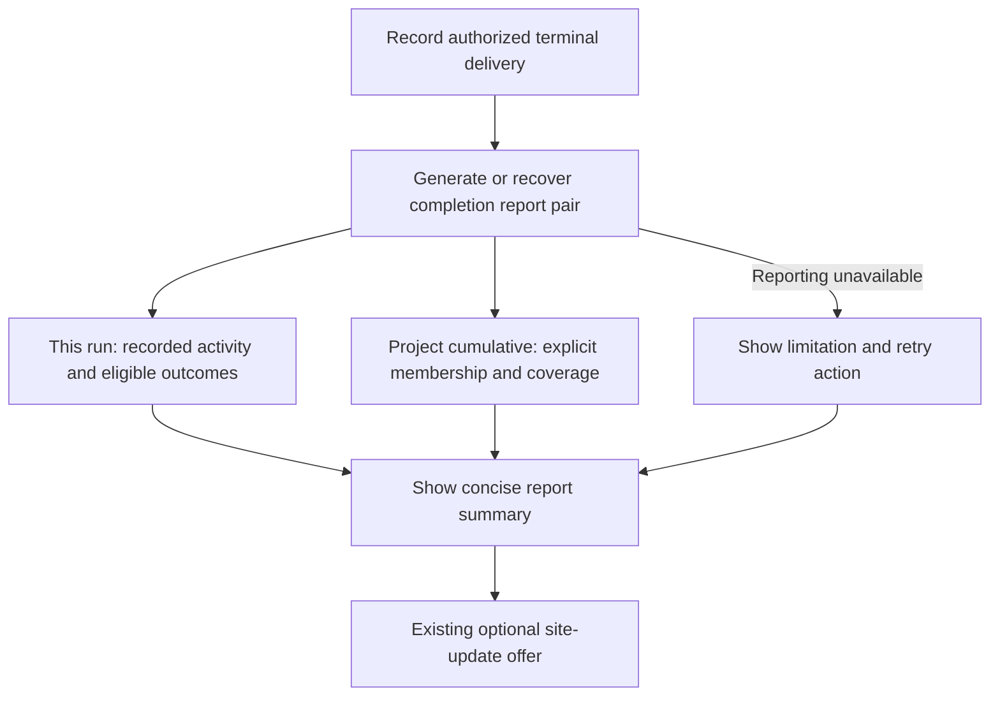

# Automatic end-of-build statistics

Status: approved by the user on 2026-10-20, after commit `351ec4e`.
Implementation follows written-plan review using the preserved Native preference.

## Intended outcome

After a DevFlow build finishes, the harness automatically presents statistics for
the current run and cumulative statistics for its project. Users do not invoke a
skill or helper manually. Reuse existing metrics, usage/pricing, context and
routing reporting rather than introduce another telemetry system.

Approved completion boundary: “end of build” means after recording terminal delivery
(local merge, retained branch or a PR reaching the existing recorded delivery
boundary), including documentation-only work. Finishing one item is not the end
of the run. Blocked or interrupted work remains resumable and is not reported as
a completed build.

## Approach

Use a durable completion-report operation called automatically by the harness
following successful delivery recording. Return both report identities/content
for the final response. Retrying delivery or resuming the harness must retrieve
or finish the same completion report, without duplicate snapshots or counting a
run twice. Keep the existing manual reporting operations available.

A prose-only skill instruction would be simpler but could silently omit the
report or repeat it on resume. Coupling report calculation into delivery's atomic
acceptance checks could make a reporting error prevent valid delivery. The
recommended operation records delivery independently and makes any incomplete
report visible and safely retryable.

## R1: Automatic completion summary

For every recorded completed build, generate and show two clearly labeled
summaries: **This run** and **Project cumulative**. No confirmation or opt-in is
required. Preserve delivery authorization, verification and independent-review
gates. Statistics run before the existing optional site-update offer.

## R2: Exact run and project scope

Bind the current report to its run ID and an unambiguous, durable project identity
from initialized repository/control context. Persist that identity for new runs;
do not trust an arbitrary report label as membership evidence. Preserve stable
membership across relocation, resume and host handoff.

Project totals cover all identifiable runs for that project in the selected
control root, not other projects or installations. Show included run IDs/status
counts and exclusions. Existing runs may join only when their recorded provenance
unambiguously establishes membership. Missing or ambiguous project identity must
produce an explicit unavailable/partial project report; never silently combine
all runs or guess membership from display names. This increment does not discover
other control roots or contact external systems.

## R3: Useful, honest statistics

Reuse available journal-derived run/item/acceptance outcomes, recorded runtime
usage and sourced pricing, measured context statistics, routing retries and
escalations. Show coverage and unavailable fields. Show recorded activity for
all included run statuses; completed-outcome metrics retain their existing
eligibility rules. Clearly identify work still in progress in cumulative totals.

Only attributable usage contributes tokens; only sufficiently covered usage with
an explicitly selected existing price version contributes priced cost. Missing
usage/cost is unavailable, never zero. A priced subtotal must identify excluded
runs and must not be labeled a complete project cost. Do not add ratios, count
overlapping snapshots twice, infer tokens from bytes, sum overlapping durations
as wall time, or claim savings from effort/byte reductions.

No provider invocation, paid probe, automatic pricing fetch, credential access,
or additional user-interaction logging is introduced. Existing privacy and
telemetry opt-in boundaries remain unchanged.

## R4: Durable snapshots and replay

Bind the report pair to the delivered run, its delivery identity, selected project
membership, source state/measurement identities, as-of time and pricing policy.
Use stable operation identity for exact retry. Freeze snapshots; repeated reads
return the same pair. Later imports or repricing may create an explicitly new
snapshot without overwriting prior reports or adding old and new versions of the
same run into project totals. Historical journal replay remains compatible.

## R5: Reporting failures

A report failure cannot undo delivery or turn a failed build into success. Return
an explicit reporting-unavailable/pending status and recovery action; do not
silently skip the report or loop indefinitely. Resume can complete missing
reporting independently of delivery. Where project attribution is unavailable,
show the valid current-run report and the project limitation separately.

## R6: Guided experience and documentation

Keep the final response concise, with run/project values side by side and links
or identities for detailed reports. Update workflow/stats skill entries, relevant
guides and Mermaid diagrams, the primary setup guide, developer reference and
runnable examples. Preserve minimal onboarding and documentation byte budgets.
Describe project-local accumulation and missing-data limitations accurately.

## Acceptance and verification

Offline tests must cover terminal delivery paths, documentation-only runs,
run/project isolation, relocated projects, legacy ambiguous membership, mixed
active/completed runs, missing usage/prices, overlapping snapshots, exact retry,
resume after reporting failure and later explicit refresh. Exercise the actual
command/journal boundary and verify that delivery gates and ordinary manual
reporting retain their behavior. Run documentation/link/byte-budget checks and
the relevant full regression suite. No live provider evaluation is required.
