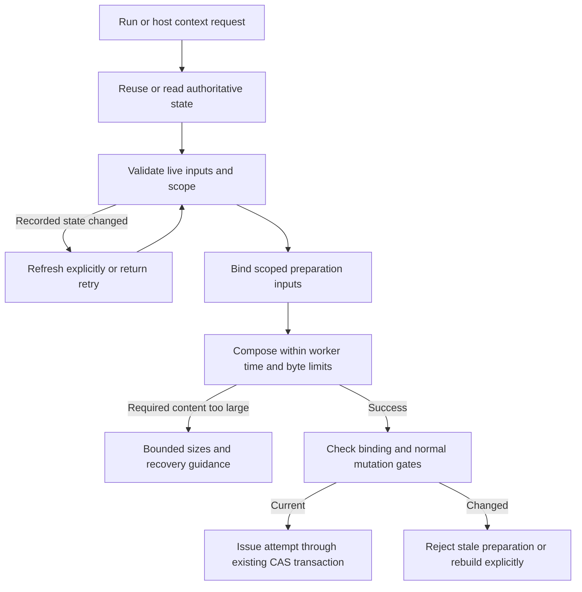

# Context preparation on large control roots

Status: written specification approved by the user on 2026-10-21 after commit
`817dc07`. The implementation plan awaits review; implementation has not started.

Source: [GitHub issue #2](https://github.com/wgentil/devflow/issues/2), reported
against DevFlow 0.3.11. This specification is independent of the completed,
unmerged `feat/project-learning` branch. Do not merge or release either branch as
part of specification or implementation work without delivery authorization.

## Intent

Users must be able to start eligible work on long-lived projects without the
context hook timing out merely because journal history has grown. A selected
item should receive complete applicable context within the requested byte budget,
or a useful explanation when its genuinely mandatory content cannot fit.

Preserve journal integrity, live specification and governing-document checks,
repository ownership, host roles, approval requirements and attempt-token rules.
The harness guides recovery; users should not need to understand internal hooks,
skill names, shell variables or Python helper calls.

## Evidence and uncertainty

The reporter measured approximately 4,370 events, 40 delivered runs, a 76 MB state
projection and a 288 MB control root. One `read_state(root)` took 5.48 seconds;
direct task preparation took 36.6 seconds and then exceeded the 20,000-byte
context budget. These are reporter measurements, not locally reproduced results.

Source inspection at main baseline `5033f91` establishes:

- `store.read_state` reconstructs state by replaying committed journal events;
  `state.json` is not the authoritative read source.
- `lifecycle_hooks.prepared_context` launches required preparation with the
  hook's default five-second deadline. The worker reads the whole state.
- `task_views.prepare_task_view` reads again before and after input preflight.
- `repo_input_gate.require_current_inputs` performs additional unconditional
  reads. `document_approvals.require_current_governing_inputs` also reads at its
  end and may journal receipt/reassessment changes while checking inputs.
- Task composition already selects requirement IDs. Its specification subset
  retains other specification fields, while stage documents, applicable governing
  rules and the brief envelope contribute additional mandatory bytes.

History replay is a demonstrated structural cause of deadline sensitivity.
The byte overflow is a separate reported failure: inspection does not establish
that other runs' history is injected into the task view. Reproduce and measure
its actual contributors before removing any context.

## Approach and alternatives

Use one authoritative validated preparation snapshot, then bounded scoped context
composition. Separate ordinary journal/input preflight from the worker's existing
five-second processing bound. Preserve the parent operation's version binding and
normal locked transaction checks before issuing an attempt.

Increasing the timeout alone retains repeated replay costs and does not resolve
byte overflow. Trusting `state.json`, silently archiving history, or bypassing
preflight would weaken integrity and is excluded. A general journal checkpoint or
storage redesign is a separate project, not required for this fix.

## R1: Consistent authoritative preparation

Build context from an authoritative journal-derived state and the exact run,
repository registrations, approved specification, governing inputs and host scope
validated for the operation. A reusable snapshot must carry its control-root and
journal/version identity and remain internal to the implementation.

On an unchanged successful path, context preparation adds at most one journal
replay if its caller has no reusable authoritative state, and none when a caller
already supplies that state through a trusted internal path. Nested input checks
and composition must not unconditionally replay the same unchanged journal.
Normal final locked transaction replay is separate and remains required.

Input checks may record drift, governing receipts or reassessment events. Such a
write must either produce an explicitly refreshed authoritative snapshot or stop
preparation with an actionable retry/stale-input result. Never mix pre-write and
post-write decisions or silently retry indefinitely. Normal unchanged paths must
not pay for mutation recovery reads.

Do not introduce public inputs allowing a caller to assert that arbitrary state
or approvals are validated. Direct helper callers retain safe live validation.

## R2: Scoped bounded worker

The context composition worker must not reconstruct the complete control state or
receive delivered runs, historical review/proof bodies, the operation map or raw
unrelated project data. It receives only the current preparation inputs needed to
compose the selected task and verify their binding.

Use the existing bounded request transport or content-bound internal artifacts
when the scoped input cannot fit its request envelope. References must bind the
selected root, run, journal version and content, with safe file handling and
cleanup. An artifact reference is not approval or a substitute for live validation.

Keep the existing default five-second worker deadline, bounded output and process
termination behavior. Journal replay and ordinary live input preflight happen
before that worker deadline starts. Report their time separately; do not claim
that the complete CLI operation finishes within five seconds. Worker timeout or
invalid output still blocks required preparation before a new token is committed.

## R3: Minimal complete selected-item context

Measure serialized UTF-8 bytes by component: selected requirements, necessary
shared specification facts, governing rules/dependency closure, stage documents,
brief/control envelope, artifact references and optional content. Measurements
must not include raw source bodies, prompts, secrets or historical proof logs.

For implementation of a selected item, include its linked requirements and any
necessary specification dependencies. Exclude unrelated requirement details,
historical run bodies and unrelated specification material. Shared facts that are
necessary to interpret those requirements remain mandatory. Review/acceptance
stages retain the broader scope their existing contracts require.

Preserve all applicable governing rules, required document dependency closure,
ownership facts, active decisions and verification/authorization constraints.
Never reclassify required facts as optional merely to pass the budget. Drop
optional content first; existing overall context budgets do not increase.

A one-item representative fixture with 12 short requirements must fit the default
20,000-byte budget when its applicable required documents and selected facts fit.
Unrelated delivered history must not increase its task-view content or bytes.
A genuinely oversized required rule or selected requirement must still fail.

## R4: Freshness and token safety

Keep existing specification approval/hash checks, governing edit approval,
grounding, current plan/run binding, repository relocation checks and host
binding/revision/role checks on shared run, host and native context paths.

Journal changes between validation, composition and token issuance must not
produce a token from stale preparation. Preserve CAS and locked mutation checks;
fail or rebuild explicitly when the preparation binding is stale. Applicable
filesystem drift must still be detected, including warm caches and artifact refs.
A context failure must not issue an attempt or consume an operation's retry key
as though successful. Existing active tokens and recorded proofs stay unchanged.

Do not add persistent success caching that bypasses live checks. Preserve
full/ref/delta artifact semantics and mandatory coverage.

## R5: Actionable bounded diagnostics

Distinguish journal/input preflight, worker timeout, stale preparation and mandatory
byte overflow. Timeout diagnostics identify the failed phase and actual configured
limit. Byte overflow includes required and allowed bytes, bounded component sizes
and useful actions supported by the existing interface, such as explicitly raising
the context byte budget or splitting oversized task scope.

The harness explains these results in ordinary language. Do not recommend journal
compaction/archive commands that do not exist or suggest downgrading as the normal
recovery path. Keep hook/control error output within its own bound; use inspection
references for larger diagnostics. Do not silently change token or byte budgets.

## R6: Regression and performance evidence

Before fixing code, reproduce the two failure classes separately with valid
synthetic projects and real command flows. No customer control-root mutation or
run-history deletion is authorized. Include:

- A small current run and many delivered runs/valid events. Instrument replay
  counts and phase timings so repeated reads are a deterministic regression,
  independent of CI speed. Demonstrate that a preflight lasting over five seconds
  does not consume the bounded worker's time; a deliberately slow worker must
  still time out and terminate.
- Actual `run next` success with a token on the large-history fixture, with the
  same selected mandatory context as its small-history equivalent. Repeating the
  operation retains existing idempotency behavior.
- Selected-item versus unrelated-specification content, full mandatory closure,
  and a truly oversized selected requirement/rule with actionable overflow.
- Specification/governing drift, preflight receipt writes, concurrent journal
  advancement, repository relocation and stale host revision. All must preserve
  the existing fail-closed behavior and token safety.
- Direct helper, run, host/native and full/ref/delta paths, warm caches, malformed
  or oversized scoped inputs, worker failure and unchanged verifier outcomes.

Record an actual local scale benchmark approximating the reported 4,370 events,
40 historical runs and tens of MB of journal-derived state. Report actual fixture
sizes, event counts, replay counts, phase timings and end-to-end result on the
available platform; avoid flaky absolute wall-time assertions in routine tests.
Do not claim performance on the reporter's project without running it. Remaining
ordinary journal replay cost is an explicit limitation, not hidden worker time.

## R7: Documentation and compatibility

Update affected workflow/build instructions, companion guides/references and
Mermaid diagrams when process or usage changes. Review `docs/setup-and-usage.md`,
`docs/skills.md`, the lifecycle/context-efficiency references and developer CLI
examples. Put detailed helper/diagnostic examples in developer documentation;
plugin onboarding and the minimal quick start gain no manual setup steps.

Document the distinction between total preparation latency and bounded worker
latency, accurate byte-budget recovery and any remaining large-journal cost.
Retain current default context budgets, hook bounds, public command semantics,
journal replay/idempotency and approvals. Any necessary compatibility change must
be explicit in the implementation plan and tested; do not migrate or rewrite
historical journal events.

The completed learning branch is preserved separately. If it is merged before
this fix is implemented, reconcile shared context integration in the plan;
optional learning must remain within existing budgets and cannot add nested full
journal replays to the scoped worker.

## Proposed flow

The refresh edge is bounded; it does not authorize unlimited retries.

## Out of scope and approval handoff

No implementation, journal checkpoint engine, automatic archive/compaction,
history deletion, provider changes, paid host probes, merge, push or release is
approved by this document alone. Native platform support remains unchanged.

After the user approves this written specification, create and review an ordered
implementation plan with explicit interfaces, failing tests and verification
steps. Prepare an isolated implementation branch only after that handoff. Record
requirement-by-requirement evidence before presenting the delivery decision.
