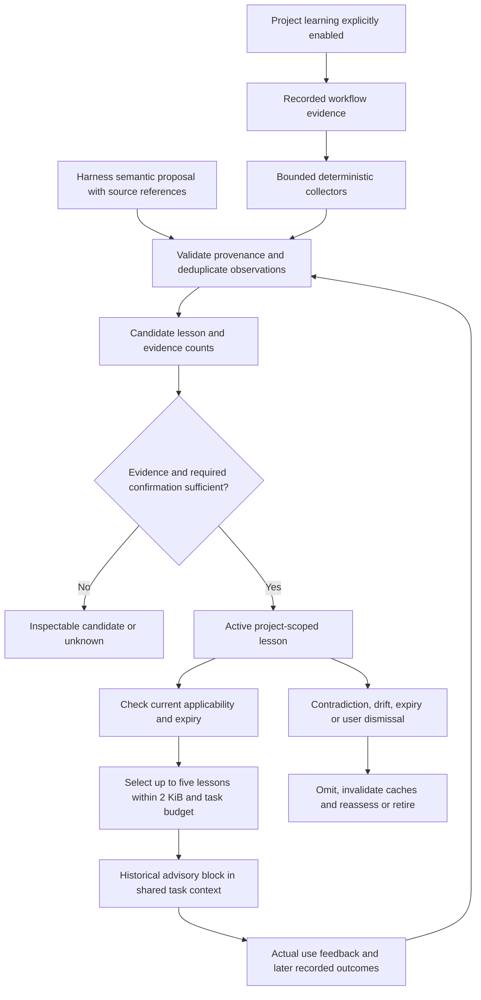

# Project learning from historical DevFlow runs

Status: written specification approved by the user on 2026-10-21 after commit
`5da5466`. All nine learning areas are in scope. The implementation plan awaits
user review; implementation has not started.

## Intent and success criteria

DevFlow should automatically turn recorded project experience into small,
evidence-backed hints that improve subsequent runs. The user wants all nine
areas: test commands, related files, recurring review findings, recovery steps,
specification gaps, context selection, task sizing/dependencies, model/effort
suitability and unstable tests. Context efficiency and simple harness-guided usage
are binding requirements. Users should not manage internal skill names or files.

Success means a later relevant task receives useful, current guidance derived
from earlier recorded work, with inspectable evidence and bounded context. It
must remain possible to finish ordinary work when learning is unavailable.
Historical success never substitutes for current verification or approval.

This document describes proposed behavior, not functionality already released.

## Current implementation and integration points

The current `improve` commands offer opt-in redacted traces, reviewed executable
cases, retrospective grouping and baseline/candidate evaluation. They do not
retrieve project lessons into future task context. Preserve their interfaces and
approval rules; project lessons are a separate advisory use of recorded evidence.

- `improvement_traces.py` projects allowlisted run summaries; it excludes raw
  prompts, repository bodies and worker output.
- `improvement_cases.py`, `improvement_eval.py` and `journal_domains.py` implement
  reviewed feedback/cases. Caller-supplied artifact labels/results are not verified
  evaluations merely because they were accepted by these interfaces.
- `evidence.py`, review records and commit attribution supply verifier, finding
  and changed-path identities. Current failed verifier calls do not necessarily
  produce a successful verification proof; learning needs explicit observations
  without converting unsuccessful checks into qualifying proofs.
- `task_views.py`, `context_artifacts.py` and `context_checkpoints.py` construct
  bounded context shared by run, host and native invocation consumers.
- `context_metrics.py` records emitted bytes and retrievals, not proof that a
  document was useful or a measurement of total host context/token savings.

## Approach and boundaries

Use one versioned project learning pipeline with nine collectors, one evidence
model and one retrieval/feedback contract. Deterministic Python collectors handle
observable patterns. The harness can submit semantic proposals for findings,
recovery explanations and requirement gaps; no additional paid/model calls are
launched by learning hooks. Semantic proposals retain their unverified status
until corroborated by recorded evidence and explicitly confirmed as described
below. All nine areas ship in the initial implementation; unavailable evidence
returns an explicit unknown status instead of fabricated guidance.

A free-form memory document is simpler but grows and mixes advice with policy.
An autonomous summarizer on every run incurs model cost and makes provenance and
invalidation harder to check. Structured, bounded lessons provide the selected
trade-off: automatic evidence-based advice with deliberate promotion boundaries.

Project learning does not change business rules, governing documents, required
checks, approval policies, execution permissions, reviewer independence or released
model eligibility. It cannot silently add a hard gate, dependency or test waiver.

## R1: Project scope and enablement

The harness offers project-local learning during setup, explaining what is
recorded and that selected lessons will be supplied to later tasks. A one-time
explicit project choice enables both automatic collection and advisory retrieval.
Default is disabled for existing and newly initialized projects until that choice
is recorded. Declining does not prevent the ordinary workflow. No repeated consent
is needed for routine observations and advisory lessons within the chosen scope.

Bind configuration to the existing project identity and selected control root.
Repository IDs alone are not sufficient across different projects or relocated
checkouts. Reuse existing relocation/ownership checks. Do not scan other project
roots, other control roots or user conversation histories. No automatic
organization-wide/global sharing or external upload.

Configuration is journaled operational state, separate from normative governing
policy. Include its version/hash in context selection. Users can disable all
learning or individual lesson types, inspect and dismiss lessons, correct an
observation, retire a lesson or clear the learning store through the harness.
Disabling stops collection and retrieval immediately and invalidates learning
context/checkpoints. Clearing removes materialized lesson/observation content and
caches, and writes a tombstone preventing journal rebuild or backfill from
resurrecting cleared records. Existing workflow audit evidence remains subject to
its existing retention rules; clearing learning is not deletion of run history.

Historical backfill is explicit, limited to selected project runs and idempotent.
It does not enable existing trace export or import legacy untrusted provenance.
The harness identifies which facts are available and which cannot be reconstructed.

## R2: Evidence records and lesson lifecycle

Store versioned immutable observations and a rebuildable bounded lesson index
under the selected control root. Use explicit journal events/reducers for
configuration, observation references, lesson transitions and user feedback.
Reuse existing CAS/idempotent-operation semantics. Learning records must not
mutate historical run proofs, reports or journal payloads.

An observation binds project, run, item/attempt where applicable, stage, repository,
source record/content hash, collector version and the relevant tool/configuration
identity. A repeated read, exact command replay or retry of the same operation
must not increase support. Independent attempts/runs must remain distinguishable.
Provenance points to actual immutable evidence; missing, forged or incompatible
references are rejected. Candidate text from an agent is not independent evidence.

Each lesson has a stable ID, type, bounded summary, applicability selectors,
evidence references, distinct support/contradiction counts, confidence state,
created/last-observed timestamps, validity predicates and expiry. States are
candidate, active, stale, dismissed and retired. Confidence is categorical, not an
invented probability. New candidates are not injected into routine task context.

A single verified command success may activate an exact-match command hint. Other
automatically inferred recurring patterns need corroboration from at least two
distinct runs. Semantic findings, specification gaps and recovery explanations
also require explicit confirmation of their bounded interpretation by the user
before activation; deterministic observations are still collected automatically.
Model suggestions and test instability have the additional evidence requirements
in R3. Insufficient evidence remains inspectable as candidate/unknown.

A relevant contradiction immediately suspends automatic retrieval pending
reassessment; retaining support counts must not hide contradictory evidence.
Material input/configuration drift marks affected lessons stale. An active lesson
expires 90 days after its last qualifying corroboration; displaying/retrieving it
does not refresh expiry. Fresh qualifying evidence may propose reactivation.
Dismissed/retired lessons stay excluded until an explicit user action.

## R3: Nine collectors and their future-run effects

| Type | Evidence required | Advisory effect and limits |
| --- | --- | --- |
| Test commands | Actual successful target execution; runner/report contract, declared targets, test/config hashes and repository identity | Suggest a matching working runner/command. Argument and environment compatibility must be checked live. This never imports a passing proof or executes a historical command on retrieval. |
| Related files | Committed, item-attributed co-changes across at least two distinct runs | Suggest files to inspect or include during planning/review. Exclude bulk/generated/vendor churn by declared filters. Correlation does not establish dependency closure or require editing a file. |
| Recurring review findings | Genuine recorded independent findings, affected paths/area, correction evidence and confirmed semantic category across at least two runs | Offer a targeted review/implementation reminder. Do not treat repeated text or repeated recording of one finding as recurrence. Findings lacking interpretable descriptions remain unknown. |
| Recovery steps | Failure signature, attempt-scoped remedy observation and later successful verification; corroboration across two runs plus confirmed explanation | Suggest a previously successful remedy for matching conditions. Report association rather than proven causality. Do not execute shell snippets or weaken assertions automatically. |
| Specification gaps | Recorded question/clarification or review-discovered requirement gap, resulting explicit decision/spec revision, two-run recurrence and confirmed category | Ask an earlier relevant question. Prior answers can be suggested only with current applicability; never silently turn a past assumption into a new requirement. |
| Context selection | Content/selector-bound retrieval observations plus explicit usefulness feedback or task evidence identifying a source's contribution | Rank optional relevant sections and suggest missing optional references. Read frequency or task success alone does not prove usefulness. All mandatory instructions/dependency closure remain present. |
| Task sizing/dependencies | Actual item boundaries, dependency declarations and correction/retry outcomes in comparable work across two runs | Suggest splitting work or checking a possible prerequisite. Do not change the approved plan/dependency graph or infer effort estimates from missing timing data. |
| Model/effort suitability | Actual host/model/version/effort observations, comparable approved task/evaluation cases, quality and available time/usage outcomes across at least two runs | Suggest among currently permitted, eligible settings. Missing effort/cost remains unknown; unobserved Claude effort cannot support strict effort claims. No automatic model promotion, permission change or paid evaluation. |
| Unstable tests | Contradictory target outcomes from distinct actual invocations under identical declared source/test/runner/configuration/environment fingerprints | Flag suspected instability and cite conflicting outcomes. Unknown environment equivalence yields an investigation candidate only. Never skip/quarantine tests, suppress failures or rerun until green automatically. |

For instability, two contradictory executions may establish a suspect candidate
within one run; active advisory promotion requires a second run corroborating the
pattern. Do not relabel expected RED followed by changed-code GREEN as flakiness.
For model advice, where equivalent comparison evidence is absent, return unknown
rather than ranking providers from raw pass counts across dissimilar tasks.

## R4: Automatic collection and feedback

After committed verification/result/review/clarification/delivery transitions,
process only newly available observations through bounded idempotent collection.
Do not rely only on successful delivery: failed and abandoned work can provide
qualified observations. Retry interrupted indexing from a durable cursor without
duplicate support. Journal/reducer replay performs no subprocesses or model calls.

Add an explicit verifier-observation path for attempted target execution, including
nonqualifying failure, timeout and unavailable report statuses. This record never
counts as RED/GREEN proof or changes the original command verdict, token or exit
status. Preserve target outcomes only when the real report supports them.
Unexecuted calls and preflight rejections are distinguishable from executed tests.

Record task-scoped semantic feedback through the harness with concrete source
references: finding category, resolved gap, remedy, source usefulness or lesson
helpful/not-helpful/incorrect. Interpretation may be proposed by the agent;
confidence requires the evidence and confirmation rules above. Preserve actual
actor/source provenance instead of inventing a human or independent review seat.

Selected lesson IDs/version hashes are bound to the consuming task/attempt.
Later outcomes add support or contradiction only when tied to those actual lesson
uses and appropriate comparable evidence. Mere presentation is not proof that a
lesson was followed or caused success. Users can explicitly correct feedback.

## R5: Bounded retrieval into future work

Use the shared context preparation path for both Claude and Codex. Retrieve at
setup/specification/planning and run/host task preparation when the current stage,
known repository-relative paths, task kind and current inputs match applicability.
Planning may lack exact paths; use explicit area/requirement tags and conservative
stage matching, not a whole-project dump. Do not invent paths from prose.

Select deterministically by validity, exact scope match, confirmed relevance,
evidence strength and recency; stable ID breaks ties. Cross-project matches are
forbidden. Recheck expiry, dismissals and source/configuration drift live before
cached selection is reused. Failed validity checks omit lessons with reason codes.

Supply at most five lessons and at most 2,048 UTF-8 serialized bytes in total,
including lesson IDs, summaries, concise provenance and inspection references.
Learning consumes the existing total context budget rather than increasing it.
Do not truncate a lesson's meaning or evict mandatory context: omit the lowest
ranked whole lessons first and disclose omissions compactly. No fitting lessons
is a valid result. Full evidence/history stays outside the prompt.

Label the block as historical advisory data with current applicability, never
normative instructions. Treat source/agent text as untrusted data: no instructions
embedded in lessons may override system, user, skill or governing policy. Provide
inspection actions for full provenance without automatically loading that history.

Include selected lesson content/configuration/index hashes and source validity in
artifact/cache keys. Dismissal, disable, correction, expiry and materially changed
inputs invalidate affected prepared views/checkpoints, including compact resume.
Existing ownership, specification, governing and complete-context checks still run.

## R6: Bounded storage, processing and failure behavior

Keep at most 500 nonretired lessons and 5,000 observation payloads per project;
each lesson is at most 4 KiB and each observation at most 8 KiB serialized UTF-8.
Preserve compact evidence digests/counts when aging detailed payloads. Expiry and
bounded compaction retire stale candidates first, then least-recently corroborated
active lessons. Do not lose a dismissal tombstone or fabricate support after
compaction. A lesson requiring unavailable source validation becomes stale.

Online collection/retrieval performs no network access, external commands or
LLM inference and has a 250 ms processing budget, excluding existing workflow
preflight. Limit each pass to 100 pending observations; unfinished work remains
behind a durable cursor for later passes or explicit harness maintenance.
Historical backfill is a separately invoked bounded operation with progress.
No whole-journal scan or whole-repository embedding rebuild on every task.

Learning is advisory: corrupt storage, unsupported schema, unavailable sources,
time budget exhaustion or optional-context overflow returns bounded diagnostics
and leaves ordinary work able to proceed. Preserve the original verifier/review
result. Never silently fall back to unchecked lessons. Existing mandatory workflow
failures still block. Failed feedback persistence is visible and retryable; do not
claim a lesson was saved when the write failed.

## R7: Privacy, command handling and authority

Allowlist stored metadata. Do not collect raw prompts, full logs, repository file
bodies, environment values or credentials. Store relative paths, bounded categories,
outcomes, hashes and source references. Review/clarification text enters a lesson
only as a bounded, user-inspectable summary; do not claim automatic secret detection
is complete. Provide a correction/removal route for accidentally sensitive text.
Reject known credential-bearing arguments and free-form shell commands from
reusable command hints; retain an inspectable omission reason. Sensitive or
unclassifiable argv remains a source reference, not injected command text.

Recommended runner commands are structured argv, never shell-evaluated text. A
hint may populate an authorized verifier request after current scope/configuration
checks, but execution still follows ordinary active-attempt, target, runner and
permission contracts. Historical command success grants no new authority.

Future model/effort hints obey current host capabilities, policy, user preferences
and evidence requirements. Lessons cannot authorize new providers/models, alter
reviewer roles, accept an old proof, infer human approval or change an application
contract. Normative proposals use existing explicit review/spec/policy workflows.

## R8: Harness experience and documentation

The harness offers learning once, explains relevant hints in ordinary language,
and provides inspect/dismiss/correct/disable/clear actions without requiring users
to know skill names or run Python. Do not add steps to the minimal quick start.
Expose explicit helper inputs/outputs for maintainers and host integration, keeping
CLI syntax and examples in the optional developer reference and skill guides.

Update affected workflow, build, review, specification, planning, project-context
and stats instructions, companion guides/references and Mermaid diagrams. Review
`docs/setup-and-usage.md`, `docs/skills.md`, context-efficiency references and
example indexes in the same change. Register conditional learning sections in the
documentation registry; retain existing entry, domain and initial-load budgets.
Describe unknowns and evidence limits accurately. Do not advertise planned learning
as implemented before the implementation release.

## Architecture and responsibility boundaries

Separate observation extraction, lesson reduction/validation, bounded project
storage/indexing, applicability/ranking, shared-context integration and harness
commands. Keep each independently testable; avoid a single growing prompt/manual.
One shared policy/schema owns thresholds, limits and promotion rules. The written
plan should sequence this shared foundation before the nine collectors and host
integration, preserving a reviewable testable unit at each step.

## Acceptance and verification

- Each of the nine lesson types has a positive real-evidence fixture and negative
  missing/stale/incomparable-evidence fixture. Semantic interpretation and human
  confirmation remain distinct from deterministic observation.
- Two project runs demonstrate automatic collection and future-task retrieval;
  unrelated projects/tasks receive no lessons. Repeated reads and event replay do
  not inflate confidence. Interrupted processing resumes without lost/duplicate
  observations. Failed/abandoned runs are represented honestly.
- Real Git/CLI verifier executions prove valid runner hints and nonqualifying
  failure observations. Retrieval alone never runs a command. Changed tests,
  runner/configuration/environment and expected RED→GREEN cannot falsely establish
  unchanged-run flakiness or qualify stale command advice.
- Semantic findings/gaps/remedies need actual citations, independent-run recurrence
  and confirmation. Feedback cannot invent actor identities or elevate advice to
  policy. Historical model fixtures/caller labels cannot promote a model.
- Shared run/host/native context tests prove deterministic selection, five-lesson
  and 2,048-byte limits, unchanged mandatory coverage, omission reporting, content
  cache invalidation and compaction/host-resume behavior after lesson changes.
- Corrupt/missing indexes, unsupported schema, exhausted processing budgets and
  storage caps omit unchecked advice and preserve original workflow decisions.
  Collection failures do not turn unsuccessful verification into proof or prevent
  ordinary work. Failed user feedback writes are visible and retryable.
- Enable/disable, per-type choices, inspection, dismiss/correct/retire/clear and
  explicit bounded backfill are tested, including clear followed by full replay.
  Cross-project access, path escapes, unsafe argv and lesson prompt-injection
  attempts do not grant access or authority.
- Run focused regressions, existing context/host/journal suites, package/example
  and documentation checks, then the full repository suite. Verify new fixtures
  use explicit UTF-8. Report offline fixture versus live host evidence separately;
  do not require paid calls or claim Windows/live-provider parity.
- Obtain independent review and record each requirement as MET/NOT MET/CANNOT
  VERIFY with changed-file evidence before the delivery decision. Merge, push and
  release require authorization for this new branch.

## Explicit exclusions

No global/organization sharing, embeddings/vector database, autonomous policy or
business-rule edits, automatic model promotion, automatic paid evaluation,
automatic test quarantine, reduction of required checks, production deployment
gates or completion-statistics feature. This work adds project learning for all
nine areas with evidence-qualified advisory behavior, not guaranteed causal
optimization or measured token/cost savings.
