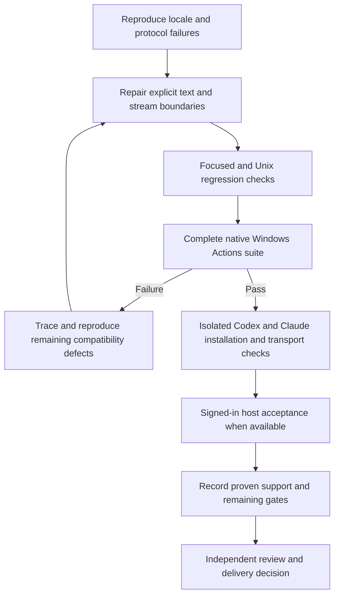

# Native Windows compatibility

Status: proposed design for user review; implementation has not started.
Baseline: DevFlow v0.3.12, `0893a2f`. This updates the remaining work from the
[historical portability design](2026-10-08-windows-portability-design.md).

## Outcome and scope

A Windows user installs the same DevFlow plugin in Codex or Claude, opens a Git
repository and asks the harness to start the normal workflow. No DevFlow-specific
shell variables, helper paths, aliases or locale overrides are onboarding steps.
Existing compatible Python and Git remain prerequisites. Target native Windows
first; WSL2 and Windows-mounted WSL repositories are distinct verification targets.

Use the existing platform lock, process transport, path and hook implementations.
Repair demonstrated compatibility defects and finish verification rather than
introducing a separate Windows fork or replacing working platform adapters.
A fixture-only repair would restore one CI step but leave runtime encoding and
installed-host gaps unresolved. WSL-only delivery would serve Linux workflows;
this design follows the requested native Windows outcome.

## Evidence and remaining uncertainty

The [v0.3.12 CI run](https://github.com/wgentil/devflow/actions/runs/39729201334)
passed Linux/macOS Python suites and Windows Claude installation/hook checks.
Its native Windows Python suite stopped after 25 tests at
`ArtifactTests.test_direct_edits_renames_and_selection_changes`.

`tests/test_context_artifacts.py` writes a JSON fixture containing `é` without
an explicit encoding. Windows encodes that fixture using its default code page;
`document_units.py` correctly requires UTF-8. Reproducing the writer default as
CP1252 on macOS yields the same `UnicodeDecodeError` and required-source failure.
The same experiment exposes additional Unicode failures in task-view and
documentation fixtures. These are simulations supporting root-cause analysis,
not native Windows acceptance evidence.

A separate runtime reproduction calls actual `run.py` context resolution with
Japanese text and a CP1252 output stream. The final JSON print raises
`UnicodeEncodeError`. Several auxiliary commands also read JSON input files
without an explicit encoding. The audit must distinguish real text boundaries
from intentional binary files and ASCII-only serialization; raw counts do not
establish that every call is defective.

The current CI command uses unittest fail-fast. Its first failure does not tell
us how many later native Windows cases fail. Existing Windows success from the
older 421-test release cannot establish compatibility for today's larger suite.
The [current validation matrix](../../windows-validation.md) also leaves actual
installed worker execution, live hook dispatch and cross-host acceptance open.

## R1: Explicit document and request encodings

DevFlow-owned JSON, Markdown, specification, request and report text boundaries
use explicit UTF-8. Fix fixtures and portable examples that depend on the machine
locale, including Unicode data generated dynamically. Exercise both accented and
non-Western content under a non-UTF-8 default and on real Windows.

Keep strict decoding for UTF-8 document contracts. Invalid bytes must fail with
an appropriate structured diagnostic rather than being silently replaced or
interpreted as legacy text. Do not change binary locks, raw artifact hashes,
journal schemas or Git pathname byte parsing as part of an encoding sweep.
Retain existing canonical Windows CRLF handling against approved Git content.

## R2: Stable CLI and hook protocol bytes

Machine-readable helper and hook streams must transport the declared JSON text
correctly regardless of the console code page, redirected pipes or PowerShell
host. A successful operation cannot mutate the journal and then crash while
printing its Unicode response. Measure actual emitted UTF-8 bytes consistently
with existing context/output budgets.

Cover successful and failing commands, non-ASCII paths and content, redirected
stdout/stderr, hook-to-helper communication and in-process callers using text
streams. Do not require `PYTHONUTF8`, `PYTHONIOENCODING`, console code-page changes
or a user-defined environment variable to make ordinary plugin use work.

## R3: Complete native Windows regression coverage

Run the complete Python suite on native Windows with Python 3.11+ and Git for
Windows. Collect all failures during diagnosis instead of stopping after the
first one; keep normal overall failure status. Retain Linux/macOS regression
jobs and the isolated Windows Claude package/hook job.

Exercise the minimum supported Python under its ordinary Windows locale and an
explicit non-UTF-8-default validation case so future UTF-8 defaults cannot hide
regressions. Record actual Python/OS/Git versions and relevant encoding settings.
Do not make CI green by globally forcing UTF-8 mode, weakening assertions,
raising existing time/byte limits or skipping supported Windows behavior.
Platform-inapplicable filename tests remain explicitly distinguished from failures.

Candidate-branch Windows Actions runs are part of implementation verification;
the implementation plan must identify the branch/event and evidence artifacts.
They do not authorize merging or publishing the candidate release.

## R4: Existing workflow, paths and journal invariants

On Windows, exercise initialization and resumption, Unicode/space-containing
repository paths, repository-backed specifications and governing approvals,
selected task preparation, token issuance and exact retry, verification/results,
review and delivery records, and explicit repository relocation/handoff.

Preserve case/drive/worktree ownership checks, path-escape protections (including
junctions), cross-process locking, atomic durable journal writes, raw content
identity and stale-input rejection. Cross-OS handoff must still require resolving
repository locations; it cannot treat another OS's absolute path as valid.
Unix behavior and existing recorded projects remain compatible.

## R5: Real installed executable and process checks

Verify the installed Windows forms of Codex and Claude through DevFlow's existing
transport, including executable discovery, arguments containing spaces/Unicode,
startup/version or protocol handshake, bounded output, timeout, process-tree
termination and interruption/reconciliation without duplicate invocation.

Use actual installed executables for startup/protocol checks. Unauthenticated
startup or account-status output is not proof that a model task executed. Keep
pure transport fixtures for deterministic tree/pipe tests and label them clearly.
Do not introduce unsafe shell interpolation to accommodate launcher shims; choose
and document a tested native launch path for supported installation forms.
Preserve existing read-only/workspace-write constraints and host approval policy.

## R6: Installed-host acceptance

Test isolated plugin installation and inventory in both native Windows hosts,
then test signed-in host behavior where a Windows account/machine is available.
Keep regular user installations unchanged. Record the exact plugin fingerprint,
host versions, OS, shell, Python, Git, commands and outcomes.

Authenticated acceptance must cover a real guided workflow, mapped completion
and live Claude event dispatch, model/worker execution and cleanup, and exact
same-release handoff/release-mismatch behavior. Follow existing genuine approval,
verification and independent-review contracts; do not invent delivery or provider
receipts to satisfy an acceptance row.

GitHub Actions is the initial automated environment. Signed-in host acceptance
requires a suitable Windows environment; missing access remains an explicit
unverified gate. Do not copy credentials to CI, create authentication secrets or
perform paid host probes as an implicit workaround for unavailable access.

## R7: Accurate Windows onboarding and support claims

Review primary setup, quick start, skills index, host/native guides, Windows
matrix, developer examples and affected skill guides/diagrams. Ordinary users
receive harness guidance and prerequisite diagnostics; detailed maintainer
commands and encoding experiments remain in developer references.

Label core Windows runtime compatibility, package installation, hook-script
behavior, live host dispatch and authenticated workflows separately. Replace
blanket unsupported language only for the gates actually demonstrated; do not
call all native Windows host behavior supported because one fixture or one CI
job passed. Preserve shell-free onboarding and current documentation budgets.
The support matrix must identify both the tested configuration and remaining gaps.

## R8: Completion and delivery

Produce a reviewed branch with reproducing tests watched fail and pass, the full
available platform matrix, installed-package evidence and requirement-by-requirement
findings with changed-file anchors. Fix in-scope compatibility failures exposed by
the complete Windows run; do not defer them merely because they followed the
original encoding failure. Keep unavailable authenticated checks visible and
provide the exact remaining acceptance procedure.

This task does not automatically merge, push main, bump a release or publish.
Candidate-branch CI verification and final integration are separate actions in the
implementation/delivery plan. Preserve the existing AGENTS.md user edit and the
separate project-learning worktree. Continue the previously selected Native
execution approach after the implementation plan is approved.

## Verification flow

## Official host references

Checked 2026-10-22. These establish host capabilities and constraints, not
DevFlow acceptance results.

- [OpenAI Windows sandbox documentation](https://learn.chatgpt.com/docs/windows/windows-sandbox)
  describes native Windows Codex use and its sandbox implementations. DevFlow must
  respect the active host permissions; compatibility must not disable isolation.
- [Claude native Windows setup](https://code.claude.com/docs/en/setup#set-up-on-windows)
  documents native Windows and WSL choices and their differing sandbox support.
  DevFlow's Git prerequisite remains independent of Claude's optional Git install.
