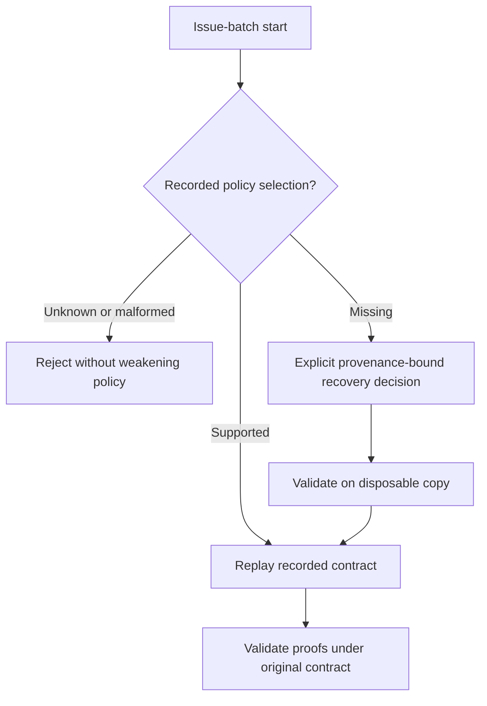

# Issue-batch replay compatibility

Status: approved on 2026-11-06. The owner approved both the investigation's
recommendations and the explicit per-run recovery behavior in this document.
No runtime change or production recovery has been performed.

Issue: [#7](https://github.com/wgentil/devflow/issues/7).
Baseline: `db4d741b601a57129026ac714a59dd31cbaefd4e` (released v0.3.18 runtime).

## Intent and confirmed cause

Restore access to pre-enforcement issue-batch histories without retroactive
enforcement, fabricated evidence, or weakened enforcement for current runs.

The investigation generated a six-event journal with actual v0.3.17 source:
fixture prerequisites, issue snapshot, grouping, issue build start, attempt and
RED verification proof. v0.3.17 replay succeeded. v0.3.18 replay of the same
journal returned `CORRUPT_STATE` at the proof with “Recorded matching
execution/source/protection claim required.” This was disposable fixture data;
no Bandpick control root was read or changed.

Unlike `run.started`, `domain.issues.start` does not persist its constructed run.
Its reducer calls today's `start_run`, injecting both enforcement and review
policy into historical runs. The old proof is then subjected to new rules.

## Approach

Select policy at the live creation boundary and persist the selection in a
versioned event contract. Reconstruct historical runs using fixed historical
semantics, not defaults that change with the running release. Preserve the
existing issue scope, deterministic run identity, operation identity and exact
retry contract. Ordinary `run.started` remains a recorded-run event.

Alternatives rejected: globally skipping execution validation weakens current
proofs; editing old proofs or journals invents history; merely removing the new
fields during all replay silently downgrades current-policy runs. Catching the
error and retrying with enforcement disabled has the same defect.

## Requirements

- R1: A genuine v0.3.17 issue-build history containing a verification proof
  replays under the repaired version without acquiring either new policy. All
  original event bytes, proof records, run IDs and operation IDs remain intact.
- R2: New issue-build starts persist an explicit versioned policy selection.
  Unknown or malformed selections fail closed. Current enforcement and review
  requirements apply on first execution and replay; missing execution evidence
  still fails. New plain run starts retain the same protection.
- R3: Replay, recovery and exact retry are deterministic and perform no live
  repository, host or model observation. Exercise both journal and SQLite
  formats, including reopen, rebuild/audit and the recorded original receipts.
- R4: Existing v0.3.18 issue-build histories must not be silently interpreted as
  pre-enforcement histories. An unversioned start event alone cannot distinguish
  the two. Policy-sensitive histories whose original selection cannot be proven
  require an explicit recovery decision with provenance; guessing from dates,
  installed version or absence of evidence is prohibited.
- R5: Tests use an independent historical oracle: retain a frozen journal and
  expected results produced by v0.3.17, with source provenance. Comparing two
  backends using the same current reducer is insufficient. Include plain starts,
  issue-build starts, explicit adoption, current-policy starts and ambiguous
  unversioned histories, including a current run before its first proof.
- R6: Update the issues skill, GUIDE and process diagram, primary setup guide,
  affected shared references and runnable examples in the same change. Explain
  exactly which upgrades are automatic and which recovery cases require human
  action. Record requirements, RED/GREEN evidence, final checks and limitations.

## Approved recovery decision

Historical v0.3.17 starts and v0.3.18 issue-batch starts have identical request
shapes. Even the absence of a new enforcement record cannot prove a legacy
selection: a v0.3.18 batch may not have reached its first tool execution.

Approved recovery contract: when the original policy is not recorded,
require an operator-confirmed per-run selection bound to the exact journal
content. Offer the legacy and v0.3.18 contracts explicitly, with neither
preselected. Preserve the original journal and validate the selection on a
disposable copy before any live recovery. This adds an explicit recovery step
for affected old issue batches, but avoids silent policy changes in either
direction. Its durable representation and public command are to be specified
in the implementation plan.

## Scope and delivery

Use autowork and an isolated worktree, preserving the user's `AGENTS.md` edit.
No new dependencies, model calls or review rounds are needed for replay.
No production migration, installed-plugin change, merge, push, issue closure or
release is implied by design approval. Finish a reviewed compatibility repair
before the delivery-metrics batch. A patch release is recommended after its
verification and separate delivery authorization.

