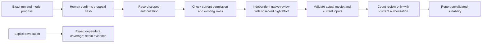

# Run-scoped authorization for observed, unvalidated reviewers

Status: approach selected by Wayne; written design awaiting approval.

## Intent and evidence

Unblock genuine independent DevFlow reviews when the installed release has no
validated provider mapping, without labeling availability as suitability or
accepting invented model receipts. This is a prerequisite fix for delivery metrics,
not an expansion of the metrics implementation.

The v0.3.19 metrics run `delivery-metrics-stage1-r2` produced
`NO_VALIDATED_PERMITTED_MODEL` at its W1 code-review dispatch. The released
`definitions/model-policy.json` has empty Codex and Claude host mappings.
Live Codex discovery on this host reported version `0.167.0`, available model
`gpt-6.1-sol`, configurable/observable `high` effort, and no model revision IDs.
Existing released-mapping validation requires matching revision metadata, so
adding an available model name cannot satisfy it. Captured diagnostics are in
`/tmp/metrics-reviewer-live-discovery.json` and
`/tmp/metrics-r2-W1-code-dispatch-result.json`; these paths are local investigation
evidence, not portable release proof.

## Approaches and selected tradeoff

1. Selected by Wayne: explicit authorization for one workflow run to use a named
   reviewer model with observable high effort and unvalidated suitability. This
   can work with the actual host metadata, but exposes a suitability limitation
   that every report must retain.
2. Keep released validated mappings as the sole route. This preserves the current
   guarantee but leaves reviews blocked until the host exposes the necessary
   revision metadata and representative evaluations have been released.

The new route is opt-in. Existing validated routes retain their eligibility
checks. No automatically inferred consent, fallback or policy promotion occurs.

## Scope and invariant boundaries

R1. Support workflow reviews only: item, branch, acceptance, and exact-head PR
review roles where those roles already exist. Standalone review sessions,
implementation workers, repair workers and advisory probes do not inherit this
permission. Unsupported subjects and roles receive a structured diagnostic.

Acceptance keeps its existing independent role, `stage: acceptance` dispatch
and requirements-verdict semantics. Carry authorization and trusted receipt
validation through that existing path. Do not send acceptance through
`specialist_scope`, which excludes it, or introduce four specialist perspectives
as a new acceptance requirement. This is a builder clarification of existing
roles, not an expansion of their review obligations.

R2. Preserve all independent-review requirements: distinct implementer/reviewer
actors, genuine invocation per perspective, current package/source/contract,
required code/test/architecture/security coverage, test-oracle assessment,
neighboring checks, findings and correction limits. An authorization does not
approve code or tests and is never itself a passing review.

R3. Preserve configured spending, invocation, time, retry, context, provider and
allowed-model restrictions. Authorization cannot clear or enlarge a budget.
Missing mandatory controls remain blockers. Revocation cannot refund spent work.

## Authorization lifecycle

R4. Add deterministic proposal, authorization, revocation and inspection helpers.
The agent presents an exact content-hashed proposal in ordinary conversation;
only an actual human decision authorizes it. Portable records are coordination
metadata backed by the real user message, not cryptographic identity claims.
The helper validates the confirmed hash, human actor ID and approval provenance;
it never manufactures consent from generic task intent or an earlier model pin.

The proposal binds schema version, actual run ID, specification identity,
review-policy identity, host/provider, one exact model ID, `deep-reasoning`,
`high`, explicit eligible review roles/perspectives and the disclosure
`suitability: unvalidated`. It also identifies existing budget/allowlist controls
without replacing them. Account identity is not required in user-visible text;
ordinary live authentication/discovery scoping remains enforced.

Authorizations are immutable, append-only, idempotently recorded events. Reusing
an operation ID with different content is rejected. Only one exact authorization
is selected by an invocation request; multiple historical authorizations never
produce an implicit model fallback. Revocation is an explicit event targeting an
exact authorization hash. New runs, changed specification/review policy, another
model/host/effort, and expanded roles require fresh consent. Ordinary source,
package and item transitions within the approved run do not require renewed model
consent; each invocation still binds its own current inputs and settings.

R5. Recheck authorization before launch, after native configuration, before report
admission and whenever review coverage is evaluated. Revoked or mismatched
permission blocks new work and prevents dependent reviews from counting toward
coverage. Retain original receipts and reports for inspection. An in-flight call
may finish after revocation; its result cannot be admitted as current coverage.
Do not imply provider cancellation or refunds.

## Route selection and actual execution

R6. A request naming an authorization selects the new route explicitly. Without
one, preserve the released validated route and existing fail-closed behavior.
Do not mutate installed plugin files or add an unvalidated released mapping.
Normal model/profile resolution remains unchanged outside selected reviews.

Discovery must report the selected model available and support configuration and
observation of provider/model/effort. Use the existing native transport and
read-only reviewer access. Compare trusted effective provider/model/high effort
with the approved selection before execution and again at completion using the
existing host observation mechanism. Substitution, missing observation, expired
host attachment, unknown access, interrupted execution, or a stale package blocks.
Claude remains blocked while its adapter cannot observe effective effort.
Missing immutable model revision stays explicitly unknown on this authorized
route; never invent a revision or claim exact backing-weight identity.

R7. Separate eligibility from suitability in receipts and gates. Keep
`capability_validated: false` for this route, add a versioned eligibility basis
such as `human-authorized-observed`, bind the authorization hash and observed
settings, and show `suitability: unvalidated` and revision availability. Update
all relevant workflow dispatch, native launch/finish, independent-review
admission and coverage checks to accept this exact basis only with current
consent and trusted observations. A boolean changed to true is not a solution.
Historical receipts missing this basis cannot be relabeled retroactively.

R8. Show the limitation in review summaries, delivery readiness evidence and
exports that expose reviewer-model provenance. Reports must distinguish released
validation from human authorization. Authorization never promotes a model or
suppresses an unknown field. No new model calls are needed to validate records.

## Persistence, compatibility and recovery

R9. Support both legacy journal and SQLite v2 roots. Reducers are deterministic;
live observations are captured outside reducers. Old roots/runs/receipts replay
without new permissions or migration writes. Unknown authorization schema or
eligibility basis fails closed. Source changes and release upgrades still follow
ordinary freshness and host-release checks.

R10. Keep the delivery-metrics worktree, locked test bytes, RED/GREEN records and
original rejected evidence intact. Build this routing fix in a separate clean
worktree after design approval. No merge, push, release, plugin-cache edit or
metrics-run adoption is implied by the approach approval. After the fix is
reviewable, present the concrete delivery decision needed to make it available
to the metrics run. A compatible upgrade/rebinding and renewed verification may
be required; never claim the current v0.3.19 run is unblocked by repository edits.

## User experience and documentation

R11. The agent handles proposal/recording and explains the exact reviewer choice
in plain language. No shell variables, manual plugin paths, direct Python setup
or manual policy editing in plugin-user onboarding. Add optional developer
command examples and deterministic error diagnostics. Update affected review-work
and workflow SKILL/GUIDE/Mermaid instructions, native-model and adversarial-review
references, host/upgrade guidance, setup-and-usage and runnable examples together.
Existing guides must continue describing the limitations of unmodified v0.3.19.

## Acceptance and test quality

Use independently expected fixtures and real RED/GREEN execution to verify:

- Exact consent hashes, correct human provenance, retry/idempotency, revocation,
  schema rejection, cross-run/spec/policy/model/effort/role isolation.
- Empty released mappings still block by default; selected authorization permits
  only the named model under genuinely observed high effort and existing limits.
- No forged/missing/substituted observation, advisory probe, self-review, stale
  package, non-independent invocation or incomplete perspective can pass.
- Revocation during execution and before report admission/coverage rejects the
  affected result without erasing execution evidence.
- Both stores replay historical events unchanged and preserve earlier receipts.
- An end-to-end workflow review crosses route selection, actual execution receipt,
  report admission and coverage. Synthetic transport fixtures are labeled; live
  acceptance requires real observed settings and independent review output.
- The existing validated route and unsupported standalone/repair paths retain
  their checks. Documentation links, metadata and examples remain valid.

Independent test review must map requirements to assertions and challenge
plausible incorrect implementations, especially setting capability_validated to
true, accepting any available model, ignoring revocation or accepting another
run's consent. Run the focused relevant suites and then the complete suite.

## Builder decisions

Exact module names, CLI spelling, record layouts, diagnostic code names and test
organization are implementation choices. Reuse current journal mutation patterns,
source/package bindings, budgets and model-receipt validation; avoid a second
transport, evaluation framework or general policy registry. Require explicit
context byte limits for live reviewer calls and preserve existing bounded effect
controls. No global model default, model evaluation campaign, automatic fallback,
standalone authorization or metrics functionality belongs in this fix.
