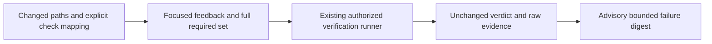

# build-work usage guide

Read the [shared setup and conventions](../../docs/skills.md#shared-setup) first.
Commands below use its `df` function and path variables.

## Purpose and prerequisites

For delegated model work, the harness supplies [task facts](../../docs/reference/task-routing.md#task-decisions). Load controls/recovery sections only when needed; prepared interactive requests do not start workers.

Verification responses add an advisory `failure_digest` beside the original
proof. It preserves verdicts, exit codes and complete evidence references, with
bounded error excerpts and explicit omissions. Digest failure never turns a
failed/unknown verifier result into success.

Before validation, use `build validation-plan --config` with explicit project-owned
check mappings and repeated `--changed-path` values. The plan selects focused
feedback but retains every required check outstanding; it executes no commands.
See [validation-checks.json](../../docs/examples/validation-checks.json).



Record actual verification for the active attempt. Register the item's repository
and save the token returned by `run next` as `ATTEMPT`. Code targets require RED
and GREEN evidence with unchanged test-file hashes.

## Unit-test example

In a disposable application checkout, copy `test_greeting.py` into `tests/` and
copy `test_runner.py` to the application root and start with `greet` returning an
incorrect result. Keep the test unchanged between
RED and GREEN. Run from your documentation shell:

```sh
df build verify --root "$CONTROL" --run-id greeting-run --attempt-id "$ATTEMPT" --phase red --argv-json '["python3","-B","test_runner.py"]' --test-path tests/test_greeting.py --target-id test_greeting.GreetingTests.test_name --report-format json
# Implement greet(name) as in docs/examples/greeting.py, then:
df build verify --root "$CONTROL" --run-id greeting-run --attempt-id "$ATTEMPT" --phase green --argv-json '["python3","-B","test_runner.py"]' --test-path tests/test_greeting.py --target-id test_greeting.GreetingTests.test_name --report-format json
df run result --root "$CONTROL" --run-id greeting-run --attempt-id "$ATTEMPT" --result '{"outcome":"success","detail":"Greeting targets verified"}' --operation-id result-W1
```

The proof captures IDs, repository fingerprint, test hashes, command, timestamps
and log references. A nonzero exit by itself is not RED; declared targets must
actually fail. GREEN requires every declared target to pass and a stable repo.
The bundled runner executes real unittest cases and emits portable JSON; `-B`
avoids bytecode changes during fingerprint checks. The verbose unittest adapter
requires output matching its supported text format; target IDs can vary by Python
version, so JSON is recommended for this example. JSON reports use `{"tests":[{"id":"TARGET","outcome":"passed"}]}`; JUnit XML
is selected with `--report-format junit`. Declare E2E targets the same way when
the runner emits a supported report; hardening gates accept exit-status commands.

## Other item kinds

IaC: `build verify-iac-plan` takes `--plan-argv-json` and `--policy-argv-json`.
After real user approval, `build authorize-apply` takes exact apply/policy argv,
`--plan-proof-id` and `--actor-id`; `build verify-iac-apply` takes the returned
`--authorization-id`. All use root/run/attempt. Policy commands must report an
empty JSON `violations` list. Apply may change external infrastructure.

Agent configuration: `build verify-eval-set` takes `--eval-argv-json`,
`--phase baseline|post` and `--pass-rate-threshold`; post additionally needs
`--baseline-id`. Use the same evaluation case IDs. Inspect subcommand help for
complete arguments and the current verifier contracts before configuring tools.

## Failure and recovery

Check `passed` and `failure`, not just shell exit status. Fix failed implementation
and rerun. An opted-in, explicit bounded repair cycle can launch the current
implementer for failed configured hardening gates and rerun those gates; see
[workflow repair](../workflow/GUIDE.md#optional-bounded-repair). It does not
replace item RED/GREEN proof or independent review. Timeout, changed files or
unsupported reports do not complete the item. If abandoning an attempt, use
`run abandon --attempt-id "$ATTEMPT"`, then `run retry --item W1`, with root/run
and distinct operation IDs. A new token needs its own verification.

Locked-test correction uses `build test-change propose --patch-file --reason
--item`, then separate `approve --proposal-id --confirm-hash --actor-id` and
`apply --proposal-id --confirm-hash` after real approval. All require root/run.
Applied changes invalidate affected GREEN proof. Never weaken tests merely to
claim GREEN. Continue with independent review.

## Host usage example

Read [canonical guidance](../../docs/hosts.md). Stage routing is declared in this skill.

## Governing-document evidence

Read [canonical guidance](../../docs/reference/governing-inputs.md#governing-document-evidence). Stage routing is declared in this skill.

## Governing input reassessment

Read [canonical guidance](../../docs/reference/governing-inputs.md#governing-input-reassessment). Stage routing is declared in this skill.
