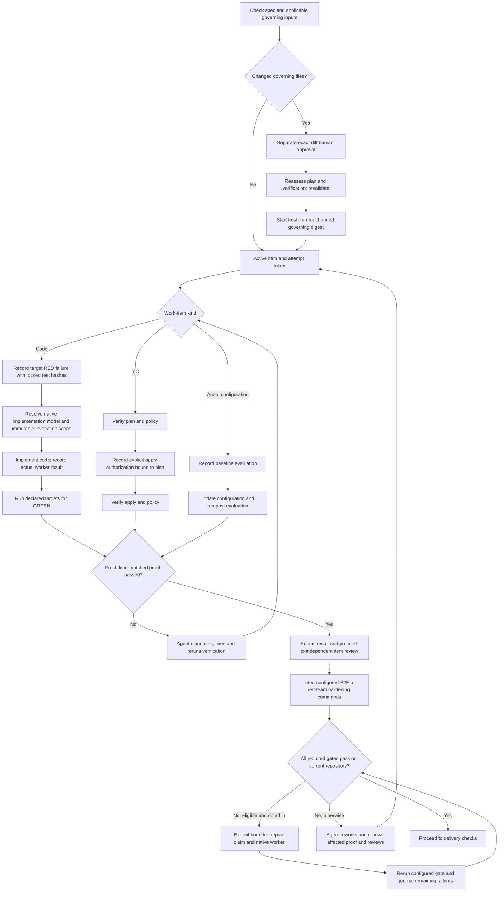

# build-work procedures

Use explicit project check mappings for focused validation feedback. A focused
pass never replaces outstanding full checks. Failure digests are bounded
navigation over original evidence; preserve the verifier verdict on digest failure.

## Verification and rework



Unit and E2E suites can be declared code verification targets when they emit a
supported report. E2E and red-team checks can also be configured hardening gates.
Failures block the relevant gate. An explicit opted-in `repair next` command can
dispatch the current implementer for a failed configured hardening gate, rerun it,
and stop at attempt, time, spend or no-progress limits. Review findings and item
verification still need agent-led rework and fresh proof. No hook launches repair.
Test reruns have no enforced correction counter; review correction limits apply
when reviewers request changes.

Use this skill only for an active run attempt with declared test paths and target test IDs. Run the actual target test command and have it emit either JSON `{ "tests": [{ "id": "...", "outcome": "passed|failed|skipped|error" }] }` or JUnit XML to standard output. A nonzero exit alone never proves RED. GREEN requires all declared targets to pass and the same test files to match the recorded RED hashes.

```sh
python3 <plugin-root>/skills/workflow/scripts/run.py build verify \
  --root <control-root> --run-id <run-id> --attempt-id <token> \
  --phase red --argv-json '["python3", "test_runner.py"]' \
  --test-path tests/test_feature.py --target-id tests.test_feature.TestFeature.test_case
```

Repeat with `--phase green` after implementation. The proof binds the run, item, token, registered repository, command, repository fingerprint, test hashes, exit status and captured logs. Unsupported reports, timeouts, stale tokens, changed tests and unrelated failures remain unverified. This helper cannot prevent an agent from running commands outside the recorded attempt.

For IaC, run `build verify-iac-plan` with separate plan and policy argv JSON arrays. A passing policy command must emit JSON containing an empty `violations` list. After plan verification, record explicit scope with `build authorize-apply`, binding the active attempt, repository, exact argv arrays, actor, and plan proof ID; then apply with the returned authorization ID. Authorization is journaled and rejected if the repository changes after planning. For agent-configuration evaluation, record `verify-eval-set --phase baseline`, then run `--phase post --baseline-id ID` with the same case IDs and the configured pass-rate threshold.

Inspect recorded proposals with `build test-change list --root <control> --run-id <run>`: no proposal ID is needed; `proposals` is empty or contains the complete collection. Listing does not approve, apply or change authoritative state. See the [developer example](../../docs/examples/test-change-list.md).

If a RED-locked test needs a correction, propose a content-only patch with `build test-change propose`, review its returned patch and hash, then separately approve and apply that exact hash with the approving human's actor ID. An `applying` event is journaled before touching files, so gates stop accepting affected GREEN proofs even if the process is interrupted. Retrying reconciles an already-applied patch. Re-run verification after applying it. Use `build verify --report-format unittest` for verbose Python unittest output; JSON and JUnit are also supported. If an item remains unresolved through the correction limit, stop and record independent adjudication; do not keep cycling changes.

## Reusing recorded RED

For GREEN on a new attempt, explicitly pass `--red-proof-id ID`; add
`--red-run-id RUN` only for another run in the same control root. The helper
requires identical plan/spec/governing/item/repository identities, test hashes,
target IDs, argv and report format, with a real failed target in the source RED.
GREEN still executes freshly under the current token. Legacy proofs missing this
contract cannot be reused. No manual implementation removal is required when a
qualifying recorded RED exists. A changed test or verifier requires new RED.

## Reverify completed work

When later commits make a completed code item's exact-head proof stale, use
`run reverify --root CONTROL --run-id RUN --item ITEM`. It issues a fresh token
and makes that item pending. Keep implementation files in place; run GREEN with
`--red-proof-id` (and explicit `--red-run-id` for another run) only when its
recorded contract qualifies, then submit `passed` with the new proof ID.
Old tokens/proofs cannot complete the new attempt. Affected item and higher-level
review/acceptance evidence remains in history but requires renewal. Existing same-token workflows
still work. Unrelated commits are not assumed harmless: exact repository freshness
remains required. Finish all planned commits, then reverify stale code items at
that final state without further commits between checks. Stop/reconcile active
workers or repairs first. Non-code items require their existing verifier flows.

## Result proof identity

Capture `proof_id` (alias of `id`) from successful verification and submit it as
`verifier_proof_id` with `outcome: passed`. Missing/mismatched proof or success-like
aliases do not consume the token. Deliberate nonpassing outcomes are unverified;
no reported result alone completes work. The stored proof schema is unchanged.

## Runner reports and executable failures

JSON target IDs are exact strings. JUnit IDs use `classname.name`, or `name` when classname is absent. See the format-only [JSON](../../docs/examples/target-test-report.json) and [JUnit](../../docs/examples/target-test-report.junit.xml) examples for the same non-Python target. A project-owned runner must execute real tests and translate their actual results; no Node, pytest or PHPUnit adapter is shipped. Include project-owned runner scripts among the locked `--test-path` values so their bytes are bound too.

GREEN and reusable RED must report every requested target. A process/import failure alone is not RED: arrange the smallest executable interface so the intended assertion runs and fails. Preserve meaningful assertions; do not fabricate reports. Existing same-token RED behavior still accepts an observed declared-target failure without requiring all targets to appear.
