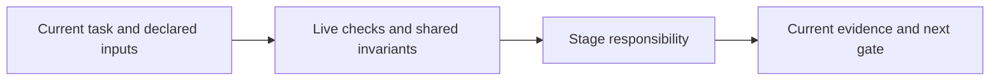

# build-work

Implement the current eligible work item and record fresh attempt-bound evidence. For code, prove actual target RED then GREEN with unchanged locked test hashes. IaC needs plan/policy proof and explicit exact-scope apply authorization; agent configuration needs the recorded baseline/post evaluation.

Read the matching verification/rework procedure before running checks. Focused validation plans never replace full required checks. Preserve original failure verdicts and raw evidence when a digest is unavailable. Changes require renewed evidence; a reported result alone does not complete an item.

Read [shared invariants](../../docs/reference/workflow-invariants.md) and the declared stage sections before work. The harness runs helpers and guides the user. For model work use `implementation` routing.

<!-- devflow:routes:build-work -->
- `skill.build-work`: `skills/build-work/SKILL.md`
- `common`: `docs/reference/workflow-invariants.md`
- `guide.build-work`: `skills/build-work/GUIDE.md` → build-work usage guide / Purpose and prerequisites
<!-- /devflow:routes -->

## Documentation

Read [procedures](REFERENCE.md) for the matching stage/mode before verification, review or advanced operations. [Guide](GUIDE.md) contains command/input/output and recovery sections; load the section for the operation, not the entire manual. [Quick start](../../docs/quick-start.md) is the user entry point.

## Verification and rework

See [canonical guidance](REFERENCE.md#verification-and-rework).

## Shared host contract

See [canonical guidance](../../docs/reference/host-lifecycle.md).

## Governing-document evidence

See [canonical guidance](../../docs/reference/governing-inputs.md#governing-document-evidence).

## Governing input reassessment

See [canonical guidance](../../docs/reference/governing-inputs.md#governing-input-reassessment).
