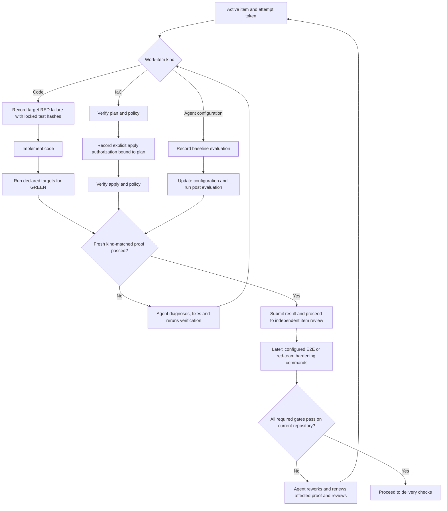

# Build work

## Verification and rework



Unit and E2E suites can be declared code verification targets when they emit a
supported report. E2E and red-team checks can also be configured hardening gates.
Failures block the relevant gate; the agent must coordinate rework and reruns.
There is no automatic failure dispatcher or dedicated red-team findings loop.
Test reruns have no enforced correction counter; review correction limits apply
when reviewers request changes.

Use this skill only for an active run attempt with declared test paths and target test IDs. Run the actual target test command and have it emit either JSON `{ "tests": [{ "id": "...", "outcome": "passed|failed|skipped|error" }] }` or JUnit XML to standard output. A nonzero exit alone never proves RED. GREEN requires all declared targets to pass and the same test files to match the recorded RED hashes.

```sh
python3 <plugin-root>/skills/workflow/scripts/run.py build verify \
  --root <control-root> --run-id <run-id> --attempt-id <token> \
  --phase red --argv-json '["python3", "test_runner.py"]' \
  --test-path tests/test_feature.py --target-id tests.test_feature.TestFeature.test_case
```

Repeat with `--phase green` after implementation. The proof binds the run, item, token, registered repository, command, repository fingerprint, test hashes, exit status and captured logs. Unsupported reports, timeouts, stale tokens, changed tests and unrelated failures remain unverified. This helper cannot prevent an agent from running commands outside the recorded attempt.

For IaC, run `build verify-iac-plan` with separate plan and policy argv JSON arrays. A passing policy command must emit JSON containing an empty `violations` list. After plan verification, record explicit scope with `build authorize-apply`, binding the active attempt, repository, exact argv arrays, actor, and plan proof ID; then apply with the returned authorization ID. Authorization is journaled and rejected if the repository changes after planning. For agent-configuration evaluation, record `verify-eval-set --phase baseline`, then run `--phase post --baseline-id ID` with the same case IDs and the configured pass-rate threshold.

If a RED-locked test needs a correction, propose a content-only patch with `build test-change propose`, review its returned patch and hash, then separately approve and apply that exact hash with the approving human's actor ID. An `applying` event is journaled before touching files, so gates stop accepting affected GREEN proofs even if the process is interrupted. Retrying reconciles an already-applied patch. Re-run verification after applying it. Use `build verify --report-format unittest` for verbose Python unittest output; JSON and JUnit are also supported. If an item remains unresolved through the correction limit, stop and record independent adjudication; do not keep cycling changes.

## Documentation

See [usage guide and examples](GUIDE.md) for prerequisites, commands, input shapes,
outputs and recovery. The [documentation index](../../docs/skills.md) covers shared
setup and all DevFlow skills.

## Shared host contract

When explicitly attached, retain the current binding ID/revision and include them
in workflow mutations; transferred/stale bindings require refresh. Map actual
host task IDs explicitly and check completion using the shared host policy.
For model work here request `implementation` stage routing; deterministic helper execution
uses no separate model. Unknown effective settings remain advisory; strict mode
blocks. See [host contracts](../../docs/hosts.md) for handoff and model limits.
