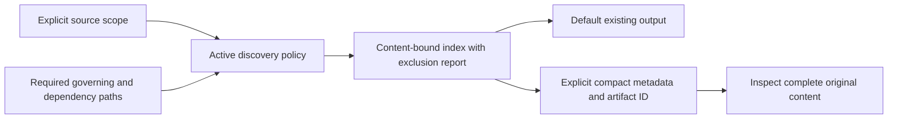

# ingest usage guide

Read the [shared setup and conventions](../../docs/skills.md#shared-setup) first.
Commands below use its `df` function and path variables.

## Purpose and prerequisites

Routine broad indexing excludes declared historical paths and reports exclusions.
`--include-history` or an explicit historical path opts in; required governing
inputs and `--required-path` selections override history and extension filtering.
The selection policy participates in new cache identities. Existing operation
receipts replay their original index even after sources change.



Index explicitly selected UTF-8 source files. Durable indexing needs a registered
repository ID, control root and operation ID. Choose narrow paths and a profile;
`profile.json` includes Python files only. Keep the control root outside scope.

## Durable indexing example

Add `--output-mode refs` to durable indexing to inspect compact source metadata.
Use `df context-artifact inspect --root "$CONTROL" --id ACTUAL_ARTIFACT_ID` to
load complete content. Durable default output remains its existing small receipt.
Read-only indexing without a control root keeps full output; reference output
requires a selected control root.

```sh
df ingest --root "$CONTROL" --repo-id app --scope greeting.py --scope tests --profile-json "$EXAMPLES/profile.json" --operation-id ingest-greeting-v1
```

Repeat exactly with the same operation ID to replay the stored result without
reading sources. To index changes, use a new operation ID. Scope can be repeated.
Directories are traversed; extensions filter files. An empty extensions list
selects every file, which can fail on binary content.

For a read-only preview, write `repo.json` as `{"location":"/absolute/app"}`:

```sh
df ingest --repo-json repo.json --scope greeting.py --profile-json "$EXAMPLES/profile.json"
```

## Outputs and provenance

Read-only preview returns sources with path, commit, content hash, text and line
range. Durable indexing returns index ID, source count and cache hit; indexes and
cache live in committed state. Repository-specific IDs prevent identical clones
from sharing incorrect provenance. Indexes support derived specification
citations; indexing does not itself synthesize or approve requirements.

## Troubleshooting

Escaping paths/symlinks, invalid UTF-8 and changes during indexing fail rather
than silently indexing different content. A prior operation ID cannot be reused
for a changed scope/profile. No source command executes during journal recovery.
See the journal reference for stored index fields and specification grounding.

## Host usage example

Invoke this skill from the same selected DevFlow project/run in either host. An
attached session uses its binding revision; a handoff preserves the attempt while
invalidating the old owner. This skill requests `scan` for model work.
Helpers execute deterministically. Scoped native workers support discovery and
explicit model selection; strict checks require validated suitability and observed
effective settings. Ordinary unmapped tasks remain unaffected.
See [setup](../../docs/setup-and-usage.md) and [host examples](../../docs/hosts.md).

For model work, see [native worker usage and examples](../../docs/native-models.md).
Example: “Use my permitted model for this stage as an advisory choice; show the
actual observed model and preserve my spending cap.” Selection never promotes a
new model to a capability-validated default.
