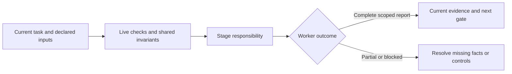

# ingest

Index explicitly scoped UTF-8 source files with repository-relative path, content hash, commit and line provenance. Reject path/symlink escapes and keep inferred facts/conflicts explicit. Durable indexing binds registered repo, unchanged source fingerprint and an operation ID.

Broad discovery omits declared history unless explicitly requested or required. Required governing/dependency paths override exclusion. Compact indexes need explicit artifact inspection before using source details; historical receipts replay unchanged.

Read [shared invariants](../../docs/reference/workflow-invariants.md) and the declared stage sections before work. The harness runs helpers and guides the user. For delegated work read [task routing](../../docs/reference/task-routing.md#task-decisions); use the actual stage and preserve user constraints.

<!-- devflow:routes:ingest -->
- `skill.ingest`: `skills/ingest/SKILL.md`
- `common`: `docs/reference/workflow-invariants.md`
- `guide.ingest`: `skills/ingest/GUIDE.md` → ingest usage guide / Purpose and prerequisites
- `routing.task-decisions`: `docs/reference/task-routing.md` → Task routing / Task decisions
<!-- /devflow:routes -->

## Documentation

Read [procedures](REFERENCE.md) for the matching stage/mode before verification, review or advanced operations. [Guide](GUIDE.md) contains command/input/output and recovery sections; load the section for the operation, not the entire manual. [Quick start](../../docs/quick-start.md) is the user entry point.

## Shared host contract

See [canonical guidance](../../docs/reference/host-lifecycle.md).
