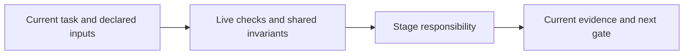

# issues

Capture complete local issue snapshots before grouping/classification. Preserve source IDs and citations, record linked build evidence, and distinguish inferred relationships from observed facts.

Incomplete snapshots cannot establish complete grouping. External reconciliation needs explicit scoped authorization and durable outbox handling; retry only the same operation/scope. Local intake does not authorize sending messages or updating trackers.

Read [shared invariants](../../docs/reference/workflow-invariants.md) and the declared stage sections before work. The harness runs helpers and guides the user. For model work use `scan` routing.

<!-- devflow:routes:issues -->
- `skill.issues`: `skills/issues/SKILL.md`
- `common`: `docs/reference/workflow-invariants.md`
- `guide.issues`: `skills/issues/GUIDE.md` → issues usage guide / Purpose and prerequisites
<!-- /devflow:routes -->

## Documentation

Read [procedures](REFERENCE.md) for the matching stage/mode before verification, review or advanced operations. [Guide](GUIDE.md) contains command/input/output and recovery sections; load the section for the operation, not the entire manual. [Quick start](../../docs/quick-start.md) is the user entry point.

## Shared host contract

See [canonical guidance](../../docs/reference/host-lifecycle.md).
