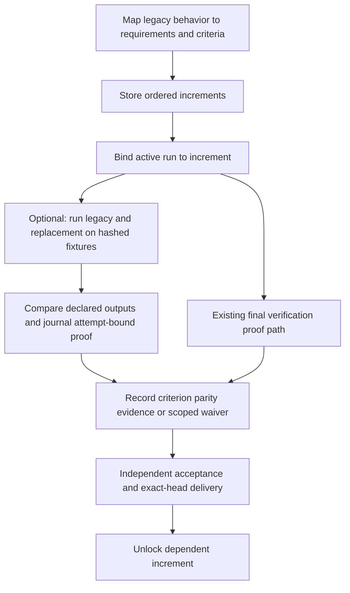

# migrate procedures

Map each legacy rule to requirement IDs and parity criteria. Preserve gaps, contradictions, and authorized waivers with their rationale and cost if wrong. Keep increment dependencies acyclic and block later delivery until prerequisites are delivered.

Use `migrate store/record-parity/bind` with a control root and explicit operation ID. Bind runs to increments before delivery so predecessor/parity guards participate in terminal recording. Resume through `migrate inspect`; do not submit caller-edited state. See `../../docs/journal-integration.md`.
For executable pilot parity, `migrate verify-pilot` runs both declared commands
on separate copies of identical hashed fixtures, compares declared outputs,
and records a proof tied to the current increment, criterion, item attempt and
repository fingerprint. Replay never re-executes. Manual final-proof parity
remains supported. Typed pilot proof becomes stale when the attempt or source
repository changes before delivery; worker assertions alone never count.
The temporary working directories do not sandbox the declared programs; use
trusted commands and an external OS sandbox if isolation is required.
