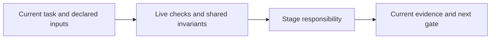

# migrate

Compare legacy requirements with ordered migration increments and explicit predecessor dependencies. Keep citations and assumptions separate, bind the run to the increment, and record executable parity evidence for declared comparators.

Missing predecessor completion, unavailable/stale source or mismatched parity scope blocks progression. Preserve incumbent behavior explicitly; no migration delivery without the required current parity and ordinary review/delivery gates.

Read [shared invariants](../../docs/reference/workflow-invariants.md) and the declared stage sections before work. The harness runs helpers and guides the user. For model work use `specification` routing.

<!-- devflow:routes:migrate -->
- `skill.migrate`: `skills/migrate/SKILL.md`
- `common`: `docs/reference/workflow-invariants.md`
- `guide.migrate`: `skills/migrate/GUIDE.md` → migrate usage guide / Purpose and prerequisites
<!-- /devflow:routes -->

## Documentation

Read [procedures](REFERENCE.md) for the matching stage/mode before verification, review or advanced operations. [Guide](GUIDE.md) contains command/input/output and recovery sections; load the section for the operation, not the entire manual. [Quick start](../../docs/quick-start.md) is the user entry point.

## Shared host contract

See [canonical guidance](../../docs/reference/host-lifecycle.md).
