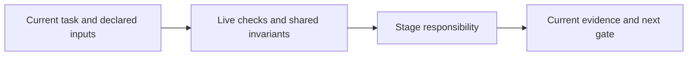

# plan-work

Decompose the approved specification into dependent, repository-bound work items. Cover every requirement with kind-specific acceptance criteria and explicit dependencies; validate the plan with bundled helpers.

Stop for missing coverage, dependency cycles, stale approval or governing reassessment. A changed plan/spec invalidates the affected work and evidence. Use current validated plan content before issuing attempts.

Read [shared invariants](../../docs/reference/workflow-invariants.md) and the declared stage sections before work. The harness runs helpers and guides the user. For model work use `planning` routing.

<!-- devflow:routes:plan-work -->
- `skill.plan-work`: `skills/plan-work/SKILL.md`
- `common`: `docs/reference/workflow-invariants.md`
- `guide.plan-work`: `skills/plan-work/GUIDE.md` → plan-work usage guide / Purpose and prerequisites
<!-- /devflow:routes -->

## Documentation

Read [procedures](REFERENCE.md) for the matching stage/mode before verification, review or advanced operations. [Guide](GUIDE.md) contains command/input/output and recovery sections; load the section for the operation, not the entire manual. [Quick start](../../docs/quick-start.md) is the user entry point.

## Shared host contract

See [canonical guidance](../../docs/reference/host-lifecycle.md).

## Governing input reassessment

See [canonical guidance](../../docs/reference/governing-inputs.md#governing-input-reassessment).
