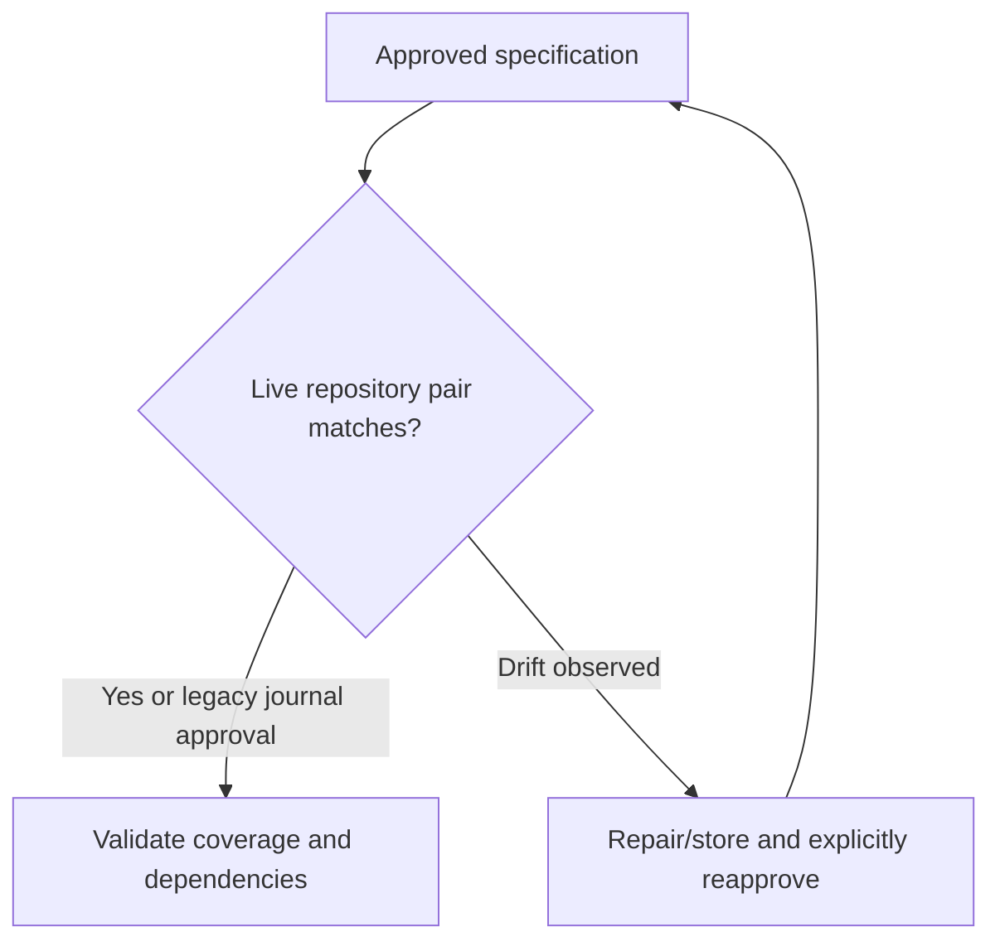

# Plan work

Map every approved requirement to one or more work items. Declare dependencies and the criteria required by each item kind. Use the shared validator before dispatch; only items whose dependencies are complete are eligible.

## Documentation

See [usage guide and examples](GUIDE.md) for prerequisites, commands, input shapes,
outputs and recovery. The [documentation index](../../docs/skills.md) covers shared
setup and all DevFlow skills.

## Shared host contract

When explicitly attached, retain the current binding ID/revision and include them
in workflow mutations; transferred/stale bindings require refresh. Map actual
host task IDs explicitly and check completion using the shared host policy.
For model work here request `planning` stage routing; deterministic helper execution
uses no separate model. Unknown effective settings remain advisory; strict mode
blocks. New scoped workers use bundled native discovery and launch; explicit advisory
pins require user permission for unvalidated suitability. Claude effort remains unobservable. See [host contracts](../../docs/hosts.md) for handoff and model limits.

Before delegated model work, follow the [native invocation guide](../../docs/native-models.md).
Keep the actual actor/stage and item token or review package. Hooks never launch
workers. Preserve blocked policy decisions and classify interrupted work before
any replacement. Deterministic operations do not need a model invocation.

Before planning, starting runs, transferring hosts or delivering repository-backed
work, use the shared live specification preflight. Observed pair drift requires
explicit human reapproval even after restoration. Keep legacy journal flows
readable; migration creates an unapproved visible candidate and preserves targets.
See the [guide](GUIDE.md#repository-specification-preflight) for recovery.

