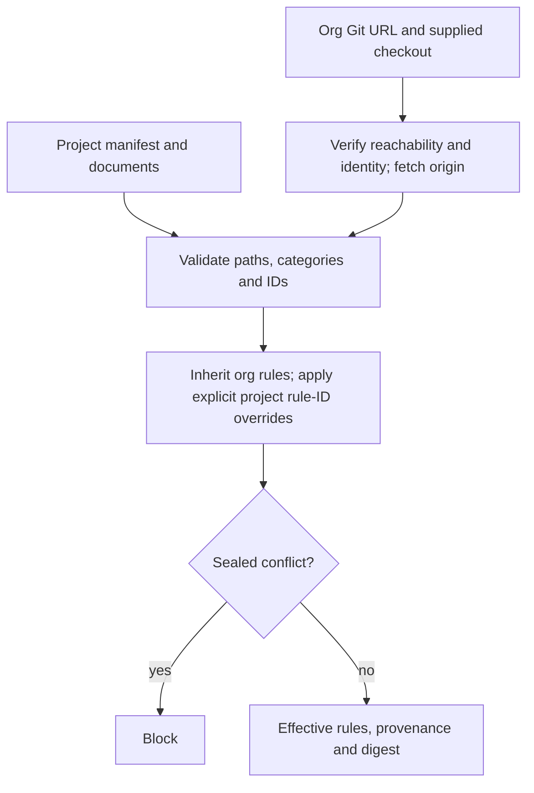

# project-context usage guide

Read the [shared setup and conventions](../../docs/skills.md#shared-setup) first.
Plugin users invoke project-context by name; the agent performs initialization and helper calls. The legacy shell examples below are optional developer reference.

## Purpose and prerequisites

Resolve organization defaults, project choices and user overrides into scoped
context with provenance. Use stable repository IDs and existing checkout paths.
The six organization slices are platform, coding-standards, architecture,
test-strategy, release-process and design-system.

## Record and resolve example

`org.json` demonstrates answered and explicitly declined slices. `project.json`
adds project architecture. Copy and adapt these files to actual user answers.

```sh
df context set --root "$CONTROL" --layer org --file "$EXAMPLES/org.json" --operation-id org-v1
df context set --root "$CONTROL" --layer project --file "$EXAMPLES/project.json" --operation-id project-v1
df context resolve --root "$CONTROL"
df repo register --root "$CONTROL" --repo-id app --location "$APP" --operation-id register-app
```

For a read-only comparison, provide layer files directly without a root:

```sh
df context resolve --org "$EXAMPLES/org.json" --project "$EXAMPLES/project.json"
```

`--overrides` accepts an object of slice names to override values; `--budgets`
accepts a budget object such as `{"max_tokens":2000}`. These are file paths.
Slice records use `status: answered|declined|unanswered`; answered records require
`value`. Preserve declines so later interviews do not repeat them.

## Outputs and relocation

Resolution returns selected values, provenance, conflicts, missing organization
slices and estimates. Budget estimates are not actual model usage. The agent asks
unanswered questions; resolution does not run an interview automatically.
Register a relocated checkout under the same ID with a new operation ID. Refresh
context after changes; source fingerprints invalidate old projections.

## Troubleshooting

Malformed slice records fail with `INVALID_CONTEXT`; missing directories cannot
be registered. Resolve conflicts with the user's instructions before building.
See [specify](../specify/GUIDE.md) for requirements and [ingest](../ingest/GUIDE.md)
for source evidence.

## Host usage example

Invoke this skill from the same selected DevFlow project/run in either host. An
attached session uses its binding revision; a handoff preserves the attempt while
invalidating the old owner. This skill requests `scan` for model work.
Helpers execute deterministically. Scoped native workers support discovery and
explicit model selection; strict checks require validated suitability and observed
effective settings. Ordinary unmapped tasks remain unaffected.
See [setup](../../docs/setup-and-usage.md) and [host examples](../../docs/hosts.md).

For model work, see [native worker usage and examples](../../docs/native-models.md).
Example: “Use my permitted model for this stage as an advisory choice; show the
actual observed model and preserve my spending cap.” Selection never promotes a
new model to a capability-validated default.

## Git-backed governing documents

Ask: “Resolve this project's governing documents using its organization checkout.”
The project declares schema version 1 in `docs/devflow-context.json`; the org uses
`docs/devflow-org.json`. See the [org manifest](../../docs/examples/devflow-org.json)
and [project manifest](../../docs/examples/devflow-context.json). These are templates:
create the referenced documents and replace the example URL before resolving.
Omit `org` and use an empty overrides object for project-only mode.

Each document declares `category`, repository-relative `path`, and nonempty
`rule_ids`. Categories are platform, coding-standards, architecture, test-strategy,
release-process, and design-system. Markdown rules use `## CODE-1: Title` headings;
headings and declared IDs must match exactly. Other UTF-8 machine-readable files
represent one named rule (JSON files are syntax-validated). Org entries may declare
`sealed_rule_ids`. The project `overrides` object maps inherited IDs to project
entry paths; overriding a sealed rule blocks resolution. Categories must agree.
Duplicate IDs, absent IDs, ignored paths, symlinks and escaping paths block.

Explicit resolution verifies the org URL with Git and fetches origin when using
a separate matching checkout. It requires a supplied existing checkout and matching
org ID; it never silently uses cached org content when the source is unreachable.
Fetch updates remote references, not the checked-out branch: users maintain the
chosen checkout/branch. Local same-repository URLs are supported. Resolution reads
working-tree files, including uncommitted edits, and reports each rule's source,
path, Git HEAD and whole-document SHA-256. The effective digest hashes selected
rule content/category/sealing, excluding unrelated files and commit metadata.
Document mode returns a read-only result and does not replace legacy journal slices.
No automatic clone, discovery or journal-to-document conversion is implemented.

Optional developer command: `context resolve --project-repo <project-checkout>
--org-repo <org-checkout>` via the workflow helper. Do not combine document flags
with legacy slice inputs or `--root`. `GOVERNING_SOURCE_UNAVAILABLE` blocks missing
or unreachable sources; `GOVERNING_RULE_SEALED` blocks prohibited overrides.


