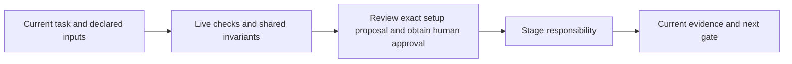

# project-context

Resolve organization defaults, project choices and user overrides with provenance. Register existing repository locations using stable IDs. Reuse answered/declined slices; surface sealed conflicts.

For first use, inspect setup, resolve applicable inherited rules and record the ground interview with evidence/reasons. Material deferrals block new planning/implementation. Policy setup is not policy approval; unavailable/stale organization sources block resolution.

Read [shared invariants](../../docs/reference/workflow-invariants.md) and the declared stage sections before work. The harness runs helpers and guides the user. For model work use `scan` routing.

<!-- devflow:routes:project-context -->
- `skill.project-context`: `skills/project-context/SKILL.md`
- `common`: `docs/reference/workflow-invariants.md`
- `guide.project-context`: `skills/project-context/GUIDE.md` → project-context usage guide / Purpose and prerequisites
<!-- /devflow:routes -->

During setup, review returned exact governing proposals with the user before specification/planning; generated content is not automatically approved.

## Documentation

Read [procedures](REFERENCE.md) for the matching stage/mode before verification, review or advanced operations. [Guide](GUIDE.md) contains command/input/output and recovery sections; load the section for the operation, not the entire manual. [Quick start](../../docs/quick-start.md) is the user entry point.

## Shared host contract

See [canonical guidance](../../docs/reference/host-lifecycle.md).

## Governing documents

See [canonical guidance](REFERENCE.md#governing-documents).

## Ground interview checkpoint

See [canonical guidance](REFERENCE.md#ground-interview-checkpoint).

### First-use document setup

See [governing guidance](../../docs/reference/governing-inputs.md).
