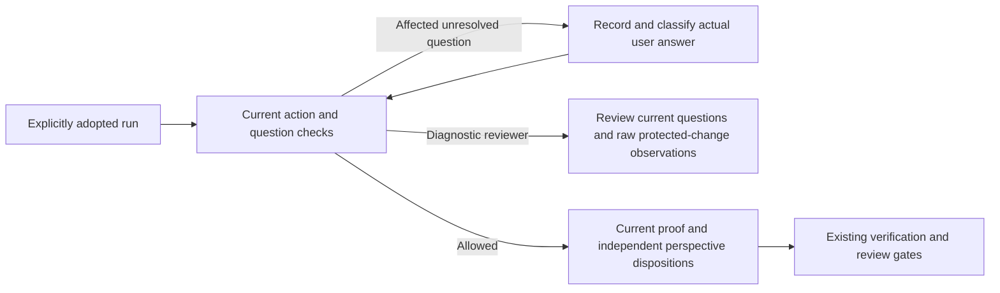
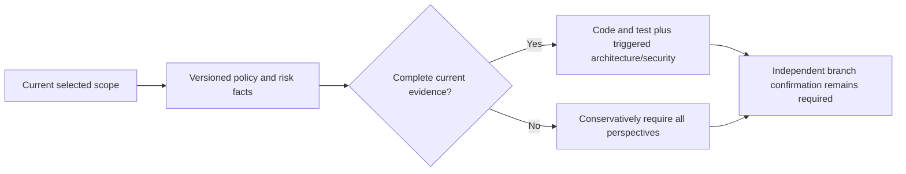
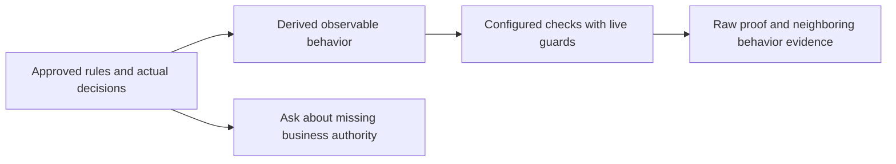
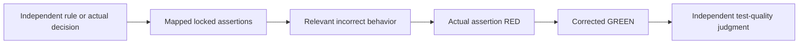
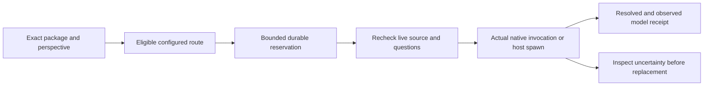
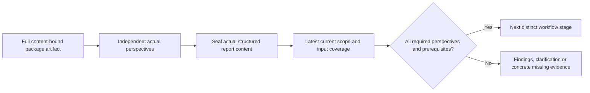
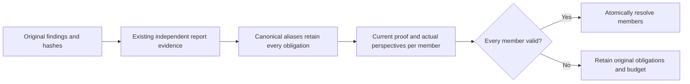
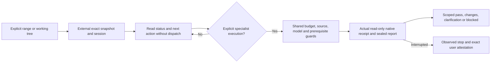

# review-work usage guide

Failure digests are navigation aids, not verification proof. Review original
evidence and named omissions; focused validation never discharges the complete
required-check set. See [context feedback](../../docs/context-efficiency.md#validation-feedback-and-failure-digests).

Read the [shared setup and conventions](../../docs/skills.md#shared-setup) first.
Commands below use its `df` function and path variables.

## Purpose and prerequisites

For delegated model work, the harness supplies [task facts](../../docs/reference/task-routing.md#task-decisions). Load controls/recovery sections only when needed; prepared interactive requests do not start workers.

Prepare review packages and record reports from genuinely separate invocations.
The implementer and each reviewer role need distinct actors. Capture exact base
and current head for each reviewed repository; include all relevant repositories.

## Package and item-review example

Set `REPOSITORIES_JSON` to an object such as:
`{"app":{"location":"/absolute/app","base":"BASE_SHA","head":"CURRENT_SHA"}}`.
Use actual Git SHAs. Work commits should include `Work-Item: W1` in their message.

```sh
df review package --root "$CONTROL" --run-id greeting-run --role item --item W1 --repositories-json "$REPOSITORIES_JSON" --operation-id item-package-v1 > package.json
```

Send the returned package to a separate reviewer invocation. Have it address W1,
returning `package_hash`, `item_id`, `verdict: pass|request-changes|block`, and
`findings`. `review-report.json` illustrates the shape, not an actual approval.
Replace its hash and use a real report, actor and invocation reference:

```sh
PACKAGE_HASH=$(python3 -c 'import json; print(json.load(open("package.json"))["package"]["package_hash"])')
REPORT_JSON=$(cat review-report.json)
df review record --root "$CONTROL" --run-id greeting-run --package-hash "$PACKAGE_HASH" --actor-id reviewer-item-1 --invocation-ref "$REVIEW_INVOCATION" --tool-available --report-json "$REPORT_JSON" --operation-id item-review-v1
```

## Branch review and acceptance

After all items, repeat package/record with role `branch`, then `acceptance`,
using distinct reviewer actors and real invocations. Branch/acceptance reports do
not need an item ID. The acceptance review is followed by `run accept` using an
acceptance report covering every requirement with MET/NOT MET/CANNOT VERIFY and
changed-file citations. Copy `acceptance.json`, bind the current acceptance
package hash, and cite actual repository paths/lines.

```sh
ACCEPTANCE_JSON=$(cat acceptance.json)
df run accept --root "$CONTROL" --run-id greeting-run --report-json "$ACCEPTANCE_JSON" --repositories-json "$REPOSITORIES_JSON" --operation-id accept-greeting-v1
df run gate-status --root "$CONTROL" --run-id greeting-run
```

Repository inputs must match the reviewed heads. MET without valid citations is
not accepted. All planned requirements must be addressed exactly once.

## Rework and blocked reviews

Fix request-changes findings, renew affected verifier proof and prepare a new
package. Four item correction waves and one branch/acceptance wave are allowed;
further unresolved requests require independent `run adjudicate`, including
role, actor, decision, rationale and cost if wrong. Use `review impact` with
`--changed-inputs-json` to assess invalidation. Missing independent tooling,
actors reused across roles or stale package content keep the gate blocked. The helper checks
record relationships; it cannot prove a supplied invocation reference is real.

## GitHub PR full review

After the user chooses and authorizes PR creation, `pr open` leaves the run in
`pr-review`. The coordinator calls `review pr-package` with the local Git
checkout containing the exact base and head commits. The helper reads every
GitHub file, commit, comment, review and CI page, compares the hosted file list
with the local binary-aware diff, and creates batches of at most 20 paths. A
fork head must first be available in the checkout. Incomplete pagination,
missing CI, or a changed PR prevents a package.
The `full_diff` field is authoritative for rename and deletion context;
batch diffs are navigation aids.

Attach a separate `pr-reviewer` host actor to the returned package and give it
all batches plus the approved spec, governing rules, acceptance criteria,
verification, prior findings, discussion and mergeability. Record a report
using [pr-review-report.json](../../docs/examples/pr-review-report.json) as a
shape example. `reviewed_files` must enumerate every changed path. `pass`
requires successful CI and mergeability. Findings need a reason and acceptance
condition; human questions also need options, impact, recommendation and owner.
Each human option states its consequence and the recorded actor must be the
named owner. Options have an `accept`, `request-changes`, or `reject` effect.
Only an accepted choice can precede a later passing review. A blocked report
lists a reason and next action. GitHub treats completed neutral and skipped
check runs as acceptable; a failed or pending check blocks a pass.
The helper can validate the report shape and actor IDs; the coordinator must
ensure the invocation was genuinely separate and the review substantive.

```sh
df review pr-package --root "$CONTROL" --run-id greeting-run \
  --repository "$CHECKOUT" --operation-id pr-package-v1
df review record --root "$CONTROL" --run-id greeting-run \
  --package-hash "$PACKAGE_HASH" --actor-id fresh-pr-reviewer \
  --invocation-ref "$PR_REVIEW_INVOCATION" --tool-available \
  --report-json "$PR_REPORT_JSON" --operation-id pr-review-v1
df pr publish --root "$CONTROL" --run-id greeting-run \
  --review-id "$PR_REVIEW_ID" --operation-id pr-publish-v1
df pr complete --root "$CONTROL" --run-id greeting-run \
  --review-id "$PR_REVIEW_ID" --operation-id pr-complete-v1
```

For `changes-requested`, publish the failure report, then use `pr rework` to
reopen all item proofs, reviews, acceptance and hardening. The implementer
repairs code and renews those gates. Prepare and verify a new delivery manifest,
push the repaired branch, then use `pr refresh` to bind its new hosted head and
pending status before preparing a new PR package. After two automatic
correction rounds, record independent human direction before another rework. For
`human-decision-required`, use `review pr-human-decision` with the exact package,
finding, selected option, actor and rationale. An accepted option needs a fresh
PR review; a request-changes option can enter rework, while rejection keeps
delivery closed for that run. A later attempt needs a fresh run. Beyond two
automatic correction rounds, `pr rework` needs a
`--direction-file` containing an independent human's `review_id`,
`choice: continue`, `actor_id`, `rationale`, and `cost_if_wrong`.
The [direction example](../../docs/examples/pr-rework-direction.json) shows the
file shape; pass it only for that later round.
A status update after a recorded human choice uses a new `pr publish` operation
ID; an exact retry of an earlier publication returns its historical receipt.
A human choice cannot waive failed CI or make a nonpassing verdict pass.
`pr publish` posts a concise GitHub summary, actionable inline findings and a
required status. `pr complete` records PR delivery only after confirmed success
on the exact head. The helper does not merge the PR or watch external updates.
Inline comments are placed only on changed text lines GitHub exposes, using
the left side for deleted lines; binary and out-of-diff findings remain in the
summary. Opening, publishing, refreshing and completing also recheck the live
required ruleset.
While delivery is pending, `pr sync` detects an external GitHub PR head or base
change and reopens the same gates. After renewing them, `pr refresh` binds the
new verified head. The old verdict and status do not transfer. After terminal
PR delivery, use a fresh run for a later update to the same PR.

```sh
df pr rework --root "$CONTROL" --run-id greeting-run \
  --review-id "$PR_REVIEW_ID" --operation-id pr-rework-v1
# Renew gates, push the new head, and verify a replacement manifest.
df pr refresh --root "$CONTROL" --run-id greeting-run \
  --manifest-file "$NEW_VERIFIED_MANIFEST" --operation-id pr-refresh-v1
```

For an external PR update while delivery is pending, start with `pr sync`
instead of `pr rework`, then renew gates and use `pr refresh`:

```sh
df pr sync --root "$CONTROL" --run-id greeting-run \
  --operation-id pr-external-update-v1
```

## Host usage example

Read [canonical guidance](../../docs/hosts.md). Stage routing is declared in this skill.

## Governing-document evidence

Read [canonical guidance](../../docs/reference/governing-inputs.md#governing-document-evidence). Stage routing is declared in this skill.

## Governing input reassessment

Read [canonical guidance](../../docs/reference/governing-inputs.md#governing-input-reassessment). Stage routing is declared in this skill.

## Item correction recovery

Prepare item packages with explicit `--item ID` so the package binds the completed
item and its current attempt. A valid `request-changes` record reopens only that
item and returns `run retry` as the next action. Issue the new attempt, fix findings,
run fresh GREEN with an explicitly qualified recorded RED when eligible,
and record a new proof-bound passing result before preparing a new item package.
Affected higher-level reviews/acceptance require renewal; history and correction
limits remain. Old packages retain their old semantics; stale completed code can
use [reverification](../build-work/REFERENCE.md#reverify-completed-work).

## Reviewer identity and finding errors

Use one stable actor ID per reviewer role per run, with a genuinely separate
invocation for each review. Reuse the item-reviewer actor for different items;
never reuse the implementer or another role's actor. A role-identity conflict
names the established actor. Finding severities are `critical`, `important`,
`minor`, `info`; each finding also needs a unique `id`, `path` and positive `line`.
The [report example](../../docs/examples/review-report.json) includes a finding;
replace its content with the reviewer's actual judgment and current package hash.

## Unrelated work during item review

Use an explicit item package and [complete repository-specific input scope](REFERENCE.md#scoped-item-review-liveness)
when the next item's unrelated files may change during review. Check the returned
liveness mode: include current dirty/index inputs too; incomplete scope falls back to whole-tree checks. A changed
packaged input still blocks with paths and requires a new package. Branch and
acceptance packages always retain conservative whole-tree behavior.

## Prior findings as reviewer context

Pass `--prior-findings-json` an array like [prior-findings.json](../../docs/examples/prior-findings.json). Each entry needs a unique nonempty `id`; optional severity must be `critical`, `important`, `minor` or `info`, optional path must be nonempty, and optional line must be a positive integer. Legacy minimal ID objects remain accepted. The reviewer checks prior findings against current code; the array does not automatically resolve findings or waive gates.


## Opt-in enforcement development foundation

Explicitly adopted runs apply versioned clarification checks at affected action
boundaries. Preserve actual user-answer provenance and renew stale preparation;
read-only assessments remain possible. The enforcement foundation is opt-in; specialist orchestration and automatic
repair belong to the companion implementation; see [current scope and developer contracts](../../docs/reference/python-enforcement.md).

Packages include recorded scoped questions/answers and actual pending execution
proofs. Independent closure dispositions must map applicable current proofs to
all consolidated obligations. A completed diagnostic assessment can resolve one
finding while others remain open; affected unresolved business questions still
block closure and cannot be waived. Required perspectives use distinct actors
and invocations with exact finding-contract bindings. Standalone assessed reports
are separate from explicitly authorized verified repair; neither supplies specialist orchestration.



A diagnostic standalone package may review exact protected edits before independent
approval exists; it does not authorize execution or verified completion. An
assessment's new findings remain valid report output. Current workflow blocks
supersede historical passes, and required standalone perspectives need distinct
actual reviewer coverage.


## Versioned review policy (development)

New runs select the risk-based review contract; historical runs need explicit
quiescent adoption. Unknown risk requires all substantive perspectives and cited
exemptions cannot be inferred from filenames. Recording risk does not dispatch a
reviewer or prove coverage; [current implementation scope](../../docs/reference/adversarial-review.md)
distinguishes available records from remaining orchestration.



## Current-policy contract prerequisites

Derive the scoped [implementation contract](../../docs/reference/adversarial-review.md#derived-implementation-contracts-and-configured-checks)
from approved rules. Preserve pending question text, source bindings and labeled
cause hypotheses. Run only configured checks; missing tools or failed checks
remain blockers. Diagnostic inspection does not grant an accepted review pass.



## Independent test quality

The current-policy test perspective must map approved behavior to actual locked
assertions and relevant incorrect alternatives. Read the [test-quality contract](../../docs/reference/adversarial-review.md#test-quality-assessment).
A defect's real assertion RED then corrected GREEN can supply discrimination;
a setup crash or always-passing assertion cannot. Optional challenges run only in
owned copies with authorized commands and retained reports.



## Specialist model execution

The harness binds each perspective to a distinct independent reviewer, exact
package and actual invocation. Read [specialist dispatch](../../docs/reference/adversarial-review.md#actual-specialist-dispatch)
for eligible model selection and recovery. A prepared request is not execution;
a diagnostic report is not a passing assessment. Keep ordinary acceptance separate.



## Current reports and coverage

Read the complete required artifact and its `report_contract`, then record exact
artifact/input coverage and actual invocation metadata. A reported pass must match
the real transport output. The test perspective owns independent oracle approval;
code confirms whole-scope risk in its existing round. Later blocked or pending
assessments supersede earlier passes. [Coverage rules and report fields](../../docs/reference/adversarial-review.md#content-bound-reports-and-effective-coverage)
apply at workflow, PR and host/session gates. Diagnostics finish assessment work
without claiming a pass; unresolved important findings survive later reports.




## Finding grouping and atomic closure

Use [finding lineage and dispositions](../../docs/reference/adversarial-review.md#finding-lineage-and-dispositions)
when existing review output establishes the same failure and correction. Keep all
original IDs, item proofs and required perspectives; unresolved business questions
need an answer before grouping. Grouping/splitting does not resolve a member or
reset repair limits. `close-canonical` validates every member before changing any
status. Diagnostic reports cannot authorize current-policy resolution/rejection.




## Standalone review outside a workflow

Use an explicit Git base/head range or working-tree selection and external output.
No project, spec, plan or workflow root is created. Preserve missing governing and
business evidence as limitations/questions. Creation and status do not run project
commands; actual specialist execution needs explicit finite budget and eligible
models. Read-only investigation may return incomplete coverage without granting a
pass. Uncertain workers require observed recovery, never an automatic replacement.
See [standalone scope, execution and limits](../../docs/reference/adversarial-review.md#standalone-selected-scope-review).



Opted-in [repair orchestration descriptors](../../docs/reference/adversarial-review.md#bounded-orchestration-state) also appear in standalone next/status output. Actual questions, limits, verification and independent coverage remain authoritative; a descriptor never means a worker ran.
