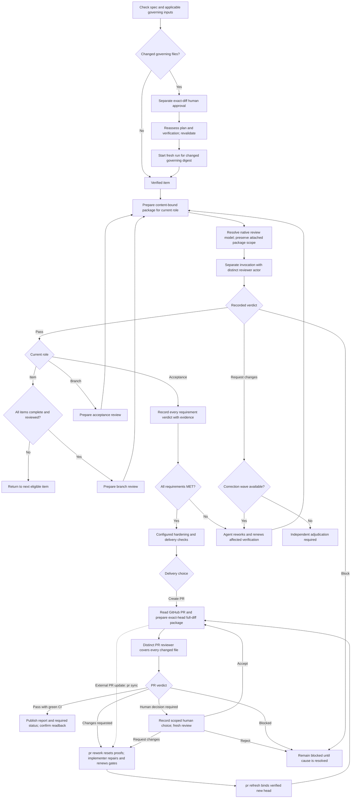

# review-work procedures

## Independent review gates



Correction budgets are four waves for item review and one each for branch and
acceptance review. The diagram shows agent handoffs, not automatic worker
dispatch. Changed content needs a fresh package and affected judgments must be
renewed. Adjudication does not manufacture missing verification or acceptance.

Use the active run ID and registered repository IDs. Prepare a read-only package for the item, branch, or acceptance role. Supply each repository's base and exact current head. The package includes the complete commit range, Work-Item attribution, working-tree and untracked changes, artifact references, criteria, prior findings, and a content hash.

Review the package in a separate host invocation. A reviewer must use one stable actor ID per role per run, distinct from the implementer and every other reviewer role. Reuse that role actor across items, with a fresh genuine invocation each time. Record the real invocation reference and a structured report bound to the package hash. If independent review tooling or the separate invocation is unavailable, leave the gate blocked; do not record a self-review as independent.

```sh
python3 <plugin-root>/skills/workflow/scripts/run.py review package \
  --root <control-root> --run-id <run-id> --role branch \
  --repositories-json '{"service":{"location":"<checkout>","base":"<base-sha>","head":"<head-sha>"}}'

python3 <plugin-root>/skills/workflow/scripts/run.py review record \
  --root <control-root> --run-id <run-id> --package-hash <package-hash> \
  --actor-id <independent-reviewer-id> --invocation-ref <review-invocation-reference> \
  --tool-available --report-json '{"package_hash":"<package-hash>","verdict":"pass","findings":[]}'
```

Use verdicts `pass`, `request-changes`, or `block`. Item review permits four correction waves; a fifth unresolved request requires adjudication. Branch and acceptance reviews permit one correction wave; a subsequent request requires adjudication. After changes, prepare a new package. Unknown correction impact invalidates all dependent judgments. Acceptance must address every requirement and cannot silently waive prior accepted requirements.

For a user-chosen GitHub PR, `review pr-package` reads all hosted PR pages and CI evidence, compares every hosted file and commit with the exact local base-to-head diff, and records bounded diff batches. Missing local fork commits, truncated GitHub lists, absent CI, or changed inputs block packaging. Attach a distinct `pr-reviewer` to that package. Its report uses `pass`, `changes-requested`, `human-decision-required`, or `blocked`, lists every file in `reviewed_files`, and gives structured findings. Two automatic correction rounds are allowed; later rework needs a recorded independent human direction. After a published changes-requested report, `pr rework` invalidates all item proofs, reviews, acceptance and hardening, then the implementer repairs and renews them. `pr refresh` binds a newly verified delivery manifest and new hosted head to the existing PR. Human options carry accept, request-changes or reject effects; only accept can precede a later pass, and no choice waives CI. `pr publish` posts a concise report, inline findings where the diff supports them, and the required status. `pr complete` needs a fresh package, live ruleset verification, and confirmed success on the exact head. External PR updates require `pr sync`, renewed gates and `pr refresh` before a fresh review; the helper does not watch GitHub continuously.

## Item-bound correction packages

`review package --role item --item ID` creates a version-2 package bound to that
completed item's current token and governing inputs. Its report must identify
the same item. `request-changes` reopens the item only after package, findings,
correction-limit and independent-actor checks pass; it does not reopen other items
or erase prior proof. Use the returned retry action and renew verification before
another package. Legacy packages keep their previous behavior and cannot imply
this transition. Branch and acceptance gates require renewed affected evidence.
