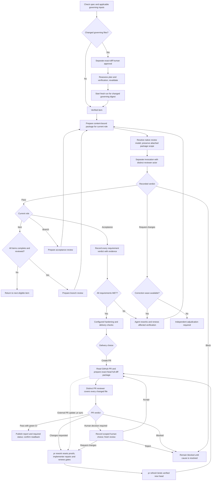

# Review work

## Independent review gates



Correction budgets are four waves for item review and one each for branch and
acceptance review. The diagram shows agent handoffs, not automatic worker
dispatch. Changed content needs a fresh package and affected judgments must be
renewed. Adjudication does not manufacture missing verification or acceptance.

Use the active run ID and registered repository IDs. Prepare a read-only package for the item, branch, or acceptance role. Supply each repository's base and exact current head. The package includes the complete commit range, Work-Item attribution, working-tree and untracked changes, artifact references, criteria, prior findings, and a content hash.

Review the package in a separate host invocation. A reviewer must use a stable actor ID distinct from the implementer and every other reviewer role. Record the real invocation reference and a structured report bound to the package hash. If independent review tooling or the separate invocation is unavailable, leave the gate blocked; do not record a self-review as independent.

```sh
python3 <plugin-root>/skills/workflow/scripts/run.py review package \
  --root <control-root> --run-id <run-id> --role branch \
  --repositories-json '{"service":{"location":"<checkout>","base":"<base-sha>","head":"<head-sha>"}}'

python3 <plugin-root>/skills/workflow/scripts/run.py review record \
  --root <control-root> --run-id <run-id> --package-hash <package-hash> \
  --actor-id <independent-reviewer-id> --invocation-ref <review-invocation-reference> \
  --tool-available --report-json '{"package_hash":"<package-hash>","verdict":"pass","findings":[]}'
```

Use verdicts `pass`, `request-changes`, or `block`. Item review permits four correction waves; a fifth unresolved request requires adjudication. Branch and acceptance reviews permit one correction wave; a subsequent request requires adjudication. After changes, prepare a new package. Unknown correction impact invalidates all dependent judgments. Acceptance must address every requirement and cannot silently waive prior accepted requirements.

For a user-chosen GitHub PR, `review pr-package` reads all hosted PR pages and CI evidence, compares every hosted file and commit with the exact local base-to-head diff, and records bounded diff batches. Missing local fork commits, truncated GitHub lists, absent CI, or changed inputs block packaging. Attach a distinct `pr-reviewer` to that package. Its report uses `pass`, `changes-requested`, `human-decision-required`, or `blocked`, lists every file in `reviewed_files`, and gives structured findings. Two automatic correction rounds are allowed; later rework needs a recorded independent human direction. After a published changes-requested report, `pr rework` invalidates all item proofs, reviews, acceptance and hardening, then the implementer repairs and renews them. `pr refresh` binds a newly verified delivery manifest and new hosted head to the existing PR. Human options carry accept, request-changes or reject effects; only accept can precede a later pass, and no choice waives CI. `pr publish` posts a concise report, inline findings where the diff supports them, and the required status. `pr complete` needs a fresh package, live ruleset verification, and confirmed success on the exact head. External PR updates require `pr sync`, renewed gates and `pr refresh` before a fresh review; the helper does not watch GitHub continuously.

## Documentation

See [usage guide and examples](GUIDE.md) for prerequisites, commands, input shapes,
outputs and recovery. The [documentation index](../../docs/skills.md) covers shared
setup and all DevFlow skills.

## Shared host contract

When explicitly attached, retain the current binding ID/revision and include them
in workflow mutations; transferred/stale bindings require refresh. Map actual
host task IDs explicitly and check completion using the shared host policy.
For model work here request `review` stage routing; deterministic helper execution
uses no separate model. Unknown effective settings remain advisory; strict mode
blocks. New scoped workers use bundled native discovery and launch; explicit advisory
pins require user permission for unvalidated suitability. Claude effort remains unobservable. See [host contracts](../../docs/hosts.md) for handoff and model limits.

Before delegated model work, follow the [native invocation guide](../../docs/native-models.md).
Keep the actual actor/stage and item token or review package. Hooks never launch
workers. Preserve blocked policy decisions and classify interrupted work before
any replacement. Deterministic operations do not need a model invocation.


## Governing-document evidence

Before new plan, build, review, delivery or host handoff work, the runner checks
repository specification approval and applicable governing inputs together.
Relevant organization and project rules are always included unless the project
manifest records an explicit `irrelevance_decisions` entry with `rule_id` and a
nonempty `reason`. The receipt stores applicable rule IDs, owning repositories,
paths, Git revisions, content digests and the effective digest. Documents remain
in their repositories; the receipt does not copy whole documents into briefs.

New or changed applicable governing files require separate human approval of
an exact proposal. Specification approval and Git commits cannot grant that
approval. Present the proposal's before/after hashes and exact diff for human
conflict review, including edits originally authored by the user; never fabricate
an approval event. Register the organization checkout before resolving inherited
rules. Unchanged historical files and unrelated edits do not need approval.
A handoff checks the prepared effective digest before changing ownership.


The accepted input receipt preserves file bytes for exact before-image recovery.
Proposals compare edits against this accepted baseline even after a Git commit.
An approval authorizes that exact before/after change; a historical approval for
the same after image cannot authorize restoration from a different baseline.
Committing an already accepted edit preserves its approval. A legacy receipt
without recoverable baseline bytes fails closed if its Git baseline differs.

## Governing input reassessment

Plan validation records the effective governing digest. An applicable policy
change after validation leaves a persistent `GOVERNING_REASSESSMENT_REQUIRED`
blocker, even after exact-diff approval or a repeated preflight. Reassess the
plan and verification impact, then explicitly validate the plan with a recorded
assessment. The helper checks that the assessment is nonempty; the agent and
human remain responsible for its substance and any required plan edits.

Runs retain their original governing digest. A run with an older digest remains
blocked with `RUN_GOVERNING_INPUTS_STALE` after plan revalidation. Preserve that
run and its evidence for audit and start a fresh run from the revalidated plan;
previous verification and review evidence are not carried forward. Discarding an
old run is a separate, explicit user-directed action, never automatic recovery.
