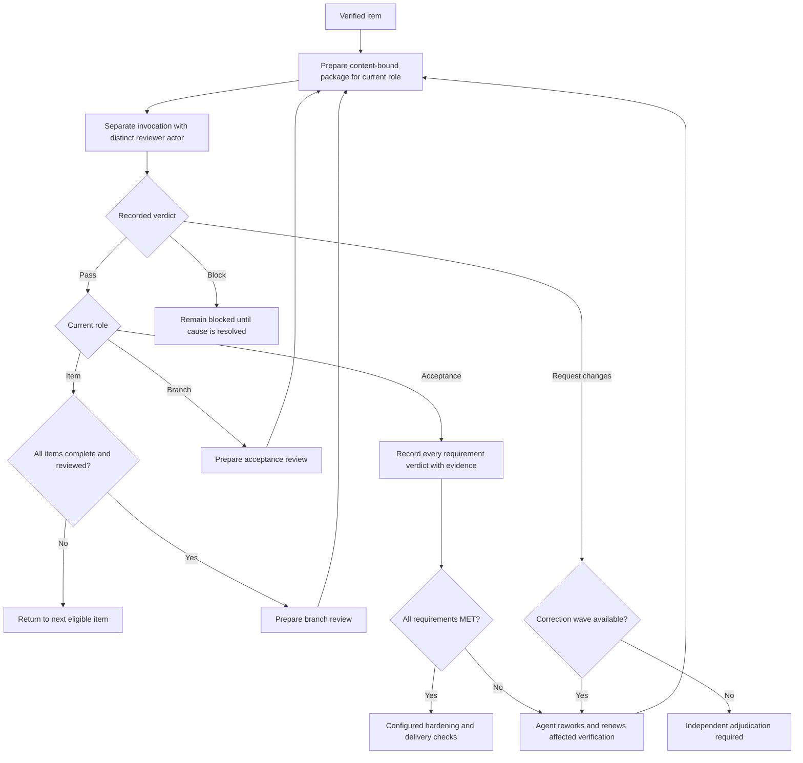

# Review work

## Independent review gates



Correction budgets are four waves for item review and one each for branch and
acceptance review. The diagram shows agent handoffs, not automatic worker
dispatch. Changed content needs a fresh package and affected judgments must be
renewed. Adjudication does not manufacture missing verification or acceptance.

Use the active run ID and registered repository IDs. Prepare a read-only package for the item, branch, or acceptance role. Supply each repository's base and exact current head. The package includes the complete commit range, Work-Item attribution, working-tree and untracked changes, artifact references, criteria, prior findings, and a content hash.

Review the package in a separate Codex invocation. A reviewer must use a stable actor ID distinct from the implementer and every other reviewer role. Record the real invocation reference and a structured report bound to the package hash. If independent review tooling or the separate invocation is unavailable, leave the gate blocked; do not record a self-review as independent.

```sh
python3 <plugin-root>/skills/workflow/scripts/run.py review package \
  --root <control-root> --run-id <run-id> --role branch \
  --repositories-json '{"service":{"location":"<checkout>","base":"<base-sha>","head":"<head-sha>"}}'

python3 <plugin-root>/skills/workflow/scripts/run.py review record \
  --root <control-root> --run-id <run-id> --package-hash <package-hash> \
  --actor-id <independent-reviewer-id> --invocation-ref <review-invocation-reference> \
  --tool-available --report-json '{"package_hash":"<package-hash>","verdict":"pass","findings":[]}'
```

Use verdicts `pass`, `request-changes`, or `block`. Item review permits four correction waves; a fifth unresolved request requires adjudication. Branch and acceptance reviews permit one correction wave; a subsequent request requires adjudication. After changes, prepare a new package. Unknown correction impact invalidates all dependent judgments. Acceptance must address every requirement and cannot silently waive prior accepted requirements.
