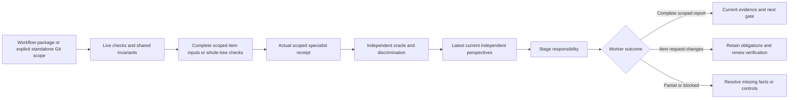

# review-work

Review exact current packages independently by item, branch and acceptance stage. Read the full required artifact; echo `review_input_ref` and exact `reviewed_inputs`. Cover changes and approved requirements; preserve cited original obligations. Implementers cannot self-approve.

Current-policy test review requires independent oracle authority, behavior-to-assertion mapping and relevant discrimination; see [test quality](../../docs/reference/adversarial-review.md#test-quality-assessment).

Bind each specialist's actual independent invocation to its perspective/package and eligible configured route; retain requested/resolved/observed settings. Prepared requests and advisory candidates do not prove coverage.

Read the package/rework procedure before recording. Rework invalidates affected evidence. UX reports/failure digests are inputs. Hosted PR review requires full diff, exact head and confirmed status; never merge implicitly.

Read [shared invariants](../../docs/reference/workflow-invariants.md) and declared stage sections. The harness runs helpers. For delegation follow [task routing](../../docs/reference/task-routing.md#task-decisions) and preserve stage/user constraints.

<!-- devflow:routes:review-work -->
- `skill.review-work`: `skills/review-work/SKILL.md`
- `common`: `docs/reference/workflow-invariants.md`
- `guide.review-work`: `skills/review-work/GUIDE.md` → review-work usage guide / Purpose and prerequisites
- `routing.task-decisions`: `docs/reference/task-routing.md` → Task routing / Task decisions
<!-- /devflow:routes -->

Item reviews use `--item ID`; complete [input scopes](REFERENCE.md#scoped-item-review-liveness) can isolate unrelated work; valid request-changes reopens only that item for retry and fresh verification.

Outside a workflow, select an explicit Git range/working tree and external output; default to report only. [Standalone review](../../docs/reference/adversarial-review.md#standalone-selected-scope-review).

## Documentation

Read [procedures](REFERENCE.md) for the matching stage/mode before verification, review or advanced operations. [Guide](GUIDE.md) contains command/input/output and recovery sections; load the section for the operation, not the entire manual. [Quick start](../../docs/quick-start.md) is the user entry point.

## Independent review gates

See [canonical guidance](REFERENCE.md#independent-review-gates).

## Shared host contract

See [canonical guidance](../../docs/reference/host-lifecycle.md).

## Governing-document evidence

See [canonical guidance](../../docs/reference/governing-inputs.md#governing-document-evidence).

## Governing input reassessment

See [canonical guidance](../../docs/reference/governing-inputs.md#governing-input-reassessment).

[Review/outcomes](../../docs/reference/adversarial-review.md#bounded-live-execution).
