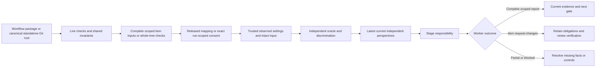

# review-work

Review current item/branch/acceptance packages independently. Verify full input bytes before/after dispatch; return exact `review_input_ref` and `reviewed_inputs`. Cover changes, requirements and cited obligations. No self-approval.

Current-policy test review requires independent oracle authority, behavior-to-assertion mapping and relevant discrimination; see [test quality](../../docs/reference/adversarial-review.md#test-quality-assessment).

Bind real independent invocations to perspective/package and eligible route; retain requested/resolved/observed settings. Preparation or advisory candidates cannot prove coverage.

Read package/rework procedures; renew affected evidence after rework. UX reports/digests are inputs. PRs require full diff, exact head and confirmed status; never merge implicitly.

Read [invariants](../../docs/reference/workflow-invariants.md), stage sections and [delegation routing](../../docs/reference/task-routing.md#task-decisions). The harness runs helpers; preserve user constraints.

<!-- devflow:routes:review-work -->
- `skill.review-work`: `skills/review-work/SKILL.md`
- `common`: `docs/reference/workflow-invariants.md`
- `guide.review-work`: `skills/review-work/GUIDE.md` → review-work usage guide / Purpose and prerequisites
- `routing.task-decisions`: `docs/reference/task-routing.md` → Task routing / Task decisions
<!-- /devflow:routes -->

Use `--item ID` and complete [input scopes](REFERENCE.md#scoped-item-review-liveness). Request-changes reopens that item for retry/fresh verification.

For [standalone review](../../docs/reference/adversarial-review.md#standalone-selected-scope-review), select canonical Git root, range/worktree and external output; default report-only.

## Documentation

Read matching [procedures](REFERENCE.md) and [guide sections](GUIDE.md) before verification/review/recovery. User entry: [quick start](../../docs/quick-start.md).

## Independent review gates

See [canonical guidance](REFERENCE.md#independent-review-gates).

## Shared host contract

See [canonical guidance](../../docs/reference/host-lifecycle.md).

## Governing-document evidence

See [canonical guidance](../../docs/reference/governing-inputs.md#governing-document-evidence).

## Governing input reassessment

See [canonical guidance](../../docs/reference/governing-inputs.md#governing-input-reassessment).

[Review/outcomes](../../docs/reference/adversarial-review.md#bounded-live-execution).

[Workflow-only consent](GUIDE.md#run-scoped-observed-reviewer-choice): exact human approval, observed high effort, unvalidated suitability; recheck at launch/admission/coverage. No repair/standalone inheritance.
