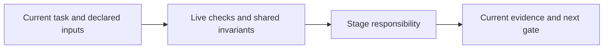

# review-work

Arrange independent item, branch and acceptance reviews over exact current content-bound packages. Cover every changed file and approved requirement. Report cited findings and real actor/invocation identity; an implementer cannot self-approve.

Before recording a review, read the matching package/rework procedure. Rework invalidates affected packages/evidence. A UX report or failure digest is input, not proof or acceptance. Hosted PR review requires the full diff, exact head and confirmed required status; never merge implicitly.

Read [shared invariants](../../docs/reference/workflow-invariants.md) and the declared stage sections before work. The harness runs helpers and guides the user. For model work use `review` routing.

<!-- devflow:routes:review-work -->
- `skill.review-work`: `skills/review-work/SKILL.md`
- `common`: `docs/reference/workflow-invariants.md`
- `guide.review-work`: `skills/review-work/GUIDE.md` → review-work usage guide / Purpose and prerequisites
<!-- /devflow:routes -->

## Documentation

Read [procedures](REFERENCE.md) for the matching stage/mode before verification, review or advanced operations. [Guide](GUIDE.md) contains command/input/output and recovery sections; load the section for the operation, not the entire manual. [Quick start](../../docs/quick-start.md) is the user entry point.

## Independent review gates

See [canonical guidance](REFERENCE.md#independent-review-gates).

## Shared host contract

See [canonical guidance](../../docs/reference/host-lifecycle.md).

## Governing-document evidence

See [canonical guidance](../../docs/reference/governing-inputs.md#governing-document-evidence).

## Governing input reassessment

See [canonical guidance](../../docs/reference/governing-inputs.md#governing-input-reassessment).
