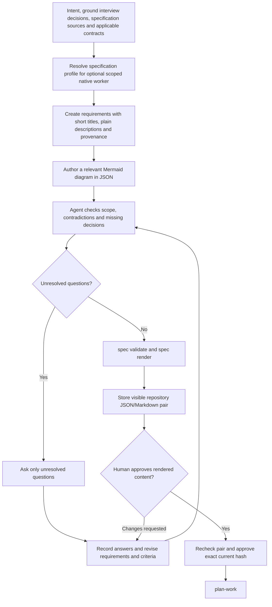

# specify procedures

## Specification refinement

The agent performs discovery and interviews. `spec gaps` only lists gaps already
recorded in the specification; it does not detect semantic omissions. The helper
validates structure and binds approval to content, but currently permits approval
with unanswered recorded gaps. Any content change requires renewed approval.

New approvals use a selected registered repository and visible JSON/Markdown pair
whose name matches the feature, such as `docs/specs/greeting.json` and `.md` for
the greeting example. The repository files are authoritative: approval checks
deterministic Markdown and both recorded hashes immediately before journaling.
Ignored paths, `.devflow`, and paths escaping the repository are rejected.
Existing journal-only flows remain supported as explicit legacy behavior.

Always include at least one relevant Mermaid diagram when creating or revising a
specification. Store each diagram as a titled `diagrams` entry in the authoritative
JSON; `spec render` includes its fenced Mermaid source in the Markdown companion.
Choose a system, data, state, sequence, or workflow view that explains actual
requirements; check the rendered diagram for accuracy. New or changed
repository-backed specifications cannot be approved without a diagram. Previously
approved content without diagrams remains usable until it changes. The helper
checks diagram structure, not Mermaid syntax or semantic accuracy.

Use `new`, `extend`, or `migrate` mode. Preserve authored, derived, and assumed provenance; cite path, commit, and line range for derived facts. Ask only unresolved gap questions. Review the rendered specification with the user before recording approval. Approval must include the exact content hash and becomes stale when content changes.
Give each new requirement a concise single-line `title`. Keep its full description
in `text`: Markdown renders the ID/title heading, then an ordinary paragraph.
Without a title, the heading contains only the ID. Exact legacy renderings remain
readable; rewriting a pair records a new Markdown hash and requires reapproval.
Before the first feature spec in a new project, complete the project-context
ground interview. Reuse its decisions and applicable governing rules for later
specs, then interview feature-specific gaps dynamically. A ready checklist is
structural evidence, not proof that all semantic gaps were found.
