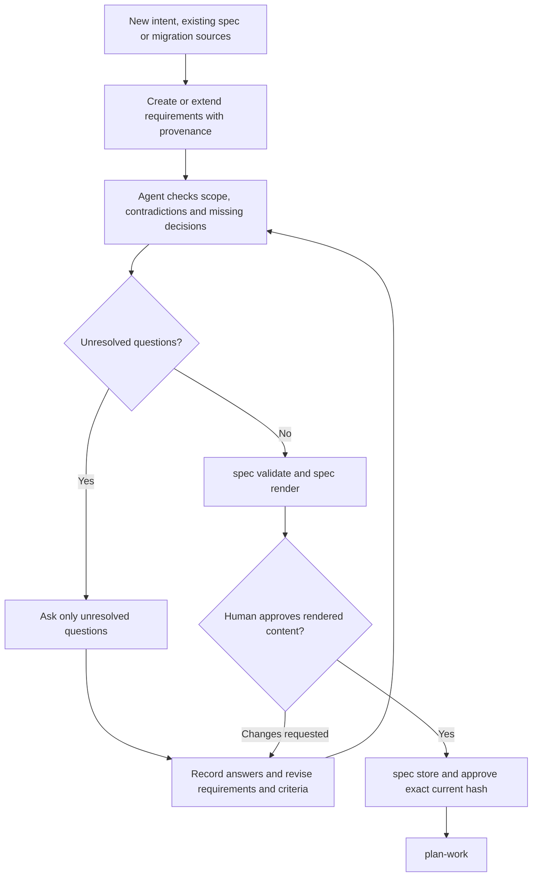

# Specify requirements

## Specification refinement

The agent performs discovery and interviews. `spec gaps` only lists gaps already
recorded in the specification; it does not detect semantic omissions. The helper
validates structure and binds approval to content, but currently permits approval
with unanswered recorded gaps. Any content change requires renewed approval.

Use `new`, `extend`, or `migrate` mode. Preserve authored, derived, and assumed provenance; cite path, commit, and line range for derived facts. Ask only unresolved gap questions. Review the rendered specification with the user before recording approval. Approval must include the exact content hash and becomes stale when content changes.
