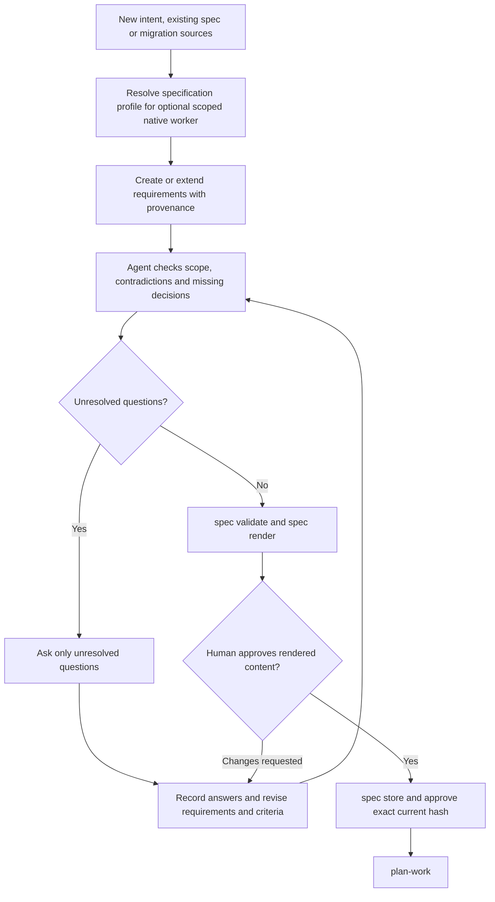

# Specify requirements

## Specification refinement

The agent performs discovery and interviews. `spec gaps` only lists gaps already
recorded in the specification; it does not detect semantic omissions. The helper
validates structure and binds approval to content, but currently permits approval
with unanswered recorded gaps. Any content change requires renewed approval.

Use `new`, `extend`, or `migrate` mode. Preserve authored, derived, and assumed provenance; cite path, commit, and line range for derived facts. Ask only unresolved gap questions. Review the rendered specification with the user before recording approval. Approval must include the exact content hash and becomes stale when content changes.

## Documentation

See [usage guide and examples](GUIDE.md) for prerequisites, commands, input shapes,
outputs and recovery. The [documentation index](../../docs/skills.md) covers shared
setup and all DevFlow skills.

## Shared host contract

When explicitly attached, retain the current binding ID/revision and include them
in workflow mutations; transferred/stale bindings require refresh. Map actual
host task IDs explicitly and check completion using the shared host policy.
For model work here request `specification` stage routing; deterministic helper execution
uses no separate model. Unknown effective settings remain advisory; strict mode
blocks. New scoped workers use bundled native discovery and launch; explicit advisory
pins require user permission for unvalidated suitability. Claude effort remains unobservable. See [host contracts](../../docs/hosts.md) for handoff and model limits.

Before delegated model work, follow the [native invocation guide](../../docs/native-models.md).
Keep the actual actor/stage and item token or review package. Hooks never launch
workers. Preserve blocked policy decisions and classify interrupted work before
any replacement. Deterministic operations do not need a model invocation.
