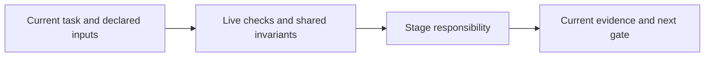

# specify

Create or extend requirements in new/extend/migrate mode with stable IDs, concise single-line titles, plain description text, criteria and authored/derived/assumed provenance. Derived facts need actual path/commit/line citations.

Inspect semantic gaps and contradictions, interview unresolved decisions, and add a relevant titled Mermaid diagram. Store the visible registered-repository JSON/Markdown pair and obtain approval of its exact current content. Legacy renderings stay readable; rewriting or changing a title needs reapproval.

Read [shared invariants](../../docs/reference/workflow-invariants.md) and the declared stage sections before work. The harness runs helpers and guides the user. For model work use `specification` routing.

<!-- devflow:routes:specify -->
- `skill.specify`: `skills/specify/SKILL.md`
- `common`: `docs/reference/workflow-invariants.md`
- `guide.specify`: `skills/specify/GUIDE.md` → specify usage guide / Purpose and prerequisites
<!-- /devflow:routes -->

## Documentation

Read [procedures](REFERENCE.md) for the matching stage/mode before verification, review or advanced operations. [Guide](GUIDE.md) contains command/input/output and recovery sections; load the section for the operation, not the entire manual. [Quick start](../../docs/quick-start.md) is the user entry point.

## Specification refinement

See [canonical guidance](REFERENCE.md#specification-refinement).

## Shared host contract

See [canonical guidance](../../docs/reference/host-lifecycle.md).
