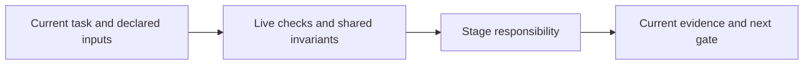

# stats

Report measured usage and event-derived outcomes. Import only accessible versioned runtime records with source identity, deduplication and explicit attribution. Freeze reports; repricing preserves prior snapshots.

Costs require sufficient explicit usage coverage and supplied versioned rates. Missing/ambiguous usage stays unknown. `stats context` measures bytes/calls/cache/full-delta behavior, not inferred token/cost savings. Opt-in traces and approved eval cases never automatically promote policy.

Read [shared invariants](../../docs/reference/workflow-invariants.md) and the declared stage sections before work. The harness runs helpers and guides the user. For deterministic reporting no model invocation is needed.

<!-- devflow:routes:stats -->
- `skill.stats`: `skills/stats/SKILL.md`
- `common`: `docs/reference/workflow-invariants.md`
- `guide.stats`: `skills/stats/GUIDE.md` → stats usage guide / Purpose and prerequisites
<!-- /devflow:routes -->

## Documentation

Read [procedures](REFERENCE.md) for the matching stage/mode before verification, review or advanced operations. [Guide](GUIDE.md) contains command/input/output and recovery sections; load the section for the operation, not the entire manual. [Quick start](../../docs/quick-start.md) is the user entry point.

## Shared host contract

See [canonical guidance](../../docs/reference/host-lifecycle.md).
