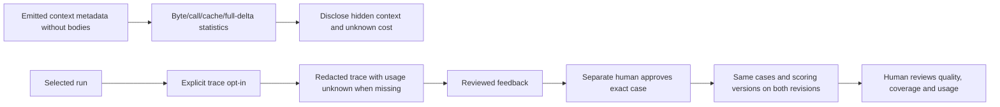

# Usage and outcome reporting

Use `stats context` for measured context bytes, repeated reads, helper calls,
cache outcomes and full/delta counts. Report required-ID coverage separately
from unknown semantic omissions. Bytes/4 is an estimate, never actual usage/cost.

Import only explicitly accessible versioned runtime records. Deduplicate by source event identity; leave ambiguous attribution unbound. Prices are user supplied, versioned, and labeled API-equivalent estimates. Cost requires at least 90% usage coverage and known rates. Reports disclose exclusions and unavailable event history, use ratios of sums, and preserve frozen snapshots when repriced.

`stats trace` emits only an opted-in allowlisted projection and its hash. It
never exports raw prompts, worker output or repository bodies. The workflow
`improve` commands bind reviewer feedback to that hash, require exact-case
approval, and compare versioned executions without automatic promotion.

Journal imports with `stats usage-import/expectations/prices/legacy-import`. Freeze reports with `stats metrics --root ROOT --operation-id ID --options JSON`; outcomes come from committed runs, not input-file summaries. `stats rollup/export/inspect` reads frozen records without mutations. Use per-run snapshots for additive rollups across overlapping scopes. See `../../docs/journal-integration.md`.

## Documentation

See [usage guide and examples](GUIDE.md) for prerequisites, commands, input shapes,
outputs and recovery. The [documentation index](../../docs/skills.md) covers shared
setup and all DevFlow skills.

## Shared host contract

When explicitly attached, retain the current binding ID/revision and include them
in workflow mutations; transferred/stale bindings require refresh. Map actual
host task IDs explicitly and check completion using the shared host policy.
For model work here request `scan` stage routing; deterministic helper execution
uses no separate model. Unknown effective settings remain advisory; strict mode
blocks. New scoped workers use bundled native discovery and launch; explicit advisory
pins require user permission for unvalidated suitability. Claude effort remains unobservable. See [host contracts](../../docs/hosts.md) for handoff and model limits.

Before delegated model work, follow the [native invocation guide](../../docs/native-models.md).
Keep the actual actor/stage and item token or review package. Hooks never launch
workers. Preserve blocked policy decisions and classify interrupted work before
any replacement. Deterministic operations do not need a model invocation.
