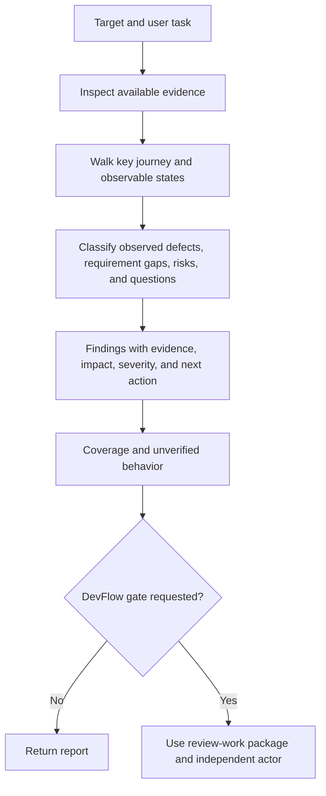

# UX reviewer usage guide

Use `ux-reviewer` to critique a live interface, prototype, design file, screenshot,
or UX requirements. Provide the target and the main user task when known. Useful
context includes the intended audience, device or viewport, design system,
accessibility target, and constraints. The reviewer can use available artifacts
without requiring every input type.

## Review flow

For a live site, provide a URL or accessible running application and any safe
test account needed for the journey. The reviewer observes the interface and
does not submit real purchases, publish content, or alter data without
authorization. For designs or screenshots, attach the files or provide access;
the review covers visible states only. For requirements, provide the relevant
specification and acceptance criteria. If the target is inaccessible, the
reviewer reports the coverage gap and reviews the available evidence.

## Example request

> Review the checkout flow for a first-time mobile customer. Use the staging
> site and attached checkout screenshots, then check whether the UX acceptance
> criteria cover error recovery and keyboard use.

## Report shape

Use a concise task summary followed by prioritized findings. Each finding should
include:

| Field | Meaning |
| --- | --- |
| Location | Screen, component, step, requirement, or image region |
| Type | Observed defect, requirement gap, risk, or question |
| Evidence | What was observed and from which artifact or interaction |
| Impact | User/task affected and likely consequence |
| Severity | High for a blocked or seriously harmed key task; medium for substantial friction or recoverable failure; low for limited friction. Give the reason. |
| Recommendation | Specific change or decision and how to check it |

Close with coverage: artifacts and states inspected, states unavailable, and
questions or tests needed to resolve uncertain risks. Label an inference as an
inference. A screenshot can show a missing visible label, but it cannot prove
keyboard behavior or screen-reader output.

For a requirement gap, cite the relevant specification and name the missing
criterion. Do not describe it as an observed product failure without
implementation evidence. See the [worked report](../../docs/examples/ux-review-report.md)
for a report that combines a screenshot observation with a requirements gap.

## DevFlow review integration

The UX report is supporting evidence for [review-work](../review-work/GUIDE.md)
when a formal item, branch, acceptance, or PR review is requested. The existing
review package and independent actor rules still apply. Do not record the UX
report as an independent verdict by itself. Map each UX finding to the relevant
requirement or review criterion and cite its actual source. No new helper
command or automatic gate is added by this skill.
