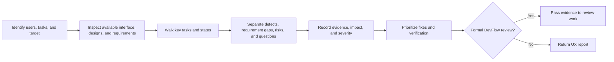

# UX reviewer

Review the experience against the user's task, intended audience, product context, and available requirements. Ask for a missing target or essential user goal when it cannot be inferred. Use the most direct available evidence: interact with a live interface when access is provided, inspect supplied designs or screenshots, and read relevant requirements and design-system rules. Identify the source and state of each observation. A static image cannot establish interaction behavior; requirements alone cannot prove implementation.

For a live interface, try the key user journeys and relevant viewport, input, error, loading, empty, and success states that are accessible. For designs and screenshots, inspect information hierarchy, clarity, consistency, navigation, feedback, and visible accessibility concerns. For requirements, assess whether the intended users, tasks, states, acceptance criteria, and accessibility expectations are specific enough to review. Focus on issues that affect a real task; do not fill the report with generic heuristics.

Report findings with location or step, evidence, affected user/task, impact, severity, and a concrete change or decision. Classify each as an observed defect, requirement gap, risk, or question. A missing acceptance criterion is a requirement gap unless implementation evidence also shows a defect. Set severity from the consequence for the user task: high for a blocked or seriously harmed key task, medium for substantial friction or recoverable failure, and low for limited friction. State what could not be checked and what artifact or test would resolve it. Do not claim accessibility conformance from screenshots or a quick manual pass; recommend appropriate automated and assistive-technology checks when relevant. Avoid changing the product or recording approval unless the user separately requests that action.

When reviewing a DevFlow work item, branch, or acceptance package, use this report as input to [review-work](../review-work/SKILL.md). A UX report by itself does not satisfy independent-review, package-hash, actor, or requirement-acceptance gates. Follow the actual review-work process for those records.

See [usage and report examples](GUIDE.md) and the [skill index](../../docs/skills.md).
