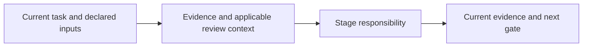

# ux-reviewer

Review the user task against live interfaces, designs, screenshots or requirements. Identify evidence source/state and inspect accessible journeys, feedback and relevant accessibility concerns. Ask for a target or essential goal only if missing.

Classify observed defects, requirement gaps, risks and questions. Give location, evidence, affected task, impact, severity and a concrete fix/verification. Static images cannot prove interaction or accessibility conformance. A UX report does not satisfy formal DevFlow review/approval gates; use review-work when those records are requested.

Read [shared invariants](../../docs/reference/workflow-invariants.md) and the declared stage sections before work. The harness runs helpers and guides the user. For model work use `review` routing.

<!-- devflow:routes:ux-reviewer -->
- `skill.ux-reviewer`: `skills/ux-reviewer/SKILL.md`
- `common`: `docs/reference/workflow-invariants.md`
- `guide.ux-reviewer`: `skills/ux-reviewer/GUIDE.md` → UX reviewer usage guide / Review flow
<!-- /devflow:routes -->

## Documentation

Read [procedures](REFERENCE.md) for the matching stage/mode before verification, review or advanced operations. [Guide](GUIDE.md) contains command/input/output and recovery sections; load the section for the operation, not the entire manual. [Quick start](../../docs/quick-start.md) is the user entry point.
