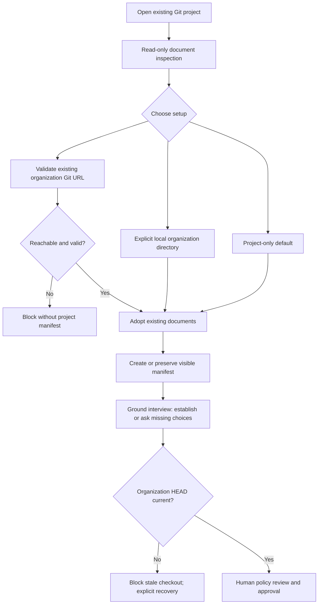

# workflow usage guide

Run next/retry/brief now return complete bounded task views; attached clients can
use `host brief`. See [context selection and limits](../../docs/context-efficiency.md).
Session start/compaction/handoff rebuild full context. A reference-only hook
response must be explicitly loaded before model work. Native invocations receive
full context once, after required preparation succeeds.

Start with the [complete setup and initialization guide](../../docs/setup-and-usage.md). Native Windows remains unsupported pending installed-hook, worker and real-host validation; the journal lock and pipe transport now use platform boundaries.

Read the [shared setup and conventions](../../docs/skills.md#shared-setup) first.
Commands below use its `df` function and path variables.

## Purpose and prerequisites

Coordinate the whole process shown in [SKILL.md](SKILL.md). Begin with registered
repositories, resolved context, a human-approved specification and a validated
plan. Preparation is covered by the context, specification and planning guides.

## First-use ground interview

After guided setup, inspect existing code, repository documents and inherited
organization rules. Record the project baseline in
`docs/devflow-ground-interview.json` using the
[complete example](../../docs/examples/ground-interview.json). Ask focused
questions only for decisions that evidence cannot establish. Record each topic
as `answered`, `established` with source references, `deferred` with a reason,
or `not-applicable` with a reason. Mark material choices explicitly; material
deferrals block repository-backed planning and work. The agent checks the quality
of decisions and whether each choice is material. Revisit the baseline when
project choices change and reassess affected feature work. Older manifests
without the declaration are compatible and are not retroactively gated.
The [project-context guide](../project-context/GUIDE.md) covers setup; the
[specify guide](../specify/GUIDE.md) covers feature-specific gaps.

## Start, inspect and resume

```sh
df run start --root "$CONTROL" --run-id greeting-run --actor-id implementer-1 --operation-id start-greeting
df run next --root "$CONTROL" --run-id greeting-run --operation-id next-W1 > next.json
ATTEMPT=$(python3 -c 'import json; print(json.load(open("next.json"))["attempt_id"])')
df run status --root "$CONTROL" --run-id greeting-run
df run brief --root "$CONTROL" --run-id greeting-run --item W1
df run gate-status --root "$CONTROL" --run-id greeting-run
df run inspect --root "$CONTROL" --run-id greeting-run
```

`next` issues an attempt token and scoped work package. Save the token for build
verification and result submission. `brief` reads context without issuing a new
attempt. `inspect` is the full record; use compact status/brief for routine work.
Follow implementation, item review, branch review, acceptance, hardening and
delivery stages. An active attempt must be resolved or abandoned before retrying.

## Configured hardening example

Copy `hardening.json` and replace its actor. It declares a real argv array for a
unit-suite gate (`-B` avoids new bytecode files during verification); add E2E or red-team commands only when those tools exist.

```sh
df harden configure --root "$CONTROL" --input hardening.json --operation-id configure-gates-v1
df harden gate --root "$CONTROL" --input "$EXAMPLES/gate.json" --operation-id unit-gate-v1
```

Failed or stale gate proofs block delivery. The agent fixes the cause, renews
verification and affected reviews, then reruns the gate with a new operation ID.
Interrupted execution reports `EXECUTION_INTERRUPTED`; a new execution requires
a new ID. Exact successful retries return committed proof without running again.

The default gate uses `exit-status`: exit zero passes, and command output is not
interpreted. For a scanner that emits a structured report, configure
`"contract":{"kind":"json-report","version":1}` as in
[structured-gate.json](../../docs/examples/structured-gate.json). Version 1
requires one JSON object with a `findings` array; each finding has a nonempty
string `id`. An empty array passes. Missing, malformed, oversized or nonempty
reports fail even when the scanner exits zero. The example runs the unit suite
and reports a finding if it fails; replace that command with the project's
actual scanner when using this contract for security checks.

```sh
df harden configure --root "$CONTROL" --input "$EXAMPLES/structured-gate.json" --operation-id configure-structured-v1
df harden gate --root "$CONTROL" --input "$EXAMPLES/gate.json" --operation-id structured-gate-v1
```

## Optional bounded repair

Existing runs remain manual until a policy is recorded. Copy and adjust
[bounded-repair.json](../../docs/examples/bounded-repair.json), then configure
the selected run. `max_estimated_cost` is a numerical cap in the same unit as
the estimate supplied for each cycle; the caller must provide a known estimate.

```sh
df repair configure --root "$CONTROL" --run-id greeting-run --input "$EXAMPLES/bounded-repair.json" --operation-id repair-policy-v1
df repair status --root "$CONTROL" --run-id greeting-run
df repair next --root "$CONTROL" --run-id greeting-run --operation-id repair-cycle-1 --estimated-cost 0.50
```

`next` claims exactly one cycle before launching the attached implementer's
native worker, reruns the failed configured hardening gates, and records the
remaining failure IDs. It requires native model eligibility; a strict-model
blocker or unknown price never counts as a pass. Replaying a claimed operation
does not launch another worker. If interrupted, inspect the native invocation,
reconcile a stopped orphan through `host model-reconcile`, then explicitly stop
the repair cycle with `repair stop --reason-code HUMAN_DECISION
--confirm-stopped-by ACTOR`. Stop preserves remaining failures and is terminal
for automatic repair on that run. Review findings and item proofs still
require agent-led rework and fresh validation; independent review is renewed
after repository edits.
If the worker returns a terminal failure or the gate runner errors after claim,
DevFlow journals an aborted cycle, its reason and remaining failures. This
stops automatic repair without leaving a claimed lease. A still-running native
invocation keeps the claim until it is reconciled.

## Run-derived improvement cases

Selected runs may opt into redacted improvement traces. Use a real actor ID
for opt-in, then inspect the trace and copy its returned `trace_hash` into
[improvement-case.json](../../docs/examples/improvement-case.json). Feedback
records a case proposal; a different human actor approves the exact returned
`case_hash` before it becomes runnable.

```sh
df improve trace-enable --root "$CONTROL" --run-id greeting-run --actor-id reviewer-1 --operation-id trace-opt-in
df stats trace --root "$CONTROL" --options '{"run_id":"greeting-run"}'
df improve feedback --root "$CONTROL" --input "$EXAMPLES/improvement-case.json" --operation-id feedback-1
```

Approve with `improve case-approve --input APPROVAL.json --operation-id ID`,
where `APPROVAL.json` has the returned `feedback_id`, `case_hash`, a distinct
human `actor_id`, and `"approved":true`. `improve inspect` lists approved
cases. `improve run-cases --input CANDIDATE.json --cwd CHECKOUT` executes the
same approved argv cases against a candidate checkout; the candidate JSON
must include its artifact hash. Save both baseline and candidate results, then
pass them together with `improve compare --input COMPARISON.json`. Case and
scoring-version mismatch blocks comparison. `improve retrospective --input
TRACES.json` groups cited feedback by owner without editing the plugin.
The artifact hash is a caller-supplied label: the runner does not select or
verify that artifact, and comparison accepts supplied result JSON. Prepare
and review separate baseline/candidate checkouts and attest their results
before treating a quality delta as evidence for a revision.
Trace output omits prompts, worker output and repository content. Missing
runtime usage is unknown; byte estimates do not establish token savings.
For model suitability, approve cases tagged `specification`, `coding`,
`debugging` and `review`, then supply actual host/model/version-bound results
to `improve model-evaluate --root "$CONTROL" --input INPUT.json`. The
[illustrative input](../../docs/examples/model-suitability.json) shows the
shape but cannot itself authorize a model: its cases are not in the journal
and its results are invented. A passing report needs human review and a
new plugin policy release. Runtime host/model revision checks still apply;
no automatic provider mapping ships.

## Optional host Goals

Ask DevFlow to show `host goal-status` for the attached binding. It returns a
contract hash, verification surface, constraints and blocked condition. After
the user authorizes that exact condition, activate `/goal` in the current
Codex or Claude session and fill
[goal-binding.json](../../docs/examples/goal-binding.json) with the active
binding, opaque host reference, contract hash and authorizing actor. Record it
with `host goal-bind --root "$CONTROL" --file goal-binding.json
--operation-id goal-bind-v1`. The host Goal's completion signal never replaces
DevFlow proof, independent review or delivery approval. On cross-host handoff,
the destination reviews the carried contract and activates a new Goal with
fresh authorization. See the [Codex](../../adapters/codex/GOALS.md) and
[Claude](../../adapters/claude/GOALS.md) adapter notes.

## Delivery example

After all gates pass, set `REPOSITORIES_JSON` to a JSON object mapping `app` to its
absolute location, base commit and exact current head (see the review guide).

```sh
df delivery prepare --root "$CONTROL" --run-id greeting-run --repositories-json "$REPOSITORIES_JSON" --outcome retained-branch > manifest.json
HASH=$(python3 -c 'import json; print(json.load(open("manifest.json"))["manifest_hash"])')
df delivery verify --root "$CONTROL" --run-id greeting-run --manifest-file manifest.json --confirm-hash "$HASH" --repositories-json "$REPOSITORIES_JSON" > verified-manifest.json
```

Ask the human to choose and authorize the exact outcome. After performing that
choice, write `actual-result.json` with `outcome`, every `repository_heads` entry,
and `authorization: {approved: true, actor_id, manifest_hash, action}`. The action
is `delivery.retained-branch` or `delivery.local-merge` for this command.
Local merge also needs matching `merge_commits`. New PR outcomes use `pr open`
with action `delivery.pull-request` after verified GitHub ruleset setup. It
creates or finds the exact-head PR, posts a pending required status, and keeps
the run active for a separate full PR review. Use `review pr-package`, attach a
distinct `pr-reviewer`, record its every-file verdict, then `pr publish` and
`pr complete` only on a fresh passing package and confirmed GitHub status.
After a published changes-requested report, `pr rework` reopens all item proofs,
reviews, acceptance and hardening. The implementer repairs, renews these gates,
pushes a new head, and uses `pr refresh` with a newly verified manifest before
another package. After two automatic correction rounds, a later rework needs
independent human direction. A human decision is scoped to an exact finding;
only an accepting choice can precede a pass, and no choice waives CI.
For a PR changed externally, `pr sync` reopens those gates before the same
refresh sequence; DevFlow has no background watcher.
Historical PR delivery records remain readable. The helper never merges a PR.

Once the authorized direct result is recorded, or `pr complete` records a
ready-to-merge PR, close the build report with this one-time question:
“Would you like me to update the [DevFlow Codex site](https://devflow-field-guide.waygent.chatgpt.site/)
with this build?” Ask for documentation-only builds too. This is an agent prompt,
not a helper command or a delivery gate. A no or no answer leaves the recorded
build complete; a yes starts a separate site-update task. Never publish site
changes from the prompt alone before the user answers.

For example, after reporting the delivered branch and test results, say:

> The build is delivered and the required checks passed. Would you like me to
> update the [DevFlow Codex site](https://devflow-field-guide.waygent.chatgpt.site/)
> with this build?

```sh
df delivery record --root "$CONTROL" --run-id greeting-run --manifest-file verified-manifest.json --actual-result-file actual-result.json --operation-id deliver-greeting
```

## Outputs and recovery

Expect durable run status, attempt tokens, gate stage and bound delivery records.
Fresh sessions resume by root/run ID. Missing verification, mandatory unresolved
findings or incomplete acceptance prevent delivery. Historical delivered records
remain readable after later repository edits or relocation.

### Initialization example

Say “start DevFlow in this project.” Workflow discovers the Git/worktree root,
initializes `.devflow/control` and excludes runtime state locally. Existing records
are reused. Multiple resumable runs require a selection. Missing compatible Python
is diagnosed; the plugin does not bundle an interpreter. See [hosts](../../docs/hosts.md).

## Host usage example

Invoke this skill from the same selected DevFlow project/run in either host. An
attached session uses its binding revision; a handoff preserves the attempt while
invalidating the old owner. This skill requests `implementation` for model work.
Helpers execute deterministically. Scoped native workers support discovery and
explicit model selection; strict checks require validated suitability and observed
effective settings. Ordinary unmapped tasks remain unaffected.
See [setup](../../docs/setup-and-usage.md) and [host examples](../../docs/hosts.md).

After an upgrade, ask “Resume my detached DevFlow binding using its current
revision.” The agent checks compatible protocol/schema and unchanged identity,
retains release history and remaps work. Exact mutation retries remain read-only.
After delivering a run, ask “Attach this session to my new DevFlow run.” The
agent uses a new binding ID and the new active run ID. DevFlow detaches the
terminal run's binding in the same journal event and clears its old task
mappings. An active worker or repair cycle must be resolved first; a live prior
run still requires ordinary detach or handoff.
A planning-only preference change keeps existing caps/allowlists unless you
explicitly remove them. Native workers apply model controls to new invocations;
manual parent selection and advisory recommendations remain available.

For model work, see [native worker usage and examples](../../docs/native-models.md).
Example: “Use my permitted model for this stage as an advisory choice; show the
actual observed model and preserve my spending cap.” Selection never promotes a
new model to a capability-validated default.

## Repository specification preflight

Repository-backed specifications use one live file gate before plan validation
and readiness, run start, host handoff preparation/acceptance, and delivery
preparation/verification/recording. Both visible JSON and deterministic Markdown
must match the approved receipt. Observed drift records an invalidation: restoring
matching files does not revive approval. Repair and store the pair when necessary,
then ask the human to approve it explicitly with a new operation ID. Historical
receipts remain readable; journal replay does not read repository files. Changes
that occur and are restored between checks cannot be detected.
New or edited repository-backed specifications need a titled Mermaid diagram in
their authoritative JSON before approval. The deterministic Markdown companion
renders it for human review. The agent checks its meaning and syntax; the helper
checks its shape and presence. Previously approved repository content without a
diagram remains usable until it changes.

Legacy journal-backed specifications remain usable under their existing approval
checks. To move one to visible files, ask the agent to migrate the specification
from the explicit control root into a registered repository and a new relative
JSON path (for example `docs/specs/greeting.json`). The agent uses
`spec migrate --root <source-control-root> --repo-id <target-repo-id>
--path <relative-json-target> --operation-id <stable-migration-id>`. It copies the
actual recorded JSON, preserves its content hash, creates the Markdown companion,
and never overwrites either target. It does not reconstruct absent JSON from a
hash. Retrying the same operation ID returns the recorded candidate receipt; a
different target needs a different ID. Migration creates no approval: human
reapproval is required before new work uses the candidate. Installed plugin
files and `.devflow` are never specification targets.
If the migrated JSON lacks a diagram, add one with `spec store`, review the new
Markdown and hash, then approve; the migration command preserves the original
JSON and does not invent a diagram.

Migration writes visible files before recording the journal receipt. An external
interruption between those steps can leave a candidate without a receipt. Inspect
and recover those files explicitly; retrying does not overwrite them. The live
specification check is a command preflight, not an atomic filesystem snapshot
with the subsequent journal commit.

A retry of a committed host handoff first validates the original request hash and
returns its recorded receipt before checking live specification files. Changed or
missing files cannot alter that read-only retry. A changed request with the same
operation ID reports an operation conflict. New handoff operations still require
the live pair gate.


## Governing-document evidence

Before new plan, build, review, delivery or host handoff work, the runner checks
repository specification approval and applicable governing inputs together.
Relevant organization and project rules are always included unless the project
manifest records an explicit `irrelevance_decisions` entry with `rule_id` and a
nonempty `reason`. The receipt stores applicable rule IDs, owning repositories,
paths, Git revisions, content digests and the effective digest. Documents remain
in their repositories; the receipt does not copy whole documents into briefs.

New or changed applicable governing files require separate human approval of
an exact proposal. Specification approval and Git commits cannot grant that
approval. Present the proposal's before/after hashes and exact diff for human
conflict review, including edits originally authored by the user; never fabricate
an approval event. Register the organization checkout before resolving inherited
rules. Unchanged historical files and unrelated edits do not need approval.
A handoff checks the prepared effective digest before changing ownership.


The accepted input receipt preserves file bytes for exact before-image recovery.
Proposals compare edits against this accepted baseline even after a Git commit.
An approval authorizes that exact before/after change; a historical approval for
the same after image cannot authorize restoration from a different baseline.
Committing an already accepted edit preserves its approval. A legacy receipt
without recoverable baseline bytes fails closed if its Git baseline differs.

## Guided organization and project setup

Open an existing Git project and invoke workflow or project-context. The agent
inspects the repository without writing documents, including from nested directories.
Choose project-only (the default), attach an accessible organization Git URL, or
create a local organization with a name and an explicit absolute directory outside
the project. DevFlow creates necessary folders and a visible `docs/devflow-context.json`.
Existing documents are adopted through explicit category, path and rule IDs; their
contents are preserved. Repeating setup preserves an existing manifest and validates
its organization source. Change an existing manifest through the document proposal
and approval workflow rather than rerunning setup with another choice.

Attachment validates reachability, remote identity, the organization manifest and
rule documents before writing a project manifest. It creates an excluded runtime
checkout under `.devflow/org/`; use the returned `org_checkout` when resolving context.
Local organization creation writes and locally commits an empty organization manifest;
it creates no remote repository and publishes nothing. Optional remote URLs must
already contain an accessible organization with the same stable identity. Prefer
attachment for an existing remote. No policy text is generated or automatically approved.

Local paths and file URLs are labeled local-only. Another host must resolve the same
source; missing or inaccessible organization sources block setup recovery and handoff.
Do not silently substitute cached organization policy. Newly created empty manifests
supply no policy until humans author and approve governing documents.



### Recovering a stale organization checkout

Setup and governing-document resolution verify that the selected organization
checkout HEAD matches the Git source's advertised HEAD. A mismatch returns
`GOVERNING_SOURCE_STALE` before reading effective organization policy. Fetching
updates remote references but does not move the checkout. DevFlow never silently
resets or checks out a user repository. Ask the agent to select an up-to-date clone,
or explicitly authorize updating the chosen checkout after preserving local work.
For a stale generated `.devflow/org/` checkout, ask the agent to preserve or remove
that runtime clone and rerun guided setup to clone the source anew. Retry context
resolution and policy review afterward. Source HEAD must be advertised and reachable;
custom pinned older revisions are not currently supported.

## Governing input reassessment

Plan validation records the effective governing digest. An applicable policy
change after validation leaves a persistent `GOVERNING_REASSESSMENT_REQUIRED`
blocker, even after exact-diff approval or a repeated preflight. Reassess the
plan and verification impact, then explicitly validate the plan with a recorded
assessment. The helper checks that the assessment is nonempty; the agent and
human remain responsible for its substance and any required plan edits.

Runs retain their original governing digest. A run with an older digest remains
blocked with `RUN_GOVERNING_INPUTS_STALE` after plan revalidation. Preserve that
run and its evidence for audit and start a fresh run from the revalidated plan;
previous verification and review evidence are not carried forward. Discarding an
old run is a separate, explicit user-directed action, never automatic recovery.
