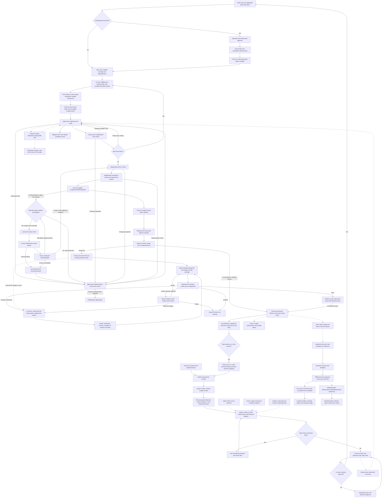

# workflow procedures

## Work orchestration

The coordinating agent selects skills, runs helpers and arranges separate review
invocations. The journal records progress and enforces gates. An explicit, opted-in
bounded repair command can launch one scoped native worker for a failed configured
hardening gate. Solid arrows below show the agent's process.

After changes, renew affected evidence and review packages before advancing.
Repair is manual by default. `repair configure` enables a bounded policy;
`repair next` requires a known cost estimate and an active implementer binding.
Claims are journaled before native launch. A claimed/interrupted cycle blocks
replay and handoff until reconciled. The runner reruns only failed configured
hardening gates; findings or failed item proofs outside those gates still need
agent-led verification. Worker prose never counts as proof.
A terminal worker failure or gate-runner error journals an aborted cycle and
typed remaining failures, stopping further automatic repair for that run.
An active native invocation still requires stopped-worker reconciliation.
Selected runs can opt into a redacted improvement trace. Reviewer feedback
binds its exact trace hash; a distinct approving actor promotes a candidate
to the durable case set. `improve run-cases` executes only approved cases,
and `improve compare` requires identical case hashes/scoring versions. Missing
usage remains unknown; comparison never promotes a skill or policy automatically.
`improve model-evaluate` reads approved stage cases and supplied observed
results. A representative report is review material; it does not install a
provider mapping. The released policy reader requires matching report, host
version and model revision evidence before a default can be strict eligible.
With explicit user authorization, `host goal-status` supplies a completion
contract and `host goal-bind` records an opaque host-specific Goal reference.
The agent activates the host Goal through its supported session command; no
portable automatic lifecycle API is claimed. Goal state cannot override journal
gates. Handoff carries the contract but never a source Goal ID.
Unconfigured tests are not enforced. Gap discovery/interviews are agent-led;
`spec gaps` lists recorded unanswered questions and approval does not currently
reject them automatically. Migration delivery also requires recorded predecessor
and parity evidence. Resume any stage from journaled run status and gate status.
Hardening gates default to command exit status. When a scanner is configured
with `json-report` version 1, require a valid `{"findings":[]}` report: missing
or malformed output and nonempty findings block advancement even if the command
exits zero. Keep the configured report contract bound to its journaled proof.
See [specify](../specify/SKILL.md), [build-work](../build-work/SKILL.md) and
[review-work](../review-work/SKILL.md) for the focused flows.

Use the bundled helper to inspect or advance a workflow. Supply an explicit control root for stateful commands; loading this skill does not create files. Devflow supports context, repository registration, approved requirements, validated plans, resumable attempts, attempt-bound code/IaC/agent-evaluation proof, independent review records, requirement acceptance, and exact-head delivery manifests. Infrastructure apply, hardening tools, external PR creation, merge execution, and cleanup remain conditional on configured tools and explicit user authorization.

[Optional helper commands](../../docs/developer-cli.md).

Store state only under the chosen root:

[Optional helper commands](../../docs/developer-cli.md).

Resume by run ID with `run status`; the active attempt token remains bound to the saved state version. `run brief` reassembles the scoped context without issuing a token; `run inspect` retrieves the full run record on request. Submit a result with `run result`, abandon with `run abandon`, or retry a prior attempt with `run retry`. Read the exact acceptance criteria and unavailable gates returned by `run next`. A result without kind-matched verifier proof does not complete a work item. Follow the current stage from `run gate-status`: implementation, item review, branch review, acceptance, hardening, or delivery. Brief byte limits never truncate mandatory criteria; overflow reports the required size and references.

Deterministic operations record best-effort byte and duration measurements under the chosen root. Read `offload.jsonl` to inspect the measures; these bytes do not establish actual tokens saved. Reuse context projections only when source and resolver fingerprints match.

Use the focused Devflow skills for project context, specification, planning, build verification, and independent review. Prepare and verify delivery manifests, then ask for the human's local-merge / pull-request / retained-branch decision. Only a chosen, authorized PR path uses GitHub. After `pr open`, prepare a complete `review pr-package`, invoke a distinct `pr-reviewer`, record its full-file verdict, then `pr publish` and `pr complete` only after a fresh pass and confirmed status. Changes need renewed evidence and a new package. The helper never merges a PR. Treat event journal state and evidence as authoritative. Requires Python 3.11+. Windows host acceptance remains unverified; see [platform gates](../../docs/windows-validation.md).

After recording each completed build's delivery outcome, including a ready-to-merge PR, ask once: “Would you like me to update the [DevFlow Codex site](https://devflow-field-guide.waygent.chatgpt.site/) with this build?” Ask even when the build made only documentation changes. A declined or unanswered offer does not block delivery. Do not update or publish the site unless the user accepts; the site is outside DevFlow's delivery journal and has no automatic sync. Do not offer this as a substitute for resolving a blocked or failed build.

## Explicit project initialization

When the user invokes workflow, resolve `scripts/run.py` relative to this loaded
skill directory. Detect an existing Python 3.11+ interpreter and invoke bundled
helpers yourself; no user environment variables or direct Python setup are needed.
Capture `version` while loading these instructions and retain its release descriptor.
Call `host init --project-dir <actual host working directory> --operation-id <unique ID>`.
Use the returned control root and stable repo ID. Select a run only when one is
unambiguous; ask a concise selection question for multiple runs. Initialization
never approves specs or creates a run without its ordinary prerequisites.

For stale completed code, use [reverification](../build-work/REFERENCE.md#reverify-completed-work).
